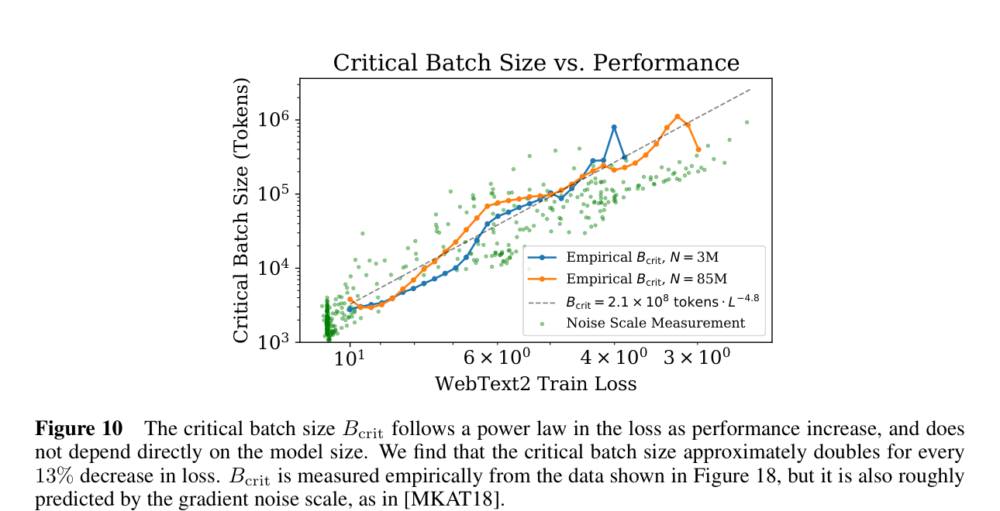

# 4.2 Results

> Section 18 of 45 from [03 - Scaling Laws for Neural Language Models](../../papers/03-scaling-laws-for-neural-language-models.md) · `results` · pages 10-11

We regularize all our models with 10% dropout, and by tracking test loss and stopping once it is no longer decreasing. The results are displayed in Figure 9, including a fit to the four parameters αN, αD, Nc, Dc in Equation (1.5):

Parameter αN αD Nc Dc

Value 0.076 0.103 6.4 × 1013 1.8 × 1013

Table 2 Fits to L(N, D)

We obtain an excellent fit, with the exception of the runs where the dataset has been reduced by a factor of 1024, to about 2 × 107 tokens. With such a small dataset, an epoch consists of only 40 parameter updates. Perhaps such a tiny dataset represents a different regime for language modeling, as overfitting happens very early in training (see Figure 16). Also note that the parameters differ very slightly from those obtained in Section 3, as here we are fitting the full L(N, D) rather than just L(N, ∞) or L(∞, D).

To chart the borderlands of the infinite data limit, we can directly study the extent of overfitting. For all but the largest models, we see no sign of overfitting when training with the full 22B token WebText2 dataset, so we can take it as representative of D = ∞. Thus we can compare finite D to the infinite data limit by

4For example, one might have used L(N, D) =  Nc

 Dc

αN +

αDβ, but this does not have a 1/D expansion.

N

D

Critical Batch Size vs. Performance

Critical Batch Size (Tokens)

106

105

Empirical Bcrit, N = 3M

104

Empirical Bcrit, N = 85M

Bcrit = 2.1 × 108 tokens L 4.8

Noise Scale Measurement

103

101 3 × 100 4 × 100 6 × 100

WebText2 Train Loss

Figure 10 The critical batch size Bcrit follows a power law in the loss as performance increase, and does not depend directly on the model size. We find that the critical batch size approximately doubles for every 13% decrease in loss. Bcrit is measured empirically from the data shown in Figure 18, but it is also roughly predicted by the gradient noise scale, as in \[MKAT18\].

defining

δL(N, D) ≡L(N, D)

L(N, ∞) −1 (4.2)

and studying it as a function of N, D. In fact, we see empirically that δL depends only a specific combination of N and D, as shown in Figure 16. This follows from the scaling law of Equation (1.5), which implies

1 +  N

!αD

 αN

αD Dc

δL ≈

−1 (4.3)

Nc

D

Note that at large D this formula also has a series expansion in powers of 1/D.

We estimate that the variation in the loss with different random seeds is roughly 0.02, which means that to avoid overfitting when training to within that threshold of convergence we require

D ≳(5 × 103) N 0.74 (4.4)

With this relation, models smaller than 109 parameters can be trained with minimal overfitting on the 22B token WebText2 dataset, but our largest models will encounter some mild overfitting. More generally, this relation shows that dataset size may grow sub-linearly in model size while avoiding overfitting. Note however that this does not typically represent maximally compute-efficient training. We should also emphasize that we have not optimized regularization (eg the dropout probability) while varying dataset and model size.

---

Full document: [03 - Scaling Laws for Neural Language Models](../../papers/03-scaling-laws-for-neural-language-models.md) · Page-level evidence: [paper-pages/03-scaling-laws-for-neural-language-models](../../paper-pages/03-scaling-laws-for-neural-language-models/index.md)
