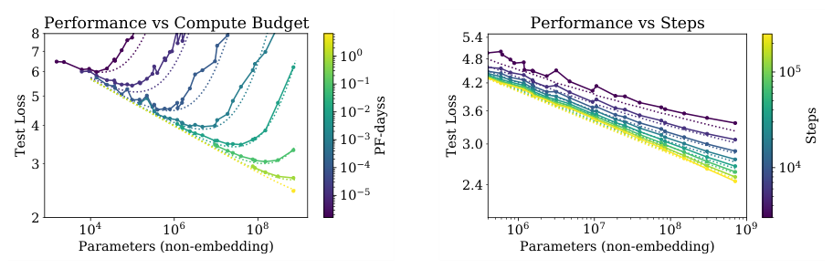

# 5 Scaling Laws with Model Size and Training Time

> Section 19 of 45 from [03 - Scaling Laws for Neural Language Models](../../papers/03-scaling-laws-for-neural-language-models.md) · `other` · pages 11-13

In this section we will demonstrate that a simple scaling law provides a good description for the loss as a function of model size N and training time. First we will explain how to use the results of \[MKAT18\] to define a universal training step Smin, which accounts for the fact that most of our models have not been trained at an optimal batch size. Then we will demonstrate that we can fit the model size and training time dependence of the loss using Equation (1.6). Later we will use these results to predict the optimal allocation of training compute between model size and training time, and then confirm that prediction.

5.1 Adjustment for Training at Bcrit(L)

A simple empirical theory for the batch size dependence of training was developed in \[MKAT18\] (see also \[SLA+18, ZLN+19\]). It was argued that there is a critical batch size Bcrit for training; for B up to Bcrit the batch size can be increased with very minimal degradation in compute-efficiency, whereas for B > Bcrit increases in B result in diminishing returns. It was also argued that the gradient noise scale provides a simple

prediction for Bcrit, and that neither depends directly on model size except through the value of the loss that has been attained. These results can be used to predict how training time and compute will vary with the batch size. To utilize both training time and compute as effectively as possible, it is best to train with a batch size B ≈Bcrit. Training at B ≫Bcrit minimizes the number of training steps, while B ≪Bcrit minimizes the use of compute.

More specifically, it was demonstrated that for a wide variety of neural network tasks, the number of training steps S and the number of data examples processed E = BS satisfy the simple relation

 S

  E

−1

−1

= 1 (5.1)

Smin

Emin

when training to any fixed value of the loss L. Here Smin is the minimum number of steps necessary to reach L, while Emin is the minimum number of data examples that must be processed.

We demonstrate the relation (5.1) for Transformers in Figure 18 in the appendix. This relation defines the critical batch size

Bcrit(L) ≡Emin

(5.2)

Smin

which is a function of the target value of the loss. Training at the critical batch size makes a roughly optimal time/compute tradeoff, requiring 2Smin training steps and processing E = 2Emin data examples.

In Figure 10 we have plotted the critical batch size and gradient noise scale5 as a function of training loss for two different models. We see that Bcrit(L) is independent of model size, and only depends on the loss L. So the predictions of \[MKAT18\] continue to hold for Transformer language models. The critical batch size can be fit with a power-law in the loss

Bcrit(L) ≈ B∗ L1/αB (5.3)

where B∗≈2 × 108 and αB ≈0.21.

We have chosen this parameterization for Bcrit(L) because as the loss approaches its minimum value Lmin, the gradient noise scale is expected to diverge, and we expect Bcrit to track this noise scale. We do not know Lmin, as we see no sign that our models are approaching it, but Lmin > 0 since the entropy of natural language is non-zero. Since apparently Lmin is much smaller than the values of L we have achieved, we used a parameterization where Bcrit diverges as L →0.

We will use Bcrit(L) to estimate the relation between the number of training steps S while training at batch size B = 219 tokens and the number of training steps while training at B ≫Bcrit. This is simply

Smin(S) ≡ S 1 + Bcrit(L)/B (minimum steps, at B ≫Bcrit) (5.4)

for any given target value L for the loss. This also defines a critical value of the compute needed to train to L with a model of size N if we were to train at B ≪Bcrit(L). This is

Cmin(C) ≡ C 1 + B/Bcrit(L) (minimum compute, at B ≪Bcrit) (5.5)

where C = 6NBS estimates the (non-embedding) compute used at batch size B.

5.2 Results for L(N, Smin) and Performance with Model Size and Compute

Now we will use Smin defined in Equation (5.4) to obtain a simple and universal fit for the dependence of the loss on model size and training time in the infinite data limit. We will fit the stable, Adam-optimized training runs using Equation (1.6), repeated here for convenience:

 Sc

αN

αS

Nc

L(N, Smin) =

+

(5.6)

N

Smin

for the loss. We include all training steps after the warmup period of the learning rate schedule, and find a fit to the data with the parameters:

5Although the critical batch size roughly matches the gradient noise scale, we are using a direct measurements of Bcrit from Figures 18 and 10 for all our later analyses.

Performance vs Compute Budget

Performance vs Steps

7 8

5.4

100

4.8

105

6

4.2

10 1

5

Test Loss

Test Loss

PF-dayss

10 2

3.6

Steps

4

10 3

3.0

3

10 4

104

2.4

10 5

2

106 107 108 109

104 106 108

Parameters (non-embedding)

Parameters (non-embedding)

Figure 11 When we hold either total compute or number of training steps fixed, performance follows L(N, S) from Equation (5.6). Each value of compute budget has an associated optimal model size that maximizes performance. Mediocre fits at small S are unsurprising, as the power-law equation for the learning curves breaks down very early in training.

Parameter αN αS Nc Sc

Value 0.077 0.76 6.5 × 1013 2.1 × 103

Table 3 Fits to L(N, S)

With these parameters, we obtain the learning curve fits in Figure 4. Though the fits are imperfect, we believe they are quite compelling given the simplicity of Equation (5.6).

The data and fits can be visualized in a different and more interesting way, as shown in Figure 11. There we study the test loss as a function of model size while fixing either the total non-embedding compute C used in training, or the number of steps S. For the fits we use Equation (5.5) and (5.4) along with the parameters above and Equation (5.6).

The power-law dependence of the loss on Smin reflects the interplay of optimizer dynamics and the loss landscape. Since the fits are best late in training, when the loss may be approximately quadratic, the powerlaw should provide information about the spectrum of the Hessian of the loss. Its universality suggests that the Hessian eigenvalue density is roughly independent of model size.

---

Full document: [03 - Scaling Laws for Neural Language Models](../../papers/03-scaling-laws-for-neural-language-models.md) · Page-level evidence: [paper-pages/03-scaling-laws-for-neural-language-models](../../paper-pages/03-scaling-laws-for-neural-language-models/index.md)
