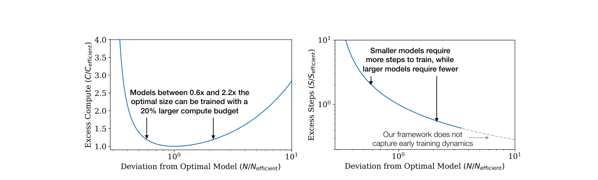

# 6 Optimal Allocation of the Compute Budget

> Section 21 of 45 from [03 - Scaling Laws for Neural Language Models](../../papers/03-scaling-laws-for-neural-language-models.md) · `other` · pages 13-14

We displayed the empirical trend of performance as a function of the computation used during training in the top-right of Figure 1. However, this result involved training at a fixed batch size B, whereas we know

Smaller models require more steps to train, while larger models require fewer

Models between 0.6x and 2.2x the

optimal size can be trained with a

20% larger compute budget

Our framework does not capture early training dynamics

Figure 12 Left: Given a fixed compute budget, a particular model size is optimal, though somewhat larger or smaller models can be trained with minimal additional compute. Right: Models larger than the computeefficient size require fewer steps to train, allowing for potentially faster training if sufficient additional parallelism is possible. Note that this equation should not be trusted for very large models, as it is only valid in the power-law region of the learning curve, after initial transient effects.

7

L = (Cmin/2.3 108) 0.050

6

L = (C/2.0 107) 0.057

5

Test Loss

4

3

2

10 8 10 6 10 4 10 2 100

Compute (PF-days), non-embedding

Figure 13 When adjusting performance to simulate training far below the critical batch size, we find a somewhat altered power law for L(Cmin) when compared with the fully empirical results. The conspicuous lump at 10−5 PF-days marks the transition from 1-layer to 2-layer networks; we exclude 1-layer networks in the power-law fits. It is the L(Cmin) trend that we expect to provide a reliable extrapolation for larger compute.

that in fact we could train more efficiently6 by training at the batch size Bcrit discussed in Section 5.1. Large and small values of the loss could have been achieved with fewer samples or fewer steps, respectively, and correcting for this inefficiency by standardizing to the critical batch size results in cleaner and more predictable trends.

In this section we will adjust for this oversight. More importantly, we will use the results of Section 5 to determine the optimal allocation of compute between model size N and the quantity of data processed during training, namely 2BcritSmin. We will determine this allocation both empirically and theoretically, by using the equation for L(N, Smin), and we will demonstrate that these methods agree.

---

Full document: [03 - Scaling Laws for Neural Language Models](../../papers/03-scaling-laws-for-neural-language-models.md) · Page-level evidence: [paper-pages/03-scaling-laws-for-neural-language-models](../../paper-pages/03-scaling-laws-for-neural-language-models/index.md)
