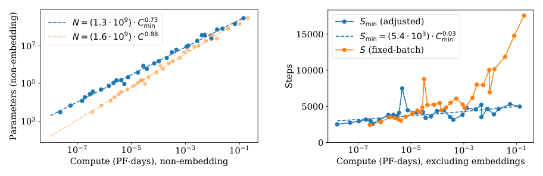
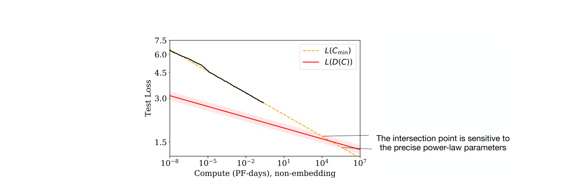

# 6.1 Optimal Performance and Allocations

> Section 22 of 45 from [03 - Scaling Laws for Neural Language Models](../../papers/03-scaling-laws-for-neural-language-models.md) · `other` · pages 14-16

Let us first study the loss as a function of the optimally allocated compute from Equation (5.5). The result is plotted in Figure 13, along with a power-law fit. We see that as compared to the compute plot of Figure 1, the new fit with Cmin is somewhat improved.

Given L(Cmin), it is natural to ask for the optimal model size N(Cmin) that provides the minimal loss with a given quantity of training compute. The optimal model size is shown in Figure 14. We observe that N(Cmin)

6One might ask why we did not simply train at Bcrit in the first place. The reason is that it depends not only on the model but also on the target value of the loss we wish to achieve, and so is a moving target.

Parameters (non-embedding)

N = (1.3 109) C0.73

Smin (adjusted)

min N = (1.6 109) C0.88

15000

Smin = (5.4 103) C0.03

min S (fixed-batch)

107

10000

Steps

105

5000

103

0

10 7 10 5 10 3 10 1

10 7 10 5 10 3 10 1

Compute (PF-days), non-embedding

Compute (PF-days), excluding embeddings

Figure 14 Left: Each value of the compute budget Cmin has an associated optimal model size N. Optimal model size grows very rapidly with Cmin, increasing by 5x for each 10x increase in compute. The number of data examples processed makes up the remainder of the increase, growing relatively modestly by only 2x. Right: The batch-adjusted number of optimization steps also grows very slowly, if at all, meaning that most of the growth in data examples processed can be used for increased batch sizes.

can be fit very well with a power-law

N(Cmin) ∝(Cmin)0.73. (6.1)

In Figure 12, we show the effect of training models of sub-optimal sizes (see Appendix B.4).

By definition Cmin ≡6NBcritS, and so we can use N(Cmin) to extract further results. In particular, since prior fits show B ∝L−4.8 and L ∝C−0.05

min , we can conclude that Bcrit ∝C0.24

min . This leads us to conclude that the optimal number of steps will only grow very slowly with compute, as

Smin ∝(Cmin)0.03, (6.2)

matching the empirical results in Figure 14. In fact the measured exponent is sufficiently small that our results may even be consistent with an exponent of zero.

Thus we conclude that as we scale up language modeling with an optimal allocation of computation, we should predominantly increase the model size N, while simultaneously scaling up the batch size via B ∝ Bcrit with negligible increase in the number of serial steps. Since compute-efficient training uses relatively few optimization steps, additional work on speeding up early training dynamics may be warranted.

6.2 Predictions from L(N, Smin)

The results for L(Cmin) and the allocations can be predicted from the L(N, Smin) equation obtained in Section 5. Given our equation for L(N, Smin), we can substitute Smin = Cmin

6NB and then find the minimum of the loss as a function of N, while fixing the training compute. We carry out this procedure in detail in Appendix B, where we also provide some additional predictions.

For the loss as a function of training compute, we predict that

αmin

Cmin

C

c Cmin

L(Cmin) =

(6.3)

where

C ≡ 1 1/αS + 1/αB + 1/αN ≈0.054 (6.4)

αmin

in excellent agreement with the exponent of Figure 13. We also predict that

N(Cmin) ∝(Cmin)αmin

C /αN ≈(Cmin)0.71 (6.5)

which also matches the scaling of Figure 14 to within a few percent. Our scaling laws provide a predictive framework for the performance of language modeling.

The intersection point is sensitive to

the precise power-law parameters

Figure 15 Far beyond the model sizes we study empirically, we find a contradiction between our equations for L(Cmin) and L(D) due to the slow growth of data needed for compute-efficient training. The intersection marks the point before which we expect our predictions to break down. The location of this point is highly sensitive to the precise exponents from our power-law fits.

---

Full document: [03 - Scaling Laws for Neural Language Models](../../papers/03-scaling-laws-for-neural-language-models.md) · Page-level evidence: [paper-pages/03-scaling-laws-for-neural-language-models](../../paper-pages/03-scaling-laws-for-neural-language-models/index.md)
