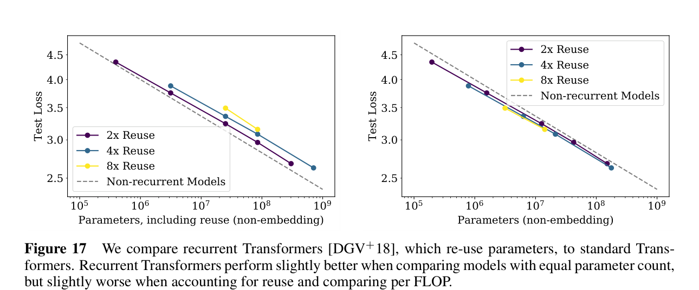
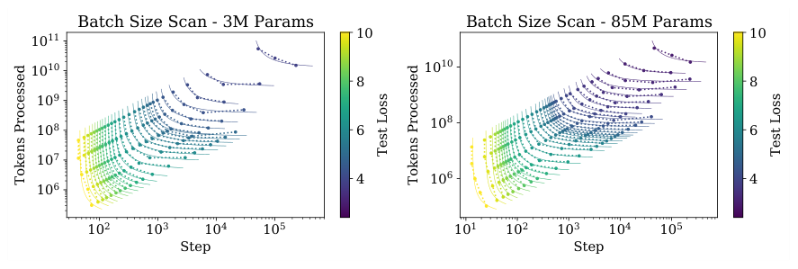

# D.3 Batch Size

> Section 39 of 45 from [03 - Scaling Laws for Neural Language Models](../../papers/03-scaling-laws-for-neural-language-models.md) · `other` · pages 22-23

We measure the critical batch size using the data displayed in figure 18. This made it possible to estimate Bcrit(L) in figure 10.

2x Reuse 4x Reuse 8x Reuse Non-recurrent Models

4.5

4.5

4.0

4.0

Test Loss

Test Loss

3.5

3.5

2x Reuse 4x Reuse 8x Reuse Non-recurrent Models

3.0

3.0

2.5

2.5

105 106 107 108 109

105 106 107 108 109

Parameters, including reuse (non-embedding)

Parameters (non-embedding)

Figure 17 We compare recurrent Transformers \[DGV+18\], which re-use parameters, to standard Transformers. Recurrent Transformers perform slightly better when comparing models with equal parameter count, but slightly worse when accounting for reuse and comparing per FLOP.

Batch Size Scan - 3M Params

Batch Size Scan - 85M Params

10

10

1011

1010

1010

Tokens Processed

Tokens Processed

8

8

109

Test Loss

Test Loss

108

108

6

6

107

106

4

4

106

102 103 104 105

101 102 103 104 105

Step

Step

Figure 18 These figures demonstrate fits to Equation (5.1) for a large number of values of the loss L, and for two different Transformer model sizes. These fits were used to measure Bcrit(L) for Figure 10.

---

Full document: [03 - Scaling Laws for Neural Language Models](../../papers/03-scaling-laws-for-neural-language-models.md) · Page-level evidence: [paper-pages/03-scaling-laws-for-neural-language-models](../../paper-pages/03-scaling-laws-for-neural-language-models/index.md)
