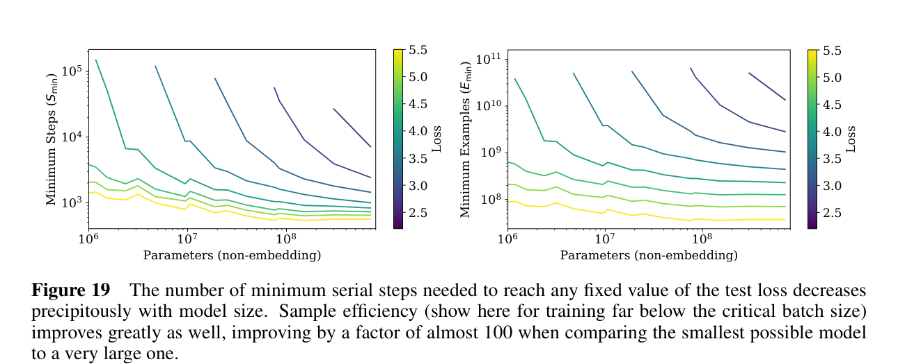
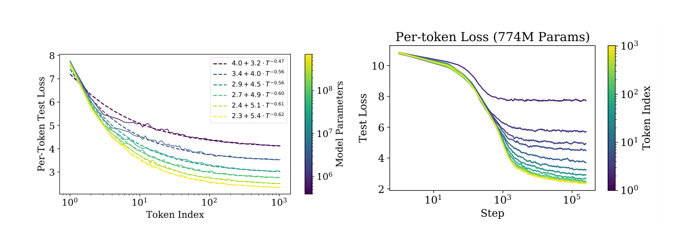
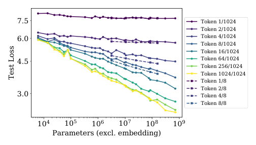

# D.4 Sample Efficiency vs Model Size

> Section 40 of 45 from [03 - Scaling Laws for Neural Language Models](../../papers/03-scaling-laws-for-neural-language-models.md) · `other` · pages 23-24

It is easy to see from figure 2 that larger models train faster, and are therefore more sample efficient. We provide another way of looking at this phenomenon in figure 19, which shows when different models reach various fixed values of the loss.

5.5

5.5

1011

Minimum Examples (Emin)

105

5.0

5.0

Minimum Steps (Smin)

4.5

4.5

1010

4.0

4.0

Loss

Loss

104

109

3.5

3.5

3.0

3.0

108

103

2.5

2.5

106 107 108

106 107 108

Parameters (non-embedding)

Parameters (non-embedding)

Figure 19 The number of minimum serial steps needed to reach any fixed value of the test loss decreases precipitously with model size. Sample efficiency (show here for training far below the critical batch size) improves greatly as well, improving by a factor of almost 100 when comparing the smallest possible model to a very large one.

Per-token Loss (774M Params)

103

8

4.0 + 3.2 T 0.47

10

3.4 + 4.0 T 0.56

7

Per-Token Test Loss

2.9 + 4.5 T 0.56

Model Parameters

108

Token Index

102

2.7 + 4.9 T 0.60

8

Test Loss

6

2.4 + 5.1 T 0.61

2.3 + 5.4 T 0.62

5

6

107

101

4

4

3

106

2

100

101 103 105

100 101 102 103

Step

Token Index

Figure 20 This figure provides information about the performance per token as a function of model size and training time. Left: Loss per token as a function of its position T in the 1024-token context. Loss scales predictably as a power-law in T. Right: Test loss per token as a function of training step.

7.5

Token 1/1024 Token 2/1024 Token 4/1024 Token 8/1024 Token 16/1024 Token 64/1024 Token 256/1024 Token 1024/1024 Token 1/8 Token 2/8 Token 4/8 Token 8/8

6.0

Test Loss

4.5

3.0

104 105 106 107 108 109

Parameters (excl. embedding)

Figure 21 In addition to the averaged loss, individual tokens within the 1024-token context also improve smoothly as model size increases. Training runs with shorter context nctx = 8 (dashed lines) perform better on early tokens, since they can allocate all of their capacity to them.

---

Full document: [03 - Scaling Laws for Neural Language Models](../../papers/03-scaling-laws-for-neural-language-models.md) · Page-level evidence: [paper-pages/03-scaling-laws-for-neural-language-models](../../paper-pages/03-scaling-laws-for-neural-language-models/index.md)
