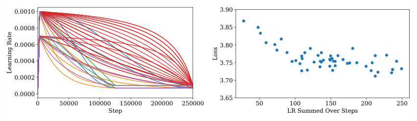
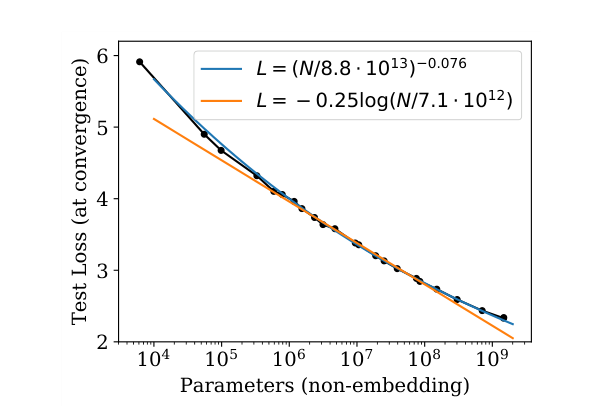

# D.6 Learning Rate Schedules and Error Analysis

> Section 42 of 45 from [03 - Scaling Laws for Neural Language Models](../../papers/03-scaling-laws-for-neural-language-models.md) · `other` · pages 24-25

We experimented with a variety of learning rates and schedules. A host of schedules and resulting test performances for a small language model are plotted in Figure 22. We conclude that the choice of learning rate schedule is mostly irrelevant, as long as the total summed learning rate is sufficiently large, and the schedule includes a warmup period and a final decay to near-vanishing learning rate. Variations among

3.90

0.0010

3.85

0.0008

Learning Rate

0.0006

3.80

Loss

0.0004

3.75

0.0002

3.70

0.0000

3.65

0 50000 100000 150000 200000 250000 Step

50 100 150 200 250 LR Summed Over Steps

Figure 22 We test a variety of learning rate schedules including cosine decay, linear decay, as well as other faster/slower decays schedules on a 3 million parameter model, shown on the left. For these experiments we do not decay to zero, since we find that this tends to give a fixed improvement close to the end of training. We find that, as long as the learning rate is not too small and does not decay too quickly, performance does not depend strongly on learning rate. Run-to-run variation is at the level of 0.05 in the loss, so averaging multiple runs is necessary to validate performance changes smaller than this level.

6

L = (N/8.8 1013) 0.076

Test Loss (at convergence)

L = 0.25log(N/7.1 1012)

5

4

3

2

104 105 106 107 108 109

Parameters (non-embedding)

Figure 23 The trend for performance as a function of parameter count, L(N), is fit better by a power law than by other functions such as a logarithm at a qualitative level.

schedules appear to be statistical noise, and provide a rough gauge for the scale of variation between different training runs. Experiments on larger models suggest that the variation in the final test loss between different random seeds is roughly constant in magnitude for different model sizes.

We found that larger models require a smaller learning rate to prevent divergence, while smaller models can tolerate a larger learning rate. To implement this, the following rule of thumb was used for most runs:

LR(N) ≈0.003239 + −0.0001395 log(N) (D.1)

We expect that this formula could be improved. There may be a dependence on network width, likely set by the initialization scale. The formula also breaks down for N > 1010 parameters. Nevertheless, we found that it works sufficiently well for the models we considered.

---

Full document: [03 - Scaling Laws for Neural Language Models](../../papers/03-scaling-laws-for-neural-language-models.md) · Page-level evidence: [paper-pages/03-scaling-laws-for-neural-language-models](../../paper-pages/03-scaling-laws-for-neural-language-models/index.md)
