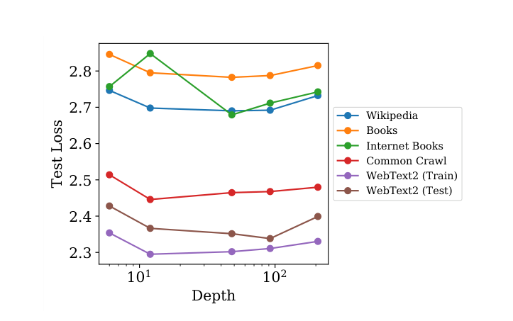

# D.8 Generalization and Architecture

> Section 44 of 45 from [03 - Scaling Laws for Neural Language Models](../../papers/03-scaling-laws-for-neural-language-models.md) · `other` · pages 25-27

In figure 24 we show that generalization to other data distributions does not depend on network depth when we hold the total parameter count fixed. It seems to depend only on the performance on the training distribution.

2.8

2.7

Wikipedia Books Internet Books Common Crawl WebText2 (Train) WebText2 (Test)

Test Loss

2.6

2.5

2.4

2.3

101 102

Depth

Figure 24 We show evaluations on a series of datasets for models with approximately 1.5 Billion parameters. We observe no effect of depth on generalization; generalization performance depends primarily on training distribution performance. The 12-layer model overfit the Internet Books dataset and we show the early-stopped performance; we have not seen this surprising result in other experiments.

## List of Figures

1 Summary of simple power laws. . . . . . . . . . . . . . . . . . . . . . . . . . . . . . . . . 3

2 Illustration of sample efficiency and compute efficiency. . . . . . . . . . . . . . . . . . . . . 4

3 How to scale up model size, batch size, and serial steps . . . . . . . . . . . . . . . . . . . . 4

4 Performance when varying model and data size, or model and training steps, simultaneously 5

5 Weak dependence of performance on hyperparameter tuning . . . . . . . . . . . . . . . . . 8

6 Comparison of performance trend when including or excluding embeddings . . . . . . . . . 8

7 LSTM and Transformer performance comparison . . . . . . . . . . . . . . . . . . . . . . . 9

8 Generalization to other test datasets . . . . . . . . . . . . . . . . . . . . . . . . . . . . . . 10

9 Universality of overfitting . . . . . . . . . . . . . . . . . . . . . . . . . . . . . . . . . . . . 11

10 Critical batch size . . . . . . . . . . . . . . . . . . . . . . . . . . . . . . . . . . . . . . . . 12

11 Performance versus compute budget or number of parameter updates . . . . . . . . . . . . . 14

12 Training on suboptimal models . . . . . . . . . . . . . . . . . . . . . . . . . . . . . . . . . 15

13 Comparison between empirical and adjusted compute trends . . . . . . . . . . . . . . . . . 15

14 Optimal model size and serial number of steps versus compute budget . . . . . . . . . . . . 16

15 Contradiction between compute and data trends . . . . . . . . . . . . . . . . . . . . . . . . 17

16 Early stopping lower bound and training curves for overfit models . . . . . . . . . . . . . . 23

17 Universal transformers . . . . . . . . . . . . . . . . . . . . . . . . . . . . . . . . . . . . . 24

18 Batch size scans . . . . . . . . . . . . . . . . . . . . . . . . . . . . . . . . . . . . . . . . . 24

19 Another look at sample efficiency . . . . . . . . . . . . . . . . . . . . . . . . . . . . . . . 24

20 Power-law dependence of performance on position in context . . . . . . . . . . . . . . . . . 25

21 Performance at different context positions versus model size . . . . . . . . . . . . . . . . . 25

22 Learning rate schedule scan . . . . . . . . . . . . . . . . . . . . . . . . . . . . . . . . . . . 26

23 Comparison of Power-Law and Logarithmic Fits . . . . . . . . . . . . . . . . . . . . . . . 26

24 Generalization versus depth . . . . . . . . . . . . . . . . . . . . . . . . . . . . . . . . . . . 27

## List of Tables

1 Parameter and compute counts for Transformer . . . . . . . . . . . . . . . . . . . . . . . . 7

2 Fits to L(N, D) . . . . . . . . . . . . . . . . . . . . . . . . . . . . . . . . . . . . . . . . . 11

3 Fits to L(N, S) . . . . . . . . . . . . . . . . . . . . . . . . . . . . . . . . . . . . . . . . . 14

4 Key trend equations . . . . . . . . . . . . . . . . . . . . . . . . . . . . . . . . . . . . . . . 20

5 Key parameters to trend fits . . . . . . . . . . . . . . . . . . . . . . . . . . . . . . . . . . . 20

6 Trends for compute-efficient training . . . . . . . . . . . . . . . . . . . . . . . . . . . . . . 20

---

Full document: [03 - Scaling Laws for Neural Language Models](../../papers/03-scaling-laws-for-neural-language-models.md) · Page-level evidence: [paper-pages/03-scaling-laws-for-neural-language-models](../../paper-pages/03-scaling-laws-for-neural-language-models/index.md)
