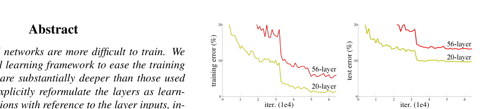

# Front matter

> Section 1 of 21 from [05 - Deep Residual Learning for Image Recognition](../../papers/05-deep-residual-learning-resnet.md) · `front-matter` · pages 1-1

The text below was extracted programmatically from the published PDF, page by page, with figures kept inline where they appear. `<!-- page N -->` comments mark the original page boundaries. Mathematical notation is preserved as plain text rather than LaTeX, so equations read approximately rather than exactly.[^original]

## Deep Residual Learning for Image Recognition

### Kaiming He Xiangyu Zhang Shaoqing Ren Jian Sun Microsoft Research {kahe, v-xiangz, v-shren, jiansun}@microsoft.com

20

20

---

Full document: [05 - Deep Residual Learning for Image Recognition](../../papers/05-deep-residual-learning-resnet.md) · Page-level evidence: [paper-pages/05-deep-residual-learning-resnet](../../paper-pages/05-deep-residual-learning-resnet/index.md)
