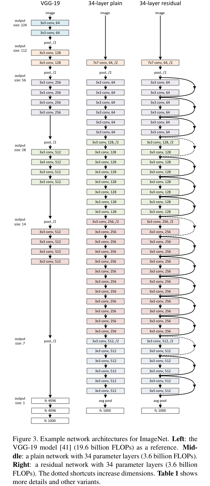

# 3.2. Identity Mapping by Shortcuts

> Section 8 of 21 from [05 - Deep Residual Learning for Image Recognition](../../papers/05-deep-residual-learning-resnet.md) · `other` · pages 2-3

We adopt residual learning to every few stacked layers. A building block is shown in Fig. 2. Formally, in this paper we consider a building block defined as:

y = F(x, {Wi}) + x. (1)

Here x and y are the input and output vectors of the layers considered. The function F(x, {Wi}) represents the residual mapping to be learned. For the example in Fig. 2 that has two layers, F = W2σ(W1x) in which σ denotes

It is worth noticing that our model has fewer filters and lower complexity than VGG nets \[41\] (Fig. 3, left). Our 34layer baseline has 3.6 billion FLOPs (multiply-adds), which is only 18% of VGG-19 (19.6 billion FLOPs).

2This hypothesis, however, is still an open question. See \[28\].

3

Residual Network. Based on the above plain network, we insert shortcut connections (Fig. 3, right) which turn the network into its counterpart residual version. The identity shortcuts (Eqn.(1)) can be directly used when the input and output are of the same dimensions (solid line shortcuts in Fig. 3). When the dimensions increase (dotted line shortcuts in Fig. 3), we consider two options: (A) The shortcut still performs identity mapping, with extra zero entries padded for increasing dimensions. This option introduces no extra parameter; (B) The projection shortcut in Eqn.(2) is used to match dimensions (done by 1×1 convolutions). For both options, when the shortcuts go across feature maps of two sizes, they are performed with a stride of 2.

VGG-19 34-layer plain

image 34-layer residual

image

image

output size: 224

3x3 conv, 64

3x3 conv, 64

pool, /2

output size: 112

3x3 conv, 128

3x3 conv, 128

7x7 conv, 64, /2

7x7 conv, 64, /2

pool, /2

pool, /2

pool, /2

output size: 56

3x3 conv, 256

3x3 conv, 64

3x3 conv, 64

3x3 conv, 256

3x3 conv, 64

3x3 conv, 64

3x3 conv, 256

3x3 conv, 64

3x3 conv, 64

3x3 conv, 256

3x3 conv, 64

3x3 conv, 64

3x3 conv, 64

3x3 conv, 64

---

Full document: [05 - Deep Residual Learning for Image Recognition](../../papers/05-deep-residual-learning-resnet.md) · Page-level evidence: [paper-pages/05-deep-residual-learning-resnet](../../paper-pages/05-deep-residual-learning-resnet/index.md)
