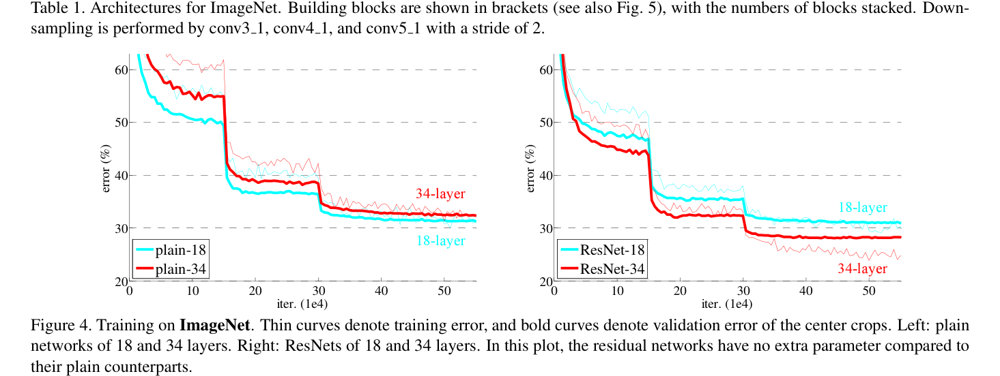
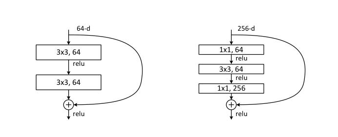

# 4.1. ImageNet Classification

> Section 11 of 21 from [05 - Deep Residual Learning for Image Recognition](../../papers/05-deep-residual-learning-resnet.md) · `other` · pages 3-6

size: 7

3x3 conv, 512

3x3 conv, 512

We evaluate our method on the ImageNet 2012 classification dataset \[36\] that consists of 1000 classes. The models are trained on the 1.28 million training images, and evaluated on the 50k validation images. We also obtain a final result on the 100k test images, reported by the test server. We evaluate both top-1 and top-5 error rates.

3x3 conv, 512

3x3 conv, 512

3x3 conv, 512

3x3 conv, 512

3x3 conv, 512

3x3 conv, 512

3x3 conv, 512

3x3 conv, 512

output

fc 4096

avg pool

avg pool

size: 1

fc 4096

fc 1000

fc 1000

Plain Networks. We first evaluate 18-layer and 34-layer plain nets. The 34-layer plain net is in Fig. 3 (middle). The 18-layer plain net is of a similar form. See Table 1 for detailed architectures.

fc 1000

Figure 3. Example network architectures for ImageNet. Left: the VGG-19 model \[41\] (19.6 billion FLOPs) as a reference. Middle: a plain network with 34 parameter layers (3.6 billion FLOPs). Right: a residual network with 34 parameter layers (3.6 billion FLOPs). The dotted shortcuts increase dimensions. Table 1 shows more details and other variants.

The results in Table 2 show that the deeper 34-layer plain net has higher validation error than the shallower 18-layer plain net. To reveal the reasons, in Fig. 4 (left) we compare their training/validation errors during the training procedure. We have observed the degradation problem - the

4

layer name output size 18-layer 34-layer 50-layer 101-layer 152-layer conv1 112×112 7×7, 64, stride 2

3×3 max pool, stride 2 













1×1, 64 3×3, 64 1×1, 256

1×1, 64 3×3, 64 1×1, 256

1×1, 64 3×3, 64 1×1, 256

conv2 x 56×56

3×3, 64 3×3, 64

3×3, 64 3×3, 64

×2

×3

×3

×3

×3



















1×1, 128 3×3, 128 1×1, 512

1×1, 128 3×3, 128 1×1, 512

1×1, 128 3×3, 128 1×1, 512

conv3 x 28×28 

3×3, 128 3×3, 128

3×3, 128 3×3, 128

×2

×4

×4

×4

×8



















1×1, 256 3×3, 256 1×1, 1024

1×1, 256 3×3, 256 1×1, 1024

1×1, 256 3×3, 256 1×1, 1024

conv4 x 14×14 

3×3, 256 3×3, 256

3×3, 256 3×3, 256

×2

×6

×6

×23

×36



















1×1, 512 3×3, 512 1×1, 2048

1×1, 512 3×3, 512 1×1, 2048

1×1, 512 3×3, 512 1×1, 2048

conv5 x 7×7 

3×3, 512 3×3, 512

3×3, 512 3×3, 512

×2

×3

×3

×3

×3







1×1 average pool, 1000-d fc, softmax FLOPs 1.8×109 3.6×109 3.8×109 7.6×109 11.3×109

Table 1. Architectures for ImageNet. Building blocks are shown in brackets (see also Fig. 5), with the numbers of blocks stacked. Downsampling is performed by conv3 1, conv4 1, and conv5 1 with a stride of 2.

60

60

50

50

error (%)

error (%)

40

40

34-layer 18-layer

30

30

18-layer

plain-18 plain-34

ResNet-18 ResNet-34

34-layer

0 10 20 30 40 50 20

0 10 20 30 40 50 20

iter. (1e4)

iter. (1e4)

Figure 4. Training on ImageNet. Thin curves denote training error, and bold curves denote validation error of the center crops. Left: plain networks of 18 and 34 layers. Right: ResNets of 18 and 34 layers. In this plot, the residual networks have no extra parameter compared to their plain counterparts.

reducing of the training error3. The reason for such optimization difficulties will be studied in the future.

plain ResNet 18 layers 27.94 27.88 34 layers 28.54 25.03

Residual Networks. Next we evaluate 18-layer and 34layer residual nets (ResNets). The baseline architectures are the same as the above plain nets, expect that a shortcut connection is added to each pair of 3×3 filters as in Fig. 3 (right). In the first comparison (Table 2 and Fig. 4 right), we use identity mapping for all shortcuts and zero-padding for increasing dimensions (option A). So they have no extra parameter compared to the plain counterparts.

Table 2. Top-1 error (%, 10-crop testing) on ImageNet validation. Here the ResNets have no extra parameter compared to their plain counterparts. Fig. 4 shows the training procedures.

34-layer plain net has higher training error throughout the whole training procedure, even though the solution space of the 18-layer plain network is a subspace of that of the 34-layer one.

We have three major observations from Table 2 and Fig. 4. First, the situation is reversed with residual learning – the 34-layer ResNet is better than the 18-layer ResNet (by 2.8%). More importantly, the 34-layer ResNet exhibits considerably lower training error and is generalizable to the validation data. This indicates that the degradation problem is well addressed in this setting and we manage to obtain accuracy gains from increased depth.

We argue that this optimization difficulty is unlikely to be caused by vanishing gradients. These plain networks are trained with BN \[16\], which ensures forward propagated signals to have non-zero variances. We also verify that the backward propagated gradients exhibit healthy norms with BN. So neither forward nor backward signals vanish. In fact, the 34-layer plain net is still able to achieve competitive accuracy (Table 3), suggesting that the solver works to some extent. We conjecture that the deep plain nets may have exponentially low convergence rates, which impact the

Second, compared to its plain counterpart, the 34-layer

3We have experimented with more training iterations (3×) and still observed the degradation problem, suggesting that this problem cannot be feasibly addressed by simply using more iterations.

5

64-d 256-d

model top-1 err. top-5 err.

VGG-16 \[41\] 28.07 9.33

1x1, 64 relu

3x3, 64

relu

GoogLeNet \[44\] 9.15

3x3, 64

1x1, 256 relu

PReLU-net \[13\] 24.27 7.38

3x3, 64

plain-34 28.54 10.02

relu

relu

ResNet-34 A 25.03 7.76

ResNet-34 B 24.52 7.46

Figure 5. A deeper residual function F for ImageNet. Left: a building block (on 56×56 feature maps) as in Fig. 3 for ResNet34. Right: a “bottleneck” building block for ResNet-50/101/152.

ResNet-34 C 24.19 7.40

ResNet-50 22.85 6.71

ResNet-101 21.75 6.05

ResNet-152 21.43 5.71

parameter-free, identity shortcuts help with training. Next we investigate projection shortcuts (Eqn.(2)). In Table 3 we compare three options: (A) zero-padding shortcuts are used for increasing dimensions, and all shortcuts are parameterfree (the same as Table 2 and Fig. 4 right); (B) projection shortcuts are used for increasing dimensions, and other shortcuts are identity; and (C) all shortcuts are projections.

Table 3. Error rates (%, 10-crop testing) on ImageNet validation. VGG-16 is based on our test. ResNet-50/101/152 are of option B that only uses projections for increasing dimensions.

method top-1 err. top-5 err. VGG \[41\] (ILSVRC’14) 8.43†

GoogLeNet \[44\] (ILSVRC’14) 7.89 VGG \[41\] (v5) 24.4 7.1 PReLU-net \[13\] 21.59 5.71 BN-inception \[16\] 21.99 5.81 ResNet-34 B 21.84 5.71 ResNet-34 C 21.53 5.60 ResNet-50 20.74 5.25 ResNet-101 19.87 4.60 ResNet-152 19.38 4.49

Table 3 shows that all three options are considerably better than the plain counterpart. B is slightly better than A. We argue that this is because the zero-padded dimensions in A indeed have no residual learning. C is marginally better than B, and we attribute this to the extra parameters introduced by many (thirteen) projection shortcuts. But the small differences among A/B/C indicate that projection shortcuts are not essential for addressing the degradation problem. So we do not use option C in the rest of this paper, to reduce memory/time complexity and model sizes. Identity shortcuts are particularly important for not increasing the complexity of the bottleneck architectures that are introduced below.

Table 4. Error rates (%) of single-model results on the ImageNet validation set (except † reported on the test set).

method top-5 err. (test) VGG \[41\] (ILSVRC’14) 7.32 GoogLeNet \[44\] (ILSVRC’14) 6.66 VGG \[41\] (v5) 6.8 PReLU-net \[13\] 4.94 BN-inception \[16\] 4.82 ResNet (ILSVRC’15) 3.57

Deeper Bottleneck Architectures. Next we describe our deeper nets for ImageNet. Because of concerns on the training time that we can afford, we modify the building block as a bottleneck design4. For each residual function F, we use a stack of 3 layers instead of 2 (Fig. 5). The three layers are 1×1, 3×3, and 1×1 convolutions, where the 1×1 layers are responsible for reducing and then increasing (restoring) dimensions, leaving the 3×3 layer a bottleneck with smaller input/output dimensions. Fig. 5 shows an example, where both designs have similar time complexity.

Table 5. Error rates (%) of ensembles. The top-5 error is on the test set of ImageNet and reported by the test server.

The parameter-free identity shortcuts are particularly important for the bottleneck architectures. If the identity shortcut in Fig. 5 (right) is replaced with projection, one can show that the time complexity and model size are doubled, as the shortcut is connected to the two high-dimensional ends. So identity shortcuts lead to more efficient models for the bottleneck designs.

ResNet reduces the top-1 error by 3.5% (Table 2), resulting from the successfully reduced training error (Fig. 4 right vs. left). This comparison verifies the effectiveness of residual learning on extremely deep systems.

Last, we also note that the 18-layer plain/residual nets are comparably accurate (Table 2), but the 18-layer ResNet converges faster (Fig. 4 right vs. left). When the net is “not overly deep” (18 layers here), the current SGD solver is still able to find good solutions to the plain net. In this case, the ResNet eases the optimization by providing faster convergence at the early stage.

50-layer ResNet: We replace each 2-layer block in the

4Deeper non-bottleneck ResNets (e.g., Fig. 5 left) also gain accuracy from increased depth (as shown on CIFAR-10), but are not as economical as the bottleneck ResNets. So the usage of bottleneck designs is mainly due to practical considerations. We further note that the degradation problem of plain nets is also witnessed for the bottleneck designs.

Identity vs. Projection Shortcuts. We have shown that

6

34-layer net with this 3-layer bottleneck block, resulting in a 50-layer ResNet (Table 1). We use option B for increasing dimensions. This model has 3.8 billion FLOPs.

method error (%) Maxout \[10\] 9.38 NIN \[25\] 8.81 DSN \[24\] 8.22 # layers # params FitNet \[35\] 19 2.5M 8.39 Highway \[42, 43\] 19 2.3M 7.54 (7.72±0.16) Highway \[42, 43\] 32 1.25M 8.80 ResNet 20 0.27M 8.75 ResNet 32 0.46M 7.51 ResNet 44 0.66M 7.17 ResNet 56 0.85M 6.97 ResNet 110 1.7M 6.43 (6.61±0.16) ResNet 1202 19.4M 7.93

101-layer and 152-layer ResNets: We construct 101layer and 152-layer ResNets by using more 3-layer blocks (Table 1). Remarkably, although the depth is significantly increased, the 152-layer ResNet (11.3 billion FLOPs) still has lower complexity than VGG-16/19 nets (15.3/19.6 billion FLOPs).

The 50/101/152-layer ResNets are more accurate than the 34-layer ones by considerable margins (Table 3 and 4). We do not observe the degradation problem and thus enjoy significant accuracy gains from considerably increased depth. The benefits of depth are witnessed for all evaluation metrics (Table 3 and 4).

Table 6. Classification error on the CIFAR-10 test set. All methods are with data augmentation. For ResNet-110, we run it 5 times and show “best (mean±std)” as in \[43\].

Comparisons with State-of-the-art Methods. In Table 4 we compare with the previous best single-model results. Our baseline 34-layer ResNets have achieved very competitive accuracy. Our 152-layer ResNet has a single-model top-5 validation error of 4.49%. This single-model result outperforms all previous ensemble results (Table 5). We combine six models of different depth to form an ensemble (only with two 152-layer ones at the time of submitting). This leads to 3.57% top-5 error on the test set (Table 5). This entry won the 1st place in ILSVRC 2015.

so our residual models have exactly the same depth, width, and number of parameters as the plain counterparts.

We use a weight decay of 0.0001 and momentum of 0.9, and adopt the weight initialization in \[13\] and BN \[16\] but with no dropout. These models are trained with a minibatch size of 128 on two GPUs. We start with a learning rate of 0.1, divide it by 10 at 32k and 48k iterations, and terminate training at 64k iterations, which is determined on a 45k/5k train/val split. We follow the simple data augmentation in \[24\] for training: 4 pixels are padded on each side, and a 32×32 crop is randomly sampled from the padded image or its horizontal flip. For testing, we only evaluate the single view of the original 32×32 image.

---

Full document: [05 - Deep Residual Learning for Image Recognition](../../papers/05-deep-residual-learning-resnet.md) · Page-level evidence: [paper-pages/05-deep-residual-learning-resnet](../../paper-pages/05-deep-residual-learning-resnet/index.md)
