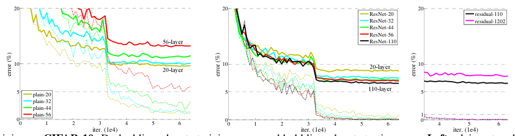
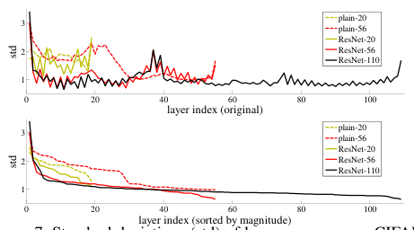

# 4.2. CIFAR-10 and Analysis

> Section 12 of 21 from [05 - Deep Residual Learning for Image Recognition](../../papers/05-deep-residual-learning-resnet.md) · `other` · pages 6-7

We conducted more studies on the CIFAR-10 dataset \[20\], which consists of 50k training images and 10k testing images in 10 classes. We present experiments trained on the training set and evaluated on the test set. Our focus is on the behaviors of extremely deep networks, but not on pushing the state-of-the-art results, so we intentionally use simple architectures as follows.

We compare n = {3, 5, 7, 9}, leading to 20, 32, 44, and 56-layer networks. Fig. 6 (left) shows the behaviors of the plain nets. The deep plain nets suffer from increased depth, and exhibit higher training error when going deeper. This phenomenon is similar to that on ImageNet (Fig. 4, left) and on MNIST (see \[42\]), suggesting that such an optimization difficulty is a fundamental problem.

The plain/residual architectures follow the form in Fig. 3 (middle/right). The network inputs are 32×32 images, with the per-pixel mean subtracted. The first layer is 3×3 convolutions. Then we use a stack of 6n layers with 3×3 convolutions on the feature maps of sizes {32, 16, 8} respectively, with 2n layers for each feature map size. The numbers of filters are {16, 32, 64} respectively. The subsampling is performed by convolutions with a stride of 2. The network ends with a global average pooling, a 10-way fully-connected layer, and softmax. There are totally 6n+2 stacked weighted layers. The following table summarizes the architecture:

Fig. 6 (middle) shows the behaviors of ResNets. Also similar to the ImageNet cases (Fig. 4, right), our ResNets manage to overcome the optimization difficulty and demonstrate accuracy gains when the depth increases.

We further explore n = 18 that leads to a 110-layer ResNet. In this case, we find that the initial learning rate of 0.1 is slightly too large to start converging5. So we use 0.01 to warm up the training until the training error is below 80% (about 400 iterations), and then go back to 0.1 and continue training. The rest of the learning schedule is as done previously. This 110-layer network converges well (Fig. 6, middle). It has fewer parameters than other deep and thin

output map size 32×32 16×16 8×8 # layers 1+2n 2n 2n # filters 16 32 64

When shortcut connections are used, they are connected to the pairs of 3×3 layers (totally 3n shortcuts). On this dataset we use identity shortcuts in all cases (i.e., option A),

5With an initial learning rate of 0.1, it starts converging (<90% error) after several epochs, but still reaches similar accuracy.

7

20

20

20

ResNet-20 ResNet-32 ResNet-44 ResNet-56 ResNet-110 56-layer

residual-110 residual-1202

error (%)

error (%)

error (%)

10

10

10

20-layer

20-layer

110-layer

5

5

5

plain-20 plain-32 plain-44 plain-56

4 5 6 0 1

0 1 2 3 4 5 6 0

0 1 2 3 4 5 6 0

iter. (1e4)

iter. (1e4)

iter. (1e4)

Figure 6. Training on CIFAR-10. Dashed lines denote training error, and bold lines denote testing error. Left: plain networks. The error of plain-110 is higher than 60% and not displayed. Middle: ResNets. Right: ResNets with 110 and 1202 layers.

plain-20 plain-56 ResNet-20 ResNet-56 ResNet-110

training data 07+12 07++12 test data VOC 07 test VOC 12 test VGG-16 73.2 70.4 ResNet-101 76.4 73.8

3

std

2

1

0 20 40 60 80 100

layer index (original)

Table 7. Object detection mAP (%) on the PASCAL VOC 2007/2012 test sets using baseline Faster R-CNN. See also Table 10 and 11 for better results.

plain-20 plain-56 ResNet-20 ResNet-56 ResNet-110

3

std

2

metric mAP@.5 mAP@\[.5, .95\] VGG-16 41.5 21.2 ResNet-101 48.4 27.2

1

0 20 40 60 80 100

layer index (sorted by magnitude)

Figure 7. Standard deviations (std) of layer responses on CIFAR10. The responses are the outputs of each 3×3 layer, after BN and before nonlinearity. Top: the layers are shown in their original order. Bottom: the responses are ranked in descending order.

Table 8. Object detection mAP (%) on the COCO validation set using baseline Faster R-CNN. See also Table 9 for better results.

have similar training error. We argue that this is because of overfitting. The 1202-layer network may be unnecessarily large (19.4M) for this small dataset. Strong regularization such as maxout \[10\] or dropout \[14\] is applied to obtain the best results (\[10, 25, 24, 35\]) on this dataset. In this paper, we use no maxout/dropout and just simply impose regularization via deep and thin architectures by design, without distracting from the focus on the difficulties of optimization. But combining with stronger regularization may improve results, which we will study in the future.

networks such as FitNet \[35\] and Highway \[42\] (Table 6), yet is among the state-of-the-art results (6.43%, Table 6).

Analysis of Layer Responses. Fig. 7 shows the standard deviations (std) of the layer responses. The responses are the outputs of each 3×3 layer, after BN and before other nonlinearity (ReLU/addition). For ResNets, this analysis reveals the response strength of the residual functions. Fig. 7 shows that ResNets have generally smaller responses than their plain counterparts. These results support our basic motivation (Sec.3.1) that the residual functions might be generally closer to zero than the non-residual functions. We also notice that the deeper ResNet has smaller magnitudes of responses, as evidenced by the comparisons among ResNet-20, 56, and 110 in Fig. 7. When there are more layers, an individual layer of ResNets tends to modify the signal less.

---

Full document: [05 - Deep Residual Learning for Image Recognition](../../papers/05-deep-residual-learning-resnet.md) · Page-level evidence: [paper-pages/05-deep-residual-learning-resnet](../../paper-pages/05-deep-residual-learning-resnet/index.md)
