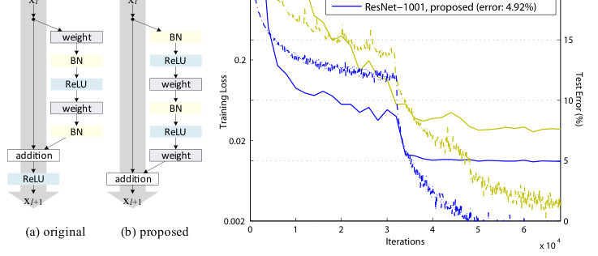

# 1 Introduction

> Section 2 of 12 from [06 - Identity Mappings in Deep Residual Networks](../../papers/06-identity-mappings-in-deep-residual-networks.md) · `introduction` · pages 1-1

Deep residual networks (ResNets) \[1\] consist of many stacked “Residual Units”. Each unit (Fig. 1 (a)) can be expressed in a general form:

yl = h(xl) + F(xl, Wl),

xl+1 = f(yl),

where xl and xl+1 are input and output of the l-th unit, and F is a residual function. In \[1\], h(xl) = xl is an identity mapping and f is a ReLU \[2\] function.

ResNets that are over 100-layer deep have shown state-of-the-art accuracy for several challenging recognition tasks on ImageNet \[3\] and MS COCO \[4\] competitions. The central idea of ResNets is to learn the additive residual function F with respect to h(xl), with a key choice of using an identity mapping h(xl) = xl. This is realized by attaching an identity skip connection (“shortcut”).

In this paper, we analyze deep residual networks by focusing on creating a “direct” path for propagating information — not only within a residual unit, but through the entire network. Our derivations reveal that if both h(xl) and f(yl) are identity mappings, the signal could be directly propagated from one unit to any other units, in both forward and backward passes. Our experiments empirically show that training in general becomes easier when the architecture is closer to the above two conditions.

To understand the role of skip connections, we analyze and compare various types of h(xl). We find that the identity mapping h(xl) = xl chosen in \[1\]

ResNet−1001, original (error: 7.61%) ResNet−1001, proposed (error: 4.92%)

xl

xl

weight

BN

15

BN

ReLU

0.2

Test Error (%)

Training Loss

ReLU

weight

10

weight

BN

BN

ReLU

0.02

addition

weight

5

ReLU

addition

xl+1

xl+1

0.002

0

(a) original

(b) proposed

0 1 2 3 4 5 6

Iterations

4

x 10

Figure 1. Left: (a) original Residual Unit in \[1\]; (b) proposed Residual Unit. The grey arrows indicate the easiest paths for the information to propagate, corresponding to the additive term “xl” in Eqn.(4) (forward propagation) and the additive term “1” in Eqn.(5) (backward propagation). Right: training curves on CIFAR-10 of 1001-layer ResNets. Solid lines denote test error (y-axis on the right), and dashed lines denote training loss (y-axis on the left). The proposed unit makes ResNet-1001 easier to train.

achieves the fastest error reduction and lowest training loss among all variants we investigated, whereas skip connections of scaling, gating \[5,6,7\], and 1×1 convolutions all lead to higher training loss and error. These experiments suggest that keeping a “clean” information path (indicated by the grey arrows in Fig. 1, 2, and 4) is helpful for easing optimization.

To construct an identity mapping f(yl) = yl, we view the activation functions (ReLU and BN \[8\]) as “pre-activation” of the weight layers, in contrast to conventional wisdom of “post-activation”. This point of view leads to a new residual unit design, shown in (Fig. 1(b)). Based on this unit, we present competitive results on CIFAR-10/100 with a 1001-layer ResNet, which is much easier to train and generalizes better than the original ResNet in \[1\]. We further report improved results on ImageNet using a 200-layer ResNet, for which the counterpart of \[1\] starts to overfit. These results suggest that there is much room to exploit the dimension of network depth, a key to the success of modern deep learning.

---

Full document: [06 - Identity Mappings in Deep Residual Networks](../../papers/06-identity-mappings-in-deep-residual-networks.md) · Page-level evidence: [paper-pages/06-identity-mappings-in-deep-residual-networks](../../paper-pages/06-identity-mappings-in-deep-residual-networks/index.md)
