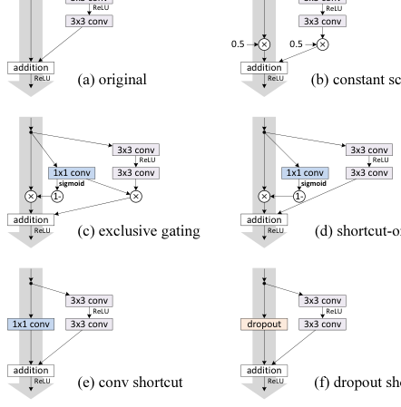

# 3 On the Importance of Identity Skip Connections

> Section 5 of 12 from [06 - Identity Mappings in Deep Residual Networks](../../papers/06-identity-mappings-in-deep-residual-networks.md) · `other` · pages 3-4

Let’s consider a simple modification, h(xl) = λlxl, to break the identity shortcut:

xl+1 = λlxl + F(xl, Wl), (6)

where λl is a modulating scalar (for simplicity we still assume f is identity). Recursively applying this formulation we obtain an equation similar to Eqn. (4): xL = (QL−1

i=l λi)xl + PL−1

i=l (QL−1

j=i+1 λj)F(xi, Wi), or simply:

L−1 Y

L−1 X

ˆF(xi, Wi), (7)

xL = (

λi)xl +

i=l

i=l

where the notation ˆF absorbs the scalars into the residual functions. Similar to Eqn.(5), we have backpropagation of the following form:

L−1 Y

L−1 X

!

∂E ∂xl

= ∂E

λi) + ∂

ˆF(xi, Wi)

(

. (8)

∂xL

∂xl

i=l

i=l

Unlike Eqn.(5), in Eqn.(8) the first additive term is modulated by a factor QL−1

i=l λi. For an extremely deep network (L is large), if λi > 1 for all i, this factor can be exponentially large; if λi < 1 for all i, this factor can be exponentially small and vanish, which blocks the backpropagated signal from the shortcut and forces it to flow through the weight layers. This results in optimization difficulties as we show by experiments.

In the above analysis, the original identity skip connection in Eqn.(3) is replaced with a simple scaling h(xl) = λlxl. If the skip connection h(xl) represents more complicated transforms (such as gating and 1×1 convolutions), in Eqn.(8) the first term becomes QL−1

i where h′ is the derivative of h. This product may also impede information propagation and hamper the training procedure as witnessed in the following experiments.

i=l h′

3x3 conv

3x3 conv

ReLU

ReLU

3x3 conv

3x3 conv

0.5 0.5

addition

addition

(a) original (b) constant scaling

ReLU

ReLU

3x3 conv

3x3 conv

ReLU

ReLU

1x1 conv sigmoid 1-

3x3 conv

1x1 conv sigmoid 1-

3x3 conv

addition

addition

(d) shortcut-only gating (c) exclusive gating

ReLU

ReLU

3x3 conv

3x3 conv

ReLU

ReLU

1x1 conv

3x3 conv

dropout

3x3 conv

addition

addition

(f) dropout shortcut (e) conv shortcut

ReLU

ReLU

Figure 2. Various types of shortcut connections used in Table 1. The grey arrows indicate the easiest paths for the information to propagate. The shortcut connections in (b-f) are impeded by different components. For simplifying illustrations we do not display the BN layers, which are adopted right after the weight layers for all units here.

---

Full document: [06 - Identity Mappings in Deep Residual Networks](../../papers/06-identity-mappings-in-deep-residual-networks.md) · Page-level evidence: [paper-pages/06-identity-mappings-in-deep-residual-networks](../../paper-pages/06-identity-mappings-in-deep-residual-networks/index.md)
