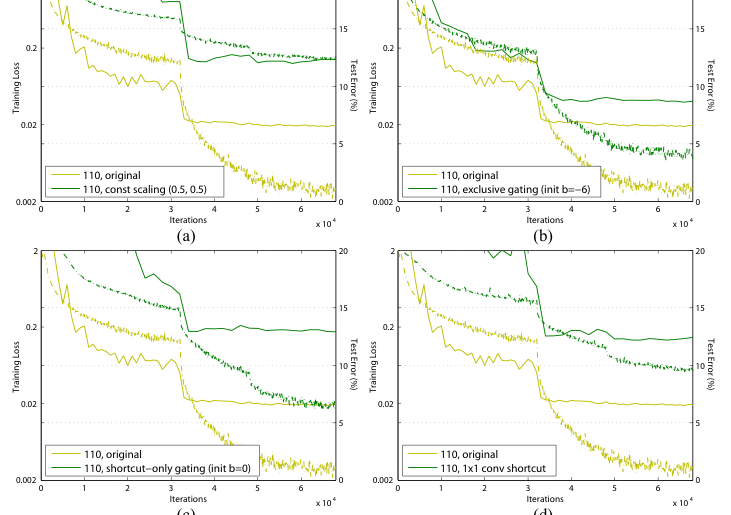
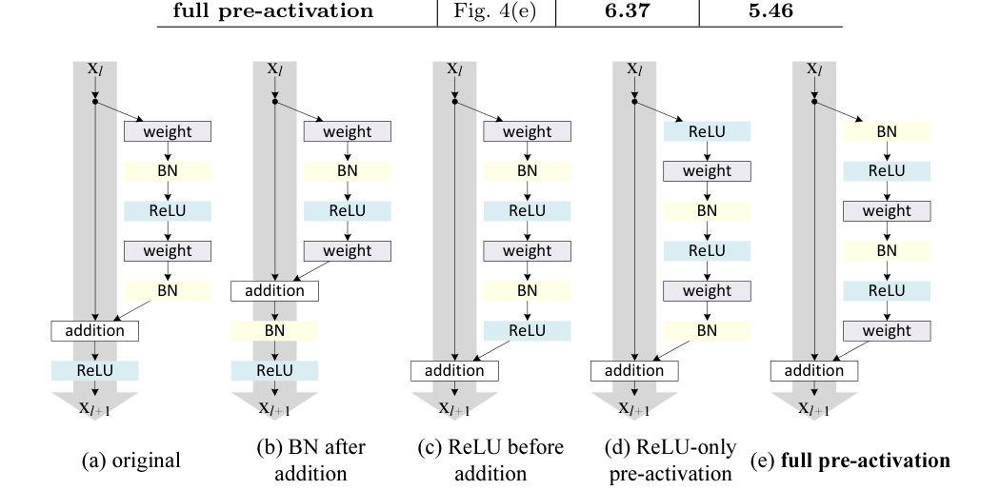

# 3.1 Experiments on Skip Connections

> Section 6 of 12 from [06 - Identity Mappings in Deep Residual Networks](../../papers/06-identity-mappings-in-deep-residual-networks.md) · `experiments` · pages 4-7

We experiment with the 110-layer ResNet as presented in \[1\] on CIFAR-10 \[10\]. This extremely deep ResNet-110 has 54 two-layer Residual Units (consisting of 3×3 convolutional layers) and is challenging for optimization. Our implementation details (see appendix) are the same as \[1\]. Throughout this paper we report the median accuracy of 5 runs for each architecture on CIFAR, reducing the impacts of random variations.

Though our above analysis is driven by identity f, the experiments in this section are all based on f = ReLU as in \[1\]; we address identity f in the next section. Our baseline ResNet-110 has 6.61% error on the test set. The comparisons of other variants (Fig. 2 and Table 1) are summarized as follows:

Constant scaling. We set λ = 0.5 for all shortcuts (Fig. 2(b)). We further study two cases of scaling F: (i) F is not scaled; or (ii) F is scaled by a constant scalar of 1−λ = 0.5, which is similar to the highway gating \[6,7\] but with frozen gates. The former case does not converge well; the latter is able to converge, but the test error (Table 1, 12.35%) is substantially higher than the original ResNet-110. Fig 3(a) shows that the training error is higher than that of the original ResNet-110, suggesting that the optimization has difficulties when the shortcut signal is scaled down.

Table 1. Classification error on the CIFAR-10 test set using ResNet-110 \[1\], with different types of shortcut connections applied to all Residual Units. We report “fail” when the test error is higher than 20%.

case Fig. on shortcut on F error (%) remark

original \[1\] Fig. 2(a) 1 1 6.61

0 1 fail This is a plain net

constant

scaling Fig. 2(b)

0.5 1 fail

0.5 0.5 12.35 frozen gating

1 −g(x) g(x) fail init bg=0 to −5

exclusive

gating Fig. 2(c)

1 −g(x) g(x) 8.70 init bg=-6

1 −g(x) g(x) 9.81 init bg=-7

gating Fig. 2(d) 1 −g(x) 1 12.86 init bg=0

shortcut-only

1 −g(x) 1 6.91 init bg=-6

1×1 conv shortcut Fig. 2(e) 1×1 conv 1 12.22

dropout shortcut Fig. 2(f) dropout 0.5 1 fail

Exclusive gating. Following the Highway Networks \[6,7\] that adopt a gating mechanism \[5\], we consider a gating function g(x) = σ(Wgx + bg) where a transform is represented by weights Wg and biases bg followed by the sigmoid function σ(x) = 1 1+e−x . In a convolutional network g(x) is realized by a 1×1 convolutional layer. The gating function modulates the signal by element-wise multiplication.

We investigate the “exclusive” gates as used in \[6,7\] — the F path is scaled by g(x) and the shortcut path is scaled by 1−g(x). See Fig 2(c). We find that the initialization of the biases bg is critical for training gated models, and following the guidelines2 in \[6,7\], we conduct hyper-parameter search on the initial value of bg in the range of 0 to -10 with a decrement step of -1 on the training set by crossvalidation. The best value (−6 here) is then used for training on the training set, leading to a test result of 8.70% (Table 1), which still lags far behind the ResNet-110 baseline. Fig 3(b) shows the training curves. Table 1 also reports the results of using other initialized values, noting that the exclusive gating network does not converge to a good solution when bg is not appropriately initialized.

The impact of the exclusive gating mechanism is two-fold. When 1 −g(x) approaches 1, the gated shortcut connections are closer to identity which helps information propagation; but in this case g(x) approaches 0 and suppresses the function F. To isolate the effects of the gating functions on the shortcut path alone, we investigate a non-exclusive gating mechanism in the next.

Shortcut-only gating. In this case the function F is not scaled; only the shortcut path is gated by 1−g(x). See Fig 2(d). The initialized value of bg is still essential in this case. When the initialized bg is 0 (so initially the expectation of 1 −g(x) is 0.5), the network converges to a poor result of 12.86% (Table 1). This is also caused by higher training error (Fig 3(c)).

15

15

0.2

0.2

Test Error (%)

Test Error (%)

Training Loss

Training Loss

10

10

0.02

0.02

5

5

110, original 110, const scaling (0.5, 0.5)

110, original 110, exclusive gating (init b=−6)

0.002

0

0.002

0

0 1 2 3 4 5 6

0 1 2 3 4 5 6

Iterations

Iterations

4

4

x 10

x 10

(a) (b)

2

20

2

20

15

15

0.2

0.2

Test Error (%)

Test Error (%)

Training Loss

Training Loss

10

10

0.02

0.02

5

5

110, original 110, shortcut−only gating (init b=0)

110, original 110, 1x1 conv shortcut

0.002

0

0.002

0

0 1 2 3 4 5 6

0 1 2 3 4 5 6

Iterations

Iterations

4

4

x 10

x 10

(d) (c)

Figure 3. Training curves on CIFAR-10 of various shortcuts. Solid lines denote test error (y-axis on the right), and dashed lines denote training loss (y-axis on the left).

When the initialized bg is very negatively biased (e.g., −6), the value of 1−g(x) is closer to 1 and the shortcut connection is nearly an identity mapping. Therefore, the result (6.91%, Table 1) is much closer to the ResNet-110 baseline.

1×1 convolutional shortcut. Next we experiment with 1×1 convolutional shortcut connections that replace the identity. This option has been investigated in \[1\] (known as option C) on a 34-layer ResNet (16 Residual Units) and shows good results, suggesting that 1×1 shortcut connections could be useful. But we find that this is not the case when there are many Residual Units. The 110-layer ResNet has a poorer result (12.22%, Table 1) when using 1×1 convolutional shortcuts. Again, the training error becomes higher (Fig 3(d)). When stacking so many Residual Units (54 for ResNet-110), even the shortest path may still impede signal propagation. We witnessed similar phenomena on ImageNet with ResNet-101 when using 1×1 convolutional shortcuts.

Dropout shortcut. Last we experiment with dropout \[11\] (at a ratio of 0.5) which we adopt on the output of the identity shortcut (Fig. 2(f)). The network fails to converge to a good solution. Dropout statistically imposes a scale of λ with an expectation of 0.5 on the shortcut, and similar to constant scaling by 0.5, it impedes signal propagation.

Table 2. Classification error (%) on the CIFAR-10 test set using different activation functions.

case Fig. ResNet-110 ResNet-164

original Residual Unit \[1\] Fig. 4(a) 6.61 5.93

BN after addition Fig. 4(b) 8.17 6.50

ReLU before addition Fig. 4(c) 7.84 6.14

ReLU-only pre-activation Fig. 4(d) 6.71 5.91

full pre-activation Fig. 4(e) 6.37 5.46

xl

xl

xl

xl

xl

weight

weight

weight

ReLU

BN

BN

BN

BN

weight

ReLU

ReLU

ReLU

ReLU

BN

weight

weight

weight

weight

ReLU

BN

BN

addition

BN

weight

ReLU

addition

BN

ReLU

BN

weight

ReLU

ReLU

addition

addition

addition

xl+1

xl+1

xl+1

xl+1

xl+1

(a) original (b) BN after

(c) ReLU before

(d) ReLU-only

pre-activation (e) full pre-activation

addition

addition

Figure 4. Various usages of activation in Table 2. All these units consist of the same components — only the orders are different.

---

Full document: [06 - Identity Mappings in Deep Residual Networks](../../papers/06-identity-mappings-in-deep-residual-networks.md) · Page-level evidence: [paper-pages/06-identity-mappings-in-deep-residual-networks](../../paper-pages/06-identity-mappings-in-deep-residual-networks/index.md)
