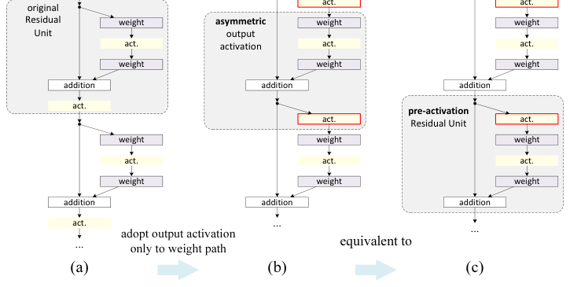
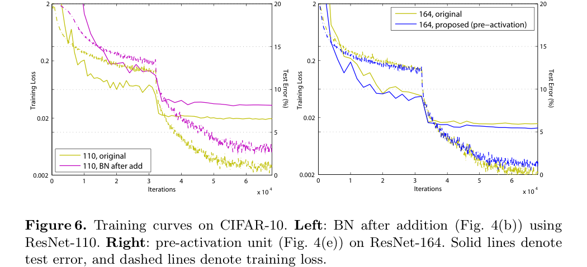

# 4.1 Experiments on Activation

> Section 9 of 12 from [06 - Identity Mappings in Deep Residual Networks](../../papers/06-identity-mappings-in-deep-residual-networks.md) · `experiments` · pages 8-10

In this section we experiment with ResNet-110 and a 164-layer Bottleneck \[1\] architecture (denoted as ResNet-164). A bottleneck Residual Unit consist of a 1×1 layer for reducing dimension, a 3×3 layer, and a 1×1 layer for restoring dimension. As designed in \[1\], its computational complexity is similar to the two-3×3 Residual Unit. More details are in the appendix. The baseline ResNet164 has a competitive result of 5.93% on CIFAR-10 (Table 2). BN after addition. Before turning f into an identity mapping, we go the opposite way by adopting BN after addition (Fig. 4(b)). In this case f involves BN and ReLU. The results become considerably worse than the baseline (Table 2). Unlike the original design, now the BN layer alters the signal that passes through the shortcut and impedes information propagation, as reflected by the difficulties on reducing training loss at the beginning of training (Fib. 6 left).

ReLU before addition. A na¨ıve choice of making f into an identity mapping is to move the ReLU before addition (Fig. 4(c)). However, this leads to a non-negative output from the transform F, while intuitively a “residual” function should take values in (−∞, +∞). As a result, the forward propagated signal is monotonically increasing. This may impact the representational ability, and the result is worse (7.84%, Table 2) than the baseline. We expect to have a residual function taking values in (−∞, +∞). This condition is satisfied by other Residual Units including the following ones.

Post-activation or pre-activation? In the original design (Eqn.(1) and Eqn.(2)), the activation xl+1 = f(yl) affects both paths in the next Residual Unit: yl+1 = f(yl) + F(f(yl), Wl+1). Next we develop an asymmetric form where an activation ˆf only affects the F path: yl+1 = yl + F( ˆf(yl), Wl+1), for any l (Fig. 5 (a) to (b)). By renaming the notations, we have the following form:

xl+1 = xl + F( ˆf(xl), Wl), . (9)

It is easy to see that Eqn.(9) is similar to Eqn.(4), and can enable a backward formulation similar to Eqn.(5). For this new Residual Unit as in Eqn.(9), the new after-addition activation becomes an identity mapping. This design means that if a new after-addition activation ˆf is asymmetrically adopted, it is equivalent to recasting ˆf as the pre-activation of the next Residual Unit. This is illustrated in Fig. 5.

act.

act.

original Residual

asymmetric

weight

weight

weight

Unit

output activation

act.

act.

act.

weight

weight

weight

addition

addition

addition

act.

pre-activation

act.

act.

Residual Unit

weight

weight

weight

act.

act.

act.

weight

weight

weight

addition

addition

addition

...

act.

...

adopt output activation

only to weight path equivalent to

...

(a)

(b)

(c)

Figure 5. Using asymmetric after-addition activation is equivalent to constructing a pre-activation Residual Unit.

Table 3. Classification error (%) on the CIFAR-10/100 test set using the original Residual Units and our pre-activation Residual Units.

dataset network baseline unit pre-activation unit

ResNet-110 (1layer skip) 9.90 8.91

ResNet-110 6.61 6.37

CIFAR-10

ResNet-164 5.93 5.46

ResNet-1001 7.61 4.92

CIFAR-100 ResNet-164 25.16 24.33

ResNet-1001 27.82 22.71

The distinction between post-activation/pre-activation is caused by the presence of the element-wise addition. For a plain network that has N layers, there are N −1 activations (BN/ReLU), and it does not matter whether we think of them as post- or pre-activations. But for branched layers merged by addition, the position of activation matters.

We experiment with two such designs: (i) ReLU-only pre-activation (Fig. 4(d)), and (ii) full pre-activation (Fig. 4(e)) where BN and ReLU are both adopted before weight layers. Table 2 shows that the ReLU-only pre-activation performs very similar to the baseline on ResNet-110/164. This ReLU layer is not used in conjunction with a BN layer, and may not enjoy the benefits of BN \[8\].

Somehow surprisingly, when BN and ReLU are both used as pre-activation, the results are improved by healthy margins (Table 2 and Table 3). In Table 3 we report results using various architectures: (i) ResNet-110, (ii) ResNet-164, (iii) a 110-layer ResNet architecture in which each shortcut skips only 1 layer (i.e.,

15

15

0.2

0.2

Test Error (%)

Test Error (%)

Training Loss

Training Loss

10

10

0.02

0.02

5

5

110, original 110, BN after add

0.002

0

0.002

0

0 1 2 3 4 5 6

0 1 2 3 4 5 6

Iterations

Iterations

4

4

x 10

x 10

Figure 6. Training curves on CIFAR-10. Left: BN after addition (Fig. 4(b)) using ResNet-110. Right: pre-activation unit (Fig. 4(e)) on ResNet-164. Solid lines denote test error, and dashed lines denote training loss.

a Residual Unit has only 1 layer), denoted as “ResNet-110(1layer)”, and (iv) a 1001-layer bottleneck architecture that has 333 Residual Units (111 on each feature map size), denoted as “ResNet-1001”. We also experiment on CIFAR100. Table 3 shows that our “pre-activation” models are consistently better than the baseline counterparts. We analyze these results in the following.

---

Full document: [06 - Identity Mappings in Deep Residual Networks](../../papers/06-identity-mappings-in-deep-residual-networks.md) · Page-level evidence: [paper-pages/06-identity-mappings-in-deep-residual-networks](../../paper-pages/06-identity-mappings-in-deep-residual-networks/index.md)
