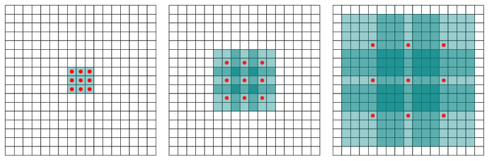

# 2 DILATED CONVOLUTIONS

> Section 4 of 11 from [07 - Multi-Scale Context Aggregation by Dilated Convolutions](../../papers/07-multi-scale-context-aggregation-dilated-convolutions.md) · `other` · pages 1-2

Let F : Z2 →R be a discrete function. Let Ωr = \[−r, r\]2 ∩Z2 and let k : Ωr →R be a discrete filter of size (2r + 1)2. The discrete convolution operator ∗can be defined as

X

(F ∗k)(p) =

F(s) k(t). (1)

s+t=p

We now generalize this operator. Let l be a dilation factor and let ∗l be defined as

X

(F ∗l k)(p) =

F(s) k(t). (2)

s+lt=p

We will refer to ∗l as a dilated convolution or an l-dilated convolution. The familiar discrete convolution ∗is simply the 1-dilated convolution.

The dilated convolution operator has been referred to in the past as “convolution with a dilated filter”. It plays a key role in the algorithme \`a trous, an algorithm for wavelet decomposition (Holschneider et al., 1987; Shensa, 1992).1 We use the term “dilated convolution” instead of “convolution with a dilated filter” to clarify that no “dilated filter” is constructed or represented. The convolution operator itself is modified to use the filter parameters in a different way. The dilated convolution operator can apply the same filter at different ranges using different dilation factors. Our definition reflects the proper implementation of the dilated convolution operator, which does not involve construction of dilated filters.

In recent work on convolutional networks for semantic segmentation, Long et al. (2015) analyzed filter dilation but chose not to use it. Chen et al. (2015a) used dilation to simplify the architecture of Long et al. (2015). In contrast, we develop a new convolutional network architecture that systematically uses dilated convolutions for multi-scale context aggregation.

Our architecture is motivated by the fact that dilated convolutions support exponentially expanding receptive fields without losing resolution or coverage. Let F0, F1, . . . , Fn−1 : Z2 →R be discrete functions and let k0, k1, . . . , kn−2 : Ω1 →R be discrete 3×3 filters. Consider applying the filters with exponentially increasing dilation:

Fi+1 = Fi ∗2i ki for i = 0, 1, . . . , n −2. (3)

Define the receptive field of an element p in Fi+1 as the set of elements in F0 that modify the value of Fi+1(p). Let the size of the receptive field of p in Fi+1 be the number of these elements. It is

1Some recent work mistakenly referred to the dilated convolution operator itself as the algorithme \`a trous. This is incorrect. The algorithme \`a trous applies a filter at multiple scales to produce a signal decomposition. The algorithm uses dilated convolutions, but is not equivalent to the dilated convolution operator itself.

(a) (b) (c)

Figure 1: Systematic dilation supports exponential expansion of the receptive field without loss of resolution or coverage. (a) F1 is produced from F0 by a 1-dilated convolution; each element in F1 has a receptive field of 3×3. (b) F2 is produced from F1 by a 2-dilated convolution; each element in F2 has a receptive field of 7×7. (c) F3 is produced from F2 by a 4-dilated convolution; each element in F3 has a receptive field of 15×15. The number of parameters associated with each layer is identical. The receptive field grows exponentially while the number of parameters grows linearly.

easy to see that the size of the receptive field of each element in Fi+1 is (2i+2 −1)×(2i+2 −1). The receptive field is a square of exponentially increasing size. This is illustrated in Figure 1.

---

Full document: [07 - Multi-Scale Context Aggregation by Dilated Convolutions](../../papers/07-multi-scale-context-aggregation-dilated-convolutions.md) · Page-level evidence: [paper-pages/07-multi-scale-context-aggregation-dilated-convolutions](../../paper-pages/07-multi-scale-context-aggregation-dilated-convolutions/index.md)
