# 4 FRONT END

> Section 6 of 11 from [07 - Multi-Scale Context Aggregation by Dilated Convolutions](../../papers/07-multi-scale-context-aggregation-dilated-convolutions.md) · `other` · pages 3-5

We implemented and trained a front-end prediction module that takes a color image as input and produces C = 21 feature maps as output. The front-end module follows the work of Long et al. (2015) and Chen et al. (2015a), but was implemented separately. We adapted the VGG-16 network (Simonyan & Zisserman, 2015) for dense prediction and removed the last two pooling and striding layers. Specifically, each of these pooling and striding layers was removed and convolutions in all subsequent layers were dilated by a factor of 2 for each pooling layer that was ablated. Thus convolutions in the final layers, which follow both ablated pooling layers, are dilated by a factor of 4. This enables initialization with the parameters of the original classification network, but produces higher-resolution output. The front-end module takes padded images as input and produces feature maps at resolution 64×64. We use reflection padding: the buffer zone is filled by reflecting the image about each edge.

Our front-end module is obtained by removing vestiges of the classification network that are counterproductive for dense prediction. Most significantly, we remove the last two pooling and striding layers entirely, whereas Long et al. kept them and Chen et al. replaced striding by dilation but kept the pooling layers. We found that simplifying the network by removing the pooling layers made it more accurate. We also remove the padding of the intermediate feature maps. Intermediate padding was used in the original classification network, but is neither necessary nor justified in dense prediction.

This simplified prediction module was trained on the Pascal VOC 2012 training set, augmented by the annotations created by Hariharan et al. (2011). We did not use images from the VOC-2012 validation set for training and therefore only used a subset of the annotations of Hariharan et al. (2011). Training was performed by stochastic gradient descent (SGD) with mini-batch size 14, learning rate 10−3, and momentum 0.9. The network was trained for 60K iterations.

We now compare the accuracy of our front-end module to the FCN-8s design of Long et al. (2015) and the DeepLab network of Chen et al. (2015a). For FCN-8s and DeepLab, we evaluate the public

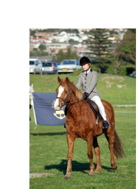

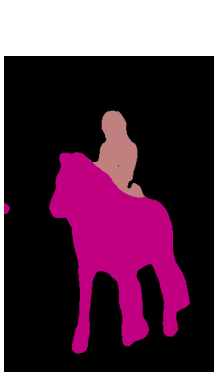

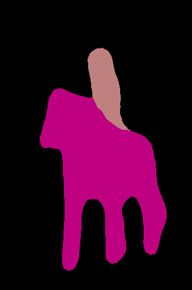

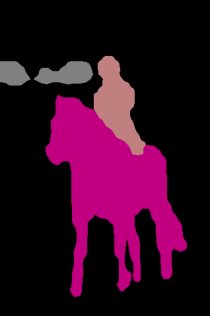

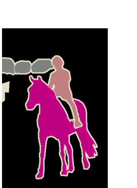

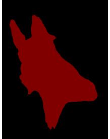

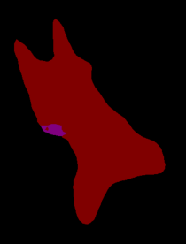

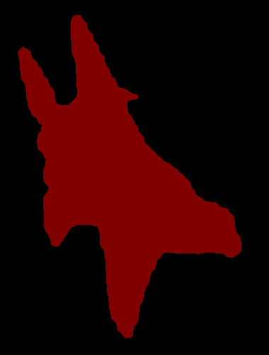

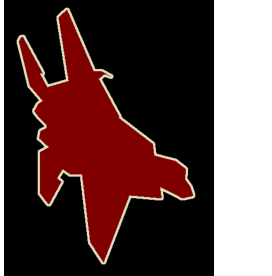

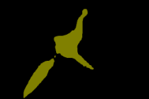

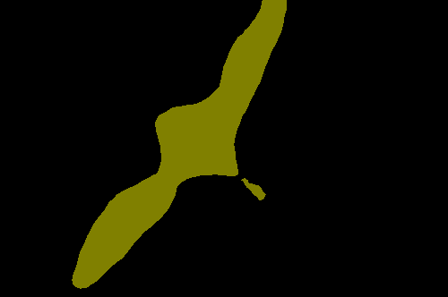

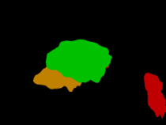

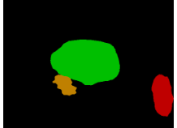

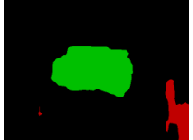

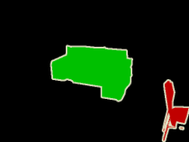

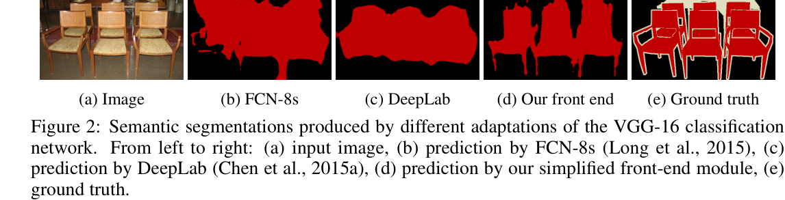

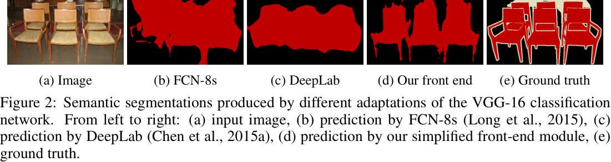

(a) Image

(b) FCN-8s

(c) DeepLab

(d) Our front end

(e) Ground truth

Figure 2: Semantic segmentations produced by different adaptations of the VGG-16 classification network. From left to right: (a) input image, (b) prediction by FCN-8s (Long et al., 2015), (c) prediction by DeepLab (Chen et al., 2015a), (d) prediction by our simplified front-end module, (e) ground truth.

mean IoU

mbike

bottle

person

horse

sheep

chair

table

train

plant

boat

bike

sofa

bird

aero

cow

bus

dog

cat

car

tv

FCN-8s 76.8 34.2 68.9 49.4 60.3 75.3 74.7 77.6 21.4 62.5 46.8 71.8 63.9 76.5 73.9 45.2 72.4 37.4 70.9 55.1 62.2 DeepLab 72 31 71.2 53.7 60.5 77 71.9 73.1 25.2 62.6 49.1 68.7 63.3 73.9 73.6 50.8 72.3 42.1 67.9 52.6 62.1 DeepLab-Msc 74.9 34.1 72.6 52.9 61.0 77.9 73.0 73.7 26.4 62.2 49.3 68.4 64.1 74.0 75.0 51.7 72.7 42.5 67.2 55.7 62.9 Our front end 82.2 37.4 72.7 57.1 62.7 82.8 77.8 78.9 28 70 51.6 73.1 72.8 81.5 79.1 56.6 77.1 49.9 75.3 60.9 67.6

Table 2: Our front-end prediction module is simpler and more accurate than prior models. This table reports accuracy on the VOC-2012 test set.

models trained by the original authors on VOC-2012. Segmentations produced by the different models on images from the VOC-2012 dataset are shown in Figure 2. The accuracy of the models on the VOC-2012 test set is reported in Table 2.

Our front-end prediction module is both simpler and more accurate than the prior models. Specifically, our simplified model outperforms both FCN-8s and the DeepLab network by more than 5 percentage points on the test set. Interestingly, our simplified front-end module outperforms the leaderboard accuracy of DeepLab+CRF on the test set by more than a percentage point (67.6% vs. 66.4%) without using a CRF.

---

Full document: [07 - Multi-Scale Context Aggregation by Dilated Convolutions](../../papers/07-multi-scale-context-aggregation-dilated-convolutions.md) · Page-level evidence: [paper-pages/07-multi-scale-context-aggregation-dilated-convolutions](../../paper-pages/07-multi-scale-context-aggregation-dilated-convolutions/index.md)
