# 6 CONCLUSION

> Section 8 of 11 from [07 - Multi-Scale Context Aggregation by Dilated Convolutions](../../papers/07-multi-scale-context-aggregation-dilated-convolutions.md) · `conclusion` · pages 5-7

We have examined convolutional network architectures for dense prediction. Since the model must produce high-resolution output, we believe that high-resolution operation throughout the network

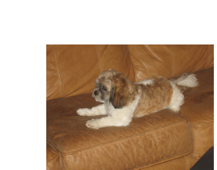

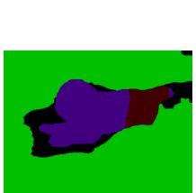

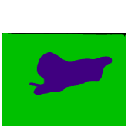

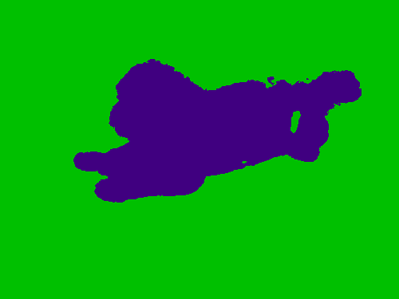

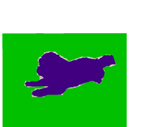

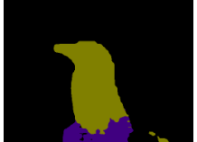

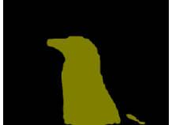

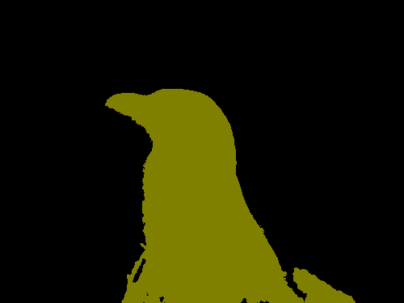

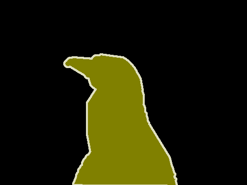

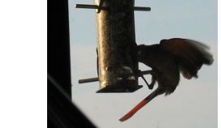

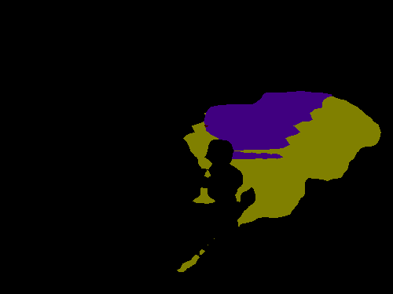

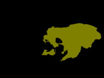

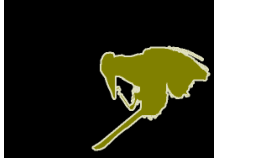

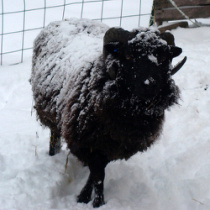

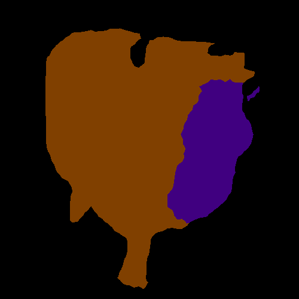

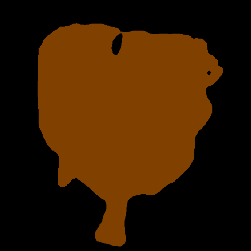

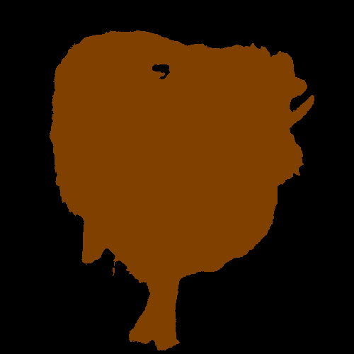

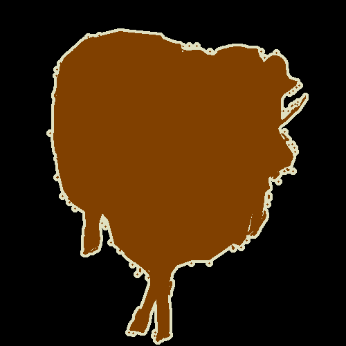

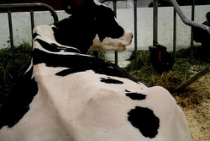

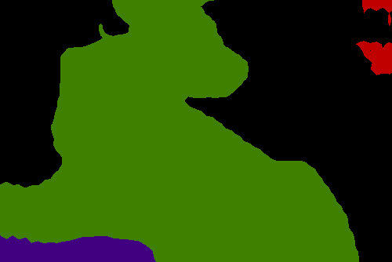

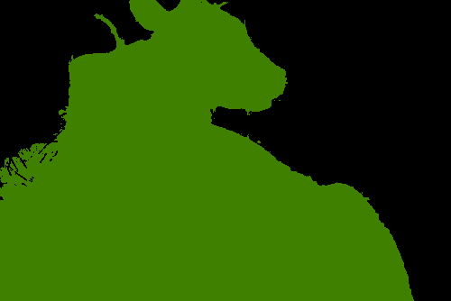

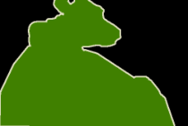

(a) Image

(b) Front end

(c) + Context

(d) + CRF-RNN

(e) Ground truth

Figure 3: Semantic segmentations produced by different models. From left to right: (a) input image, (b) prediction by the front-end module, (c) prediction by the large context network plugged into the front end, (d) prediction by the front end + context module + CRF-RNN, (e) ground truth.

mean IoU

mbike

bottle

person

horse

sheep

chair

table

train

plant

boat

bike

sofa

bird

aero

cow

bus

dog

cat

car

tv

Front end 86.3 38.2 76.8 66.8 63.2 87.3 78.7 82 33.7 76.7 53.5 73.7 76 76.6 83 51.9 77.8 44 79.9 66.3 69.8 Front + Basic 86.4 37.6 78.5 66.3 64.1 89.9 79.9 84.9 36.1 79.4 55.8 77.6 81.6 79 83.1 51.2 81.3 43.7 82.3 65.7 71.3 Front + Large 87.3 39.2 80.3 65.6 66.4 90.2 82.6 85.8 34.8 81.9 51.7 79 84.1 80.9 83.2 51.2 83.2 44.7 83.4 65.6 72.1 Front end + CRF 89.2 38.8 80 69.8 63.2 88.8 80 85.2 33.8 80.6 55.5 77.1 80.8 77.3 84.3 53.1 80.4 45 80.7 67.9 71.6 Front + Basic + CRF 89.1 38.7 81.4 67.4 65 91 81 86.7 37.5 81 57 79.6 83.6 79.9 84.6 52.7 83.3 44.3 82.6 67.2 72.7 Front + Large + CRF 89.6 39.9 82.7 66.7 67.5 91.1 83.3 87.4 36 83.3 52.5 80.7 85.7 81.8 84.4 52.6 84.4 45.3 83.7 66.7 73.3 Front end + RNN 88.8 38.1 80.8 69.1 65.6 89.9 79.6 85.7 36.3 83.6 57.3 77.9 83.2 77 84.6 54.7 82.1 46.9 80.9 66.7 72.5 Front + Basic + RNN 89 38.4 82.3 67.9 65.2 91.5 80.4 87.2 38.4 82.1 57.7 79.9 85 79.6 84.5 53.5 84 45 82.8 66.2 73.1 Front + Large + RNN 89.3 39.2 83.6 67.2 69 92.1 83.1 88 38.4 84.8 55.3 81.2 86.7 81.3 84.3 53.6 84.4 45.8 83.8 67 73.9

Table 3: Controlled evaluation of the effect of the context module on the accuracy of three different architectures for semantic segmentation. Experiments performed on the VOC-2012 validation set. Validation images were not used for training. Top: adding the context module to a semantic segmentation front end with no structured prediction (Long et al., 2015). The basic context module increases accuracy, the large module increases it by a larger margin. Middle: the context module increases accuracy when plugged into a front-end + dense CRF configuration (Chen et al., 2015a). Bottom: the context module increases accuracy when plugged into a front-end + CRF-RNN configuration (Zheng et al., 2015).

is both feasible and desirable. Our work shows that the dilated convolution operator is particularly suited to dense prediction due to its ability to expand the receptive field without losing resolution or coverage. We have utilized dilated convolutions to design a new network structure that reliably increases accuracy when plugged into existing semantic segmentation systems. As part of this work, we have also shown that the accuracy of existing convolutional networks for semantic segmentation can be increased by removing vestigial components that had been developed for image classification.

mean IoU

mbike

bottle

person

horse

sheep

chair

table

train

plant

boat

bike

sofa

bird

aero

cow

bus

dog

cat

car

tv

DeepLab++ 89.1 38.3 88.1 63.3 69.7 87.1 83.1 85 29.3 76.5 56.5 79.8 77.9 85.8 82.4 57.4 84.3 54.9 80.5 64.1 72.7 DeepLab-MSc++ 89.2 46.7 88.5 63.5 68.4 87.0 81.2 86.3 32.6 80.7 62.4 81.0 81.3 84.3 82.1 56.2 84.6 58.3 76.2 67.2 73.9 CRF-RNN 90.4 55.3 88.7 68.4 69.8 88.3 82.4 85.1 32.6 78.5 64.4 79.6 81.9 86.4 81.8 58.6 82.4 53.5 77.4 70.1 74.7 Front end 86.6 37.3 84.9 62.4 67.3 86.2 81.2 82.1 32.6 77.4 58.3 75.9 81 83.6 82.3 54.2 81.5 50.1 77.5 63 71.3 Context 89.1 39.1 86.8 62.6 68.9 88.2 82.6 87.7 33.8 81.2 59.2 81.8 87.2 83.3 83.6 53.6 84.9 53.7 80.5 62.9 73.5 Context + CRF 91.3 39.9 88.9 64.3 69.8 88.9 82.6 89.7 34.7 82.7 59.5 83 88.4 84.2 85 55.3 86.7 54.4 81.9 63.6 74.7 Context + CRF-RNN 91.7 39.6 87.8 63.1 71.8 89.7 82.9 89.8 37.2 84 63 83.3 89 83.8 85.1 56.8 87.6 56 80.2 64.7 75.3

Table 4: Evaluation on the VOC-2012 test set. ‘DeepLab++’ stands for DeepLab-CRF-COCOLargeFOV and ‘DeepLab-MSc++’ stands for DeepLab-MSc-CRF-LargeFOV-COCO-CrossJoint (Chen et al., 2015a). ‘CRF-RNN’ is the system of Zheng et al. (2015). ‘Context’ refers to the large context module plugged into our front end. The context network yields very high accuracy, ourperforming the DeepLab++ architecture without performing structured prediction. Combining the context network with the CRF-RNN structured prediction module increases the accuracy of the CRF-RNN system.

We believe that the presented work is a step towards dedicated architectures for dense prediction that are not constrained by image classification precursors. As new sources of data become available, future architectures may be trained densely end-to-end, removing the need for pre-training on image classification datasets. This may enable architectural simplification and unification. Specifically, end-to-end dense training may enable a fully dense architecture akin to the presented context network to operate at full resolution throughout, accepting the raw image as input and producing dense label assignments at full resolution as output.

State-of-the-art systems for semantic segmentation leave significant room for future advances. Failure cases of our most accurate configuration are shown in Figure 4. We will release our code and trained models to support progress in this area.

---

Full document: [07 - Multi-Scale Context Aggregation by Dilated Convolutions](../../papers/07-multi-scale-context-aggregation-dilated-convolutions.md) · Page-level evidence: [paper-pages/07-multi-scale-context-aggregation-dilated-convolutions](../../paper-pages/07-multi-scale-context-aggregation-dilated-convolutions/index.md)
