# REFERENCES

> Section 10 of 11 from [07 - Multi-Scale Context Aggregation by Dilated Convolutions](../../papers/07-multi-scale-context-aggregation-dilated-convolutions.md) · `references` · pages 7-10

Badrinarayanan, Vijay, Handa, Ankur, and Cipolla, Roberto. SegNet: A deep convolutional encoder-decoder

architecture for robust semantic pixel-wise labelling. arXiv:1505.07293, 2015.

Brostow, Gabriel J., Fauqueur, Julien, and Cipolla, Roberto. Semantic object classes in video: A high-definition

ground truth database. Pattern Recognition Letters, 30(2), 2009.

Chen, Liang-Chieh, Papandreou, George, Kokkinos, Iasonas, Murphy, Kevin, and Yuille, Alan L. Semantic

image segmentation with deep convolutional nets and fully connected CRFs. In ICLR, 2015a.

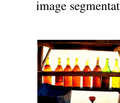

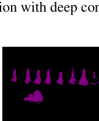

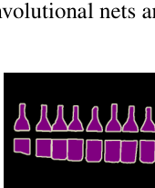

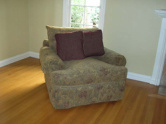

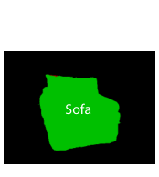

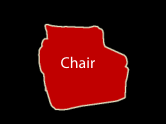

Chair

Sofa

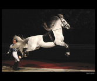

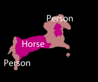

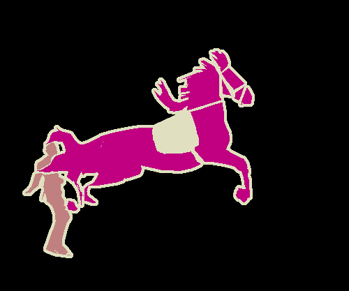

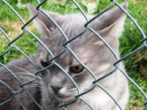

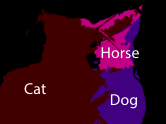

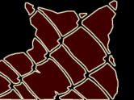

Person

Horse

Horse

Cat Dog

Person

Image

Our result

Ground truth

Image

Our result

Ground truth

Figure 4: Failure cases from the VOC-2012 validation set. The most accurate architecture we trained (Context + CRF-RNN) performs poorly on these images.

Chen, Liang-Chieh, Yang, Yi, Wang, Jiang, Xu, Wei, and Yuille, Alan L. Attention to scale: Scale-aware

semantic image segmentation. arXiv:1511.03339, 2015b.

Cordts, Marius, Omran, Mohamed, Ramos, Sebastian, Rehfeld, Timo, Enzweiler, Markus, Benenson, Rodrigo,

Franke, Uwe, Roth, Stefan, and Schiele, Bernt. The Cityscapes dataset for semantic urban scene understanding. In CVPR, 2016.

Everingham, Mark, Gool, Luc J. Van, Williams, Christopher K. I., Winn, John M., and Zisserman, Andrew.

The Pascal visual object classes (VOC) challenge. IJCV, 88(2), 2010.

Farabet, Cl´ement, Couprie, Camille, Najman, Laurent, and LeCun, Yann. Learning hierarchical features for

scene labeling. PAMI, 35(8), 2013.

Fischer, Philipp, Dosovitskiy, Alexey, Ilg, Eddy, H¨ausser, Philip, Hazrba, Caner, Golkov, Vladimir, van der

Smagt, Patrick, Cremers, Daniel, and Brox, Thomas. Learning optical flow with convolutional neural networks. In ICCV, 2015.

Galleguillos, Carolina and Belongie, Serge J. Context based object categorization: A critical survey. Computer

Vision and Image Understanding, 114(6), 2010.

Geiger, Andreas, Lenz, Philip, Stiller, Christoph, and Urtasun, Raquel. Vision meets robotics: The KITTI

dataset. International Journal of Robotics Research, 32(11), 2013.

Glorot, Xavier and Bengio, Yoshua. Understanding the difficulty of training deep feedforward neural networks.

In AISTATS, 2010.

Hariharan, Bharath, Arbelaez, Pablo, Bourdev, Lubomir D., Maji, Subhransu, and Malik, Jitendra. Semantic

contours from inverse detectors. In ICCV, 2011.

He, Xuming, Zemel, Richard S., and Carreira-Perpi˜n´an, Miguel ´A. Multiscale conditional random fields for

image labeling. In CVPR, 2004.

Holschneider, M., Kronland-Martinet, R., Morlet, J., and Tchamitchian, Ph. A real-time algorithm for signal

analysis with the help of the wavelet transform. In Wavelets: Time-Frequency Methods and Phase Space. Proceedings of the International Conference, 1987.

Jia, Yangqing, Shelhamer, Evan, Donahue, Jeff, Karayev, Sergey, Long, Jonathan, Girshick, Ross B., Guadar-

rama, Sergio, and Darrell, Trevor. Caffe: Convolutional architecture for fast feature embedding. In Proc. ACM Multimedia, 2014.

Kohli, Pushmeet, Ladicky, Lubor, and Torr, Philip H. S. Robust higher order potentials for enforcing label

consistency. IJCV, 82(3), 2009.

Kr¨ahenb¨uhl, Philipp and Koltun, Vladlen. Efficient inference in fully connected CRFs with Gaussian edge

potentials. In NIPS, 2011.

Krizhevsky, Alex, Sutskever, Ilya, and Hinton, Geoffrey E. ImageNet classification with deep convolutional

neural networks. In NIPS, 2012.

Kundu, Abhijit, Vineet, Vibhav, and Koltun, Vladlen. Feature space optimization for semantic video segmen-

tation. In CVPR, 2016.

Ladicky, Lubor, Russell, Christopher, Kohli, Pushmeet, and Torr, Philip H. S. Associative hierarchical CRFs

for object class image segmentation. In ICCV, 2009.

Le, Quoc V., Jaitly, Navdeep, and Hinton, Geoffrey E. A simple way to initialize recurrent networks of rectified

linear units. arXiv:1504.00941, 2015.

LeCun, Yann, Boser, Bernhard, Denker, John S., Henderson, Donnie, Howard, Richard E., Hubbard, Wayne,

and Jackel, Lawrence D. Backpropagation applied to handwritten zip code recognition. Neural Computation, 1(4), 1989.

Lin, Guosheng, Shen, Chunhua, Reid, Ian, and van dan Hengel, Anton. Efficient piecewise training of deep

structured models for semantic segmentation. arXiv:1504.01013, 2015.

Lin, Tsung-Yi, Maire, Michael, Belongie, Serge, Hays, James, Perona, Pietro, Ramanan, Deva, Doll´ar, Piotr,

and Zitnick, C. Lawrence. Microsoft COCO: Common objects in context. In ECCV, 2014.

Liu, Buyu and He, Xuming. Multiclass semantic video segmentation with object-level active inference. In

CVPR, 2015.

Long, Jonathan, Shelhamer, Evan, and Darrell, Trevor. Fully convolutional networks for semantic segmenta-

tion. In CVPR, 2015.

Noh, Hyeonwoo, Hong, Seunghoon, and Han, Bohyung. Learning deconvolution network for semantic seg-

mentation. In ICCV, 2015.

Ros, Germ´an, Ramos, Sebastian, Granados, Manuel, Bakhtiary, Amir, V´azquez, David, and L´opez, Anto-

nio Manuel. Vision-based offline-online perception paradigm for autonomous driving. In WACV, 2015.

Rumelhart, David E., Hinton, Geoffrey E., and Williams, Ronald J. Learning representations by backpropagating errors. Nature, 323, 1986.

Shensa, Mark J. The discrete wavelet transform: wedding the \`a trous and Mallat algorithms. IEEE Transactions

on Signal Processing, 40(10), 1992.

Shotton, Jamie, Winn, John M., Rother, Carsten, and Criminisi, Antonio. TextonBoost for image understanding:

Multi-class object recognition and segmentation by jointly modeling texture, layout, and context. IJCV, 81 (1), 2009.

Simonyan, Karen and Zisserman, Andrew. Very deep convolutional networks for large-scale image recognition.

In ICLR, 2015.

Sturgess, Paul, Alahari, Karteek, Ladicky, Lubor, and Torr, Philip H. S. Combining appearance and structure

from motion features for road scene understanding. In BMVC, 2009.

Tighe, Joseph and Lazebnik, Svetlana. Superparsing – scalable nonparametric image parsing with superpixels.

IJCV, 101(2), 2013.

Zheng, Shuai, Jayasumana, Sadeep, Romera-Paredes, Bernardino, Vineet, Vibhav, Su, Zhizhong, Du, Dalong,

Huang, Chang, and Torr, Philip. Conditional random fields as recurrent neural networks. In ICCV, 2015.

---

Full document: [07 - Multi-Scale Context Aggregation by Dilated Convolutions](../../papers/07-multi-scale-context-aggregation-dilated-convolutions.md) · Page-level evidence: [paper-pages/07-multi-scale-context-aggregation-dilated-convolutions](../../paper-pages/07-multi-scale-context-aggregation-dilated-convolutions/index.md)
