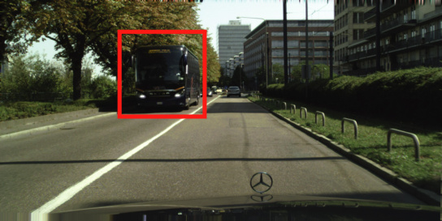
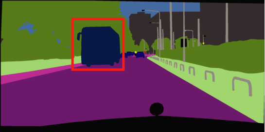

# APPENDIX A URBAN SCENE UNDERSTANDING

> Section 11 of 11 from [07 - Multi-Scale Context Aggregation by Dilated Convolutions](../../papers/07-multi-scale-context-aggregation-dilated-convolutions.md) · `appendix` · pages 10-13

In this appendix, we report experiments on three datasets for urban scene understanding: the CamVid dataset (Brostow et al., 2009), the KITTI dataset (Geiger et al., 2013), and the new Cityscapes dataset (Cordts et al., 2016). As the accuracy measure we use the mean IoU (Everingham et al., 2010). We only train our model on the training set, even when a validation set is available. The results reported in this section do not use conditional random fields or other forms of structured prediction. They were obtained with convolutional networks that combine a front-end module and a context module, akin to the “Front + Basic” network evaluated in Table 3. The trained models can be found at https://github.com/fyu/dilation.

We now summarize the training procedure used for training the front-end module. This procedure applies to all datasets. Training is performed with stochastic gradient descent. Each mini-batch contains 8 crops from randomly sampled images. Each crop is of size 628×628 and is randomly sampled from a padded image. Images are padded using reflection padding. No padding is used in the intermediate layers. The learning rate is 10−4 and momentum is set to 0.99. The number of iterations depends on the number of images in the dataset and is reported for each dataset below.

The context modules used for these datasets are all derived from the “Basic” network, using the terminology of Table 1. The number of channels in each layer is the number of predicted classes C. (For example, C = 19 for the Cityscapes dataset.) Each layer in the context module is padded such that the input and response maps have the same size. The number of layers in the context module depends on the resolution of the images in the dataset. Joint training of the complete model, composed of the front-end and the context module, is summarized below for each dataset.

A.1 CAMVID

We use the split of Sturgess et al. (2009), which partitions the dataset into 367 training images, 100 validation images, and 233 test images. 11 semantic classes are used. The images are downsampled to 640×480.

The context module has 8 layers, akin to the model used for the Pascal VOC dataset in the main body of the paper. The overall training procedure is as follows. First, the front-end module is trained for 20K iterations. Then the complete model (front-end + context) is jointly trained by sampling crops of size 852 × 852 with batch size 1. The learning rate for joint training is set to 10−5 and the momentum is set to 0.9.

Results on the CamVid test set are reported in Table 5. We refer to our complete convolutional network (front-end + context) as Dilation8, since the context module has 8 layers. Our model outperforms the prior work. This model was used as the unary classifier in the recent work of Kundu et al. (2016).

Pedestrian

mean IoU

Sidewalk

Bicyclist

Building

Fence

Road

Tree

Pole

Sign

Car

Sky

ALE 73.4 70.2 91.1 64.2 24.4 91.1 29.1 31.0 13.6 72.4 28.6 53.6 SuperParsing 70.4 54.8 83.5 43.3 25.4 83.4 11.6 18.3 5.2 57.4 8.9 42.0 Liu and He 66.8 66.6 90.1 62.9 21.4 85.8 28.0 17.8 8.3 63.5 8.5 47.2 SegNet 68.7 52.0 87.0 58.5 13.4 86.2 25.3 17.9 16.0 60.5 24.8 46.4 DeepLab-LFOV 81.5 74.6 89.0 82.2 42.3 92.2 48.4 27.2 14.3 75.4 50.1 61.6 Dilation8 82.6 76.2 89.9 84.0 46.9 92.2 56.3 35.8 23.4 75.3 55.5 65.3

Table 5: Semantic segmentation results on the CamVid dataset. Our model (Dilation8) is compared to ALE (Ladicky et al., 2009), SuperParsing (Tighe & Lazebnik, 2013), Liu and He (Liu & He, 2015), SegNet (Badrinarayanan et al., 2015), and the DeepLab-LargeFOV model (Chen et al., 2015a). Our model outperforms the prior work.

A.2 KITTI

We use the training and validation split of Ros et al. (2015): 100 training images and 46 test images. The images were all collected from the KITTI visual odometry/SLAM dataset. The image resolution is 1226×370. Since the vertical resolution is small compared to the other datasets, we remove Layer 6 in Table 1. The resulting context module has 7 layers. The complete network (front-end + context) is referred to as Dilation7.

The front-end is trained for 10K iterations. Next, the front-end and the context module are trained jointly. For joint training, the crop size is 900×900 and momentum is set to 0.99, while the other parameters are the same as the ones used for the CamVid dataset. Joint training is performed for 20K iterations.

The results are shown in Table 6. As the table demonstrates, our model outperforms the prior work.

Pedestrian

mean IoU

Sidewalk

Bicyclist

Building

Fence

Road

Tree

Pole

Sign

Car

Sky

Ros et al. 71.8 69.5 84.4 51.2 4.2 72.4 1.7 32.4 2.6 45.3 3.2 39.9 DeepLab-LFOV 82.8 78.6 82.4 78.0 28.8 91.3 0.0 39.4 29.9 72.4 12.9 54.2 Dilation7 84.6 81.1 83 81.4 41.8 92.9 4.6 47.1 35.2 73.1 26.4 59.2

Table 6: Semantic segmentation results on the KITTI dataset. We compare our results to Ros et al. (2015) and to the DeepLab-LargeFOV model (Chen et al., 2015a). Our network (Dilation7) yields higher accuracy than the prior work.

A.3 CITYSCAPES

The Cityscapes dataset contains 2975 training images, 500 validation images, and 1525 test images (Cordts et al., 2016). Due to the high image resolution (2048×1024), we add two layers to the context network after Layer 6 in Table 1. These two layers have dilation 32 and 64, respectively. The total number of layers in the context module is 10 and we refer to the complete model (front-end + context) as Dilation10.

The Dilation10 network was trained in three stages. First, the front-end prediction module was trained for 40K iterations. Second, the context module was trained for 24K iterations on whole (uncropped) images, with learning rate 10−4, momentum 0.99, and batch size 100. Third, the complete model (front-end + context) was jointly trained for 60K iterations on halves of images (input size 1396×1396, including padding), with learning rate 10−5, momentum 0.99, and batch size 1.

Figure 5 visualizes the effect of the training stages on the performance of the model. Quantitative results are given in Tables 7 and 8.

The performance of Dilation10 was compared to prior work on the Cityscapes dataset by Cordts et al. (2016). In their evaluation, Dilation10 outperformed all prior models (Cordts et al., 2016). Dilation10 was also used as the unary classifier in the recent work of Kundu et al. (2016), which used structured prediction to increase accuracy further.

(a) Image (b) Ground truth

(c) Front end (d) +Context (e) +Joint (f) Ground truth

Figure 5: Results produced by the Dilation10 model after different training stages. (a) Input image. (b) Ground truth segmentation. (c) Segmentation produced by the model after the first stage of training (front-end only). (d) Segmentation produced after the second stage, which trains the context module. (e) Segmentation produced after the third stage, in which both modules are trained jointly.

Motorcycle

Vegetation

mean IoU

Sidewalk

Building

Terrain

Bicycle

Person

Fence

Truck

Rider

Train

Road

Light

Wall

Pole

Sign

Bus

Car

Sky

Validation set 97.2 79.5 90.4 44.9 52.4 55.1 56.7 69 91 58.7 92.6 75.7 50 92.2 56.2 72.6 54.3 46.2 70.1 68.7 Test set 97.6 79.2 89.9 37.3 47.6 53.2 58.6 65.2 91.8 69.4 93.7 78.9 55 93.3 45.5 53.4 47.7 52.2 66 67.1

Table 7: Per-class and mean class-level IoU achieved by our model (Dilation10) on the Cityscapes dataset.

Flat Nature Object Sky Construction Human Vehicle mean IoU Validation set 98.2 91.4 62.3 92.6 90.7 77.6 91 86.3 Test set 98.3 91.4 60.5 93.7 90.2 79.8 91.8 86.5

Table 8: Per-category and mean category-level IoU on the Cityscapes dataset.

---

Full document: [07 - Multi-Scale Context Aggregation by Dilated Convolutions](../../papers/07-multi-scale-context-aggregation-dilated-convolutions.md) · Page-level evidence: [paper-pages/07-multi-scale-context-aggregation-dilated-convolutions](../../paper-pages/07-multi-scale-context-aggregation-dilated-convolutions/index.md)
