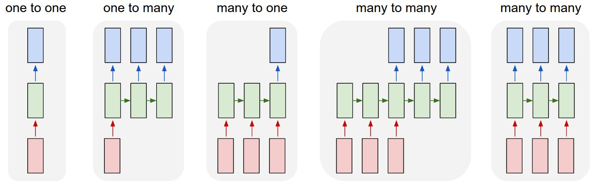
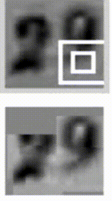

# Recurrent Neural Networks

> Section 2 of 10 from [08 - The Unreasonable Effectiveness of Recurrent Neural Networks](../../papers/08-unreasonable-effectiveness-of-recurrent-neural-networks.md) · `other` · pages n/a

**Sequences**. Depending on your background you might be wondering: _What makes Recurrent Networks so special_? A glaring limitation of Vanilla Neural Networks (and also Convolutional Networks) is that their API is too constrained: they accept a fixed-sized vector as input (e.g. an image) and produce a fixed-sized vector as output (e.g. probabilities of different classes). Not only that: These models perform this mapping using a fixed amount of computational steps (e.g. the number of layers in the model). The core reason that recurrent nets are more exciting is that they allow us to operate over _sequences_ of vectors: Sequences in the input, the output, or in the most general case both. A few examples may make this more concrete:



Each rectangle is a vector and arrows represent functions (e.g. matrix multiply). Input vectors are in red, output vectors are in blue and green vectors hold the RNN's state (more on this soon). From left to right: **(1)** Vanilla mode of processing without RNN, from fixed-sized input to fixed-sized output (e.g. image classification). **(2)** Sequence output (e.g. image captioning takes an image and outputs a sentence of words). **(3)** Sequence input (e.g. sentiment analysis where a given sentence is classified as expressing positive or negative sentiment). **(4)** Sequence input and sequence output (e.g. Machine Translation: an RNN reads a sentence in English and then outputs a sentence in French). **(5)** Synced sequence input and output (e.g. video classification where we wish to label each frame of the video). Notice that in every case are no pre-specified constraints on the lengths sequences because the recurrent transformation (green) is fixed and can be applied as many times as we like.

As you might expect, the sequence regime of operation is much more powerful compared to fixed networks that are doomed from the get-go by a fixed number of computational steps, and hence also much more appealing for those of us who aspire to build more intelligent systems. Moreover, as we’ll see in a bit, RNNs combine the input vector with their state vector with a fixed (but learned) function to produce a new state vector. This can in programming terms be interpreted as running a fixed program with certain inputs and some internal variables. Viewed this way, RNNs essentially describe programs. In fact, it is known that [RNNs are Turing-Complete](http://binds.cs.umass.edu/papers/1995_Siegelmann_Science.pdf) in the sense that they can to simulate arbitrary programs (with proper weights). But similar to universal approximation theorems for neural nets you shouldn’t read too much into this. In fact, forget I said anything.

> If training vanilla neural nets is optimization over functions, training recurrent nets is optimization over programs.

**Sequential processing in absence of sequences**. You might be thinking that having sequences as inputs or outputs could be relatively rare, but an important point to realize is that even if your inputs/outputs are fixed vectors, it is still possible to use this powerful formalism to _process_ them in a sequential manner. For instance, the figure below shows results from two very nice papers from [DeepMind](http://deepmind.com/). On the left, an algorithm learns a recurrent network policy that steers its attention around an image; In particular, it learns to read out house numbers from left to right ( [Ba et al.](http://arxiv.org/abs/1412.7755)). On the right, a recurrent network _generates_ images of digits by learning to sequentially add color to a canvas ( [Gregor et al.](http://arxiv.org/abs/1502.04623)):



Left: RNN learns to read house numbers. Right: RNN learns to paint house numbers.

The takeaway is that even if your data is not in form of sequences, you can still formulate and train powerful models that learn to process it sequentially. You’re learning stateful programs that process your fixed-sized data.

**RNN computation.** So how do these things work? At the core, RNNs have a deceptively simple API: They accept an input vector `x` and give you an output vector `y`. However, crucially this output vector’s contents are influenced not only by the input you just fed in, but also on the entire history of inputs you’ve fed in in the past. Written as a class, the RNN’s API consists of a single `step` function:

```
rnn = RNN()
y = rnn.step(x) # x is an input vector, y is the RNN's output vector
```

The RNN class has some internal state that it gets to update every time `step` is called. In the simplest case this state consists of a single _hidden_ vector `h`. Here is an implementation of the step function in a Vanilla RNN:

```
class RNN:
  # ...
  def step(self, x):
    # update the hidden state
    self.h = np.tanh(np.dot(self.W_hh, self.h) + np.dot(self.W_xh, x))
    # compute the output vector
    y = np.dot(self.W_hy, self.h)
    return y
```

The above specifies the forward pass of a vanilla RNN. This RNN’s parameters are the three matrices `W_hh, W_xh, W_hy`. The hidden state `self.h` is initialized with the zero vector. The `np.tanh` function implements a non-linearity that squashes the activations to the range `[-1, 1]`. Notice briefly how this works: There are two terms inside of the tanh: one is based on the previous hidden state and one is based on the current input. In numpy `np.dot` is matrix multiplication. The two intermediates interact with addition, and then get squashed by the tanh into the new state vector. If you’re more comfortable with math notation, we can also write the hidden state update as ht=tanh(Whhht−1+Wxhxt)ht=tanh⁡(Whhht−1+Wxhxt), where tanh is applied elementwise.

We initialize the matrices of the RNN with random numbers and the bulk of work during training goes into finding the matrices that give rise to desirable behavior, as measured with some loss function that expresses your preference to what kinds of outputs `y` you’d like to see in response to your input sequences `x`.

**Going deep**. RNNs are neural networks and everything works monotonically better (if done right) if you put on your deep learning hat and start stacking models up like pancakes. For instance, we can form a 2-layer recurrent network as follows:

```
y1 = rnn1.step(x)
y = rnn2.step(y1)
```

In other words we have two separate RNNs: One RNN is receiving the input vectors and the second RNN is receiving the output of the first RNN as its input. Except neither of these RNNs know or care - it’s all just vectors coming in and going out, and some gradients flowing through each module during backpropagation.

**Getting fancy**. I’d like to briefly mention that in practice most of us use a slightly different formulation than what I presented above called a _Long Short-Term Memory_ (LSTM) network. The LSTM is a particular type of recurrent network that works slightly better in practice, owing to its more powerful update equation and some appealing backpropagation dynamics. I won’t go into details, but everything I’ve said about RNNs stays exactly the same, except the mathematical form for computing the update (the line `self.h = ...`) gets a little more complicated. From here on I will use the terms “RNN/LSTM” interchangeably but all experiments in this post use an LSTM.

---

Full document: [08 - The Unreasonable Effectiveness of Recurrent Neural Networks](../../papers/08-unreasonable-effectiveness-of-recurrent-neural-networks.md) · Page-level evidence: [paper-pages/08-unreasonable-effectiveness-of-recurrent-neural-networks](../../paper-pages/08-unreasonable-effectiveness-of-recurrent-neural-networks/index.md)
