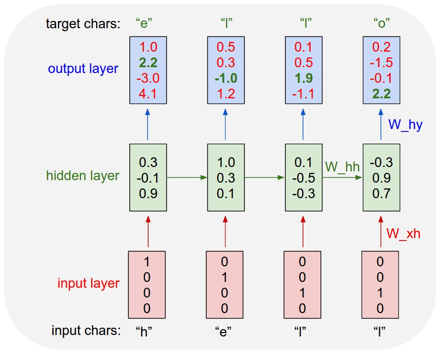

# Character-Level Language Models

> Section 3 of 10 from [08 - The Unreasonable Effectiveness of Recurrent Neural Networks](../../papers/08-unreasonable-effectiveness-of-recurrent-neural-networks.md) · `other` · pages n/a

Okay, so we have an idea about what RNNs are, why they are super exciting, and how they work. We’ll now ground this in a fun application: We’ll train RNN character-level language models. That is, we’ll give the RNN a huge chunk of text and ask it to model the probability distribution of the next character in the sequence given a sequence of previous characters. This will then allow us to generate new text one character at a time.

As a working example, suppose we only had a vocabulary of four possible letters “helo”, and wanted to train an RNN on the training sequence “hello”. This training sequence is in fact a source of 4 separate training examples: 1. The probability of “e” should be likely given the context of “h”, 2. “l” should be likely in the context of “he”, 3. “l” should also be likely given the context of “hel”, and finally 4. “o” should be likely given the context of “hell”.

Concretely, we will encode each character into a vector using 1-of-k encoding (i.e. all zero except for a single one at the index of the character in the vocabulary), and feed them into the RNN one at a time with the `step` function. We will then observe a sequence of 4-dimensional output vectors (one dimension per character), which we interpret as the confidence the RNN currently assigns to each character coming next in the sequence. Here’s a diagram:

An example RNN with 4-dimensional input and output layers, and a hidden layer of 3 units (neurons). This diagram shows the activations in the forward pass when the RNN is fed the characters "hell" as input. The output layer contains confidences the RNN assigns for the next character (vocabulary is "h,e,l,o"); We want the green numbers to be high and red numbers to be low.

For example, we see that in the first time step when the RNN saw the character “h” it assigned confidence of 1.0 to the next letter being “h”, 2.2 to letter “e”, -3.0 to “l”, and 4.1 to “o”. Since in our training data (the string “hello”) the next correct character is “e”, we would like to increase its confidence (green) and decrease the confidence of all other letters (red). Similarly, we have a desired target character at every one of the 4 time steps that we’d like the network to assign a greater confidence to. Since the RNN consists entirely of differentiable operations we can run the backpropagation algorithm (this is just a recursive application of the chain rule from calculus) to figure out in what direction we should adjust every one of its weights to increase the scores of the correct targets (green bold numbers). We can then perform a _parameter update_, which nudges every weight a tiny amount in this gradient direction. If we were to feed the same inputs to the RNN after the parameter update we would find that the scores of the correct characters (e.g. “e” in the first time step) would be slightly higher (e.g. 2.3 instead of 2.2), and the scores of incorrect characters would be slightly lower. We then repeat this process over and over many times until the network converges and its predictions are eventually consistent with the training data in that correct characters are always predicted next.

A more technical explanation is that we use the standard Softmax classifier (also commonly referred to as the cross-entropy loss) on every output vector simultaneously. The RNN is trained with mini-batch Stochastic Gradient Descent and I like to use [RMSProp](http://arxiv.org/abs/1502.04390) or Adam (per-parameter adaptive learning rate methods) to stablilize the updates.

Notice also that the first time the character “l” is input, the target is “l”, but the second time the target is “o”. The RNN therefore cannot rely on the input alone and must use its recurrent connection to keep track of the context to achieve this task.

At **test time**, we feed a character into the RNN and get a distribution over what characters are likely to come next. We sample from this distribution, and feed it right back in to get the next letter. Repeat this process and you’re sampling text! Lets now train an RNN on different datasets and see what happens.

To further clarify, for educational purposes I also wrote a [minimal character-level RNN language model in Python/numpy](https://gist.github.com/karpathy/d4dee566867f8291f086). It is only about 100 lines long and hopefully it gives a concise, concrete and useful summary of the above if you’re better at reading code than text. We’ll now dive into example results, produced with the much more efficient Lua/Torch codebase.

## Fun with RNNs

All 5 example character models below were trained with the [code](https://github.com/karpathy/char-rnn) I’m releasing on Github. The input in each case is a single file with some text, and we’re training an RNN to predict the next character in the sequence.

### Paul Graham generator

Lets first try a small dataset of English as a sanity check. My favorite fun dataset is the concatenation of [Paul Graham’s essays](http://www.paulgraham.com/articles.html). The basic idea is that there’s a lot of wisdom in these essays, but unfortunately Paul Graham is a relatively slow generator. Wouldn’t it be great if we could sample startup wisdom on demand? That’s where an RNN comes in.

Concatenating all pg essays over the last ~5 years we get approximately 1MB text file, or about 1 million characters (this is considered a very small dataset by the way). _Technical:_ Lets train a 2-layer LSTM with 512 hidden nodes (approx. 3.5 million parameters), and with dropout of 0.5 after each layer. We’ll train with batches of 100 examples and truncated backpropagation through time of length 100 characters. With these settings one batch on a TITAN Z GPU takes about 0.46 seconds (this can be cut in half with 50 character BPTT at negligible cost in performance). Without further ado, lets see a sample from the RNN:

_“The surprised in investors weren’t going to raise money. I’m not the company with the time there are all interesting quickly, don’t have to get off the same programmers. There’s a super-angel round fundraising, why do you can do. If you have a different physical investment are become in people who reduced in a startup with the way to argument the acquirer could see them just that you’re also the founders will part of users’ affords that and an alternation to the idea. \[2\] Don’t work at first member to see the way kids will seem in advance of a bad successful startup. And if you have to act the big company too.”_

Okay, clearly the above is unfortunately not going to replace Paul Graham anytime soon, but remember that the RNN had to learn English completely from scratch and with a small dataset (including where you put commas, apostrophes and spaces). I also like that it learns to support its own arguments (e.g. \[2\], above). Sometimes it says something that offers a glimmer of insight, such as _“a company is a meeting to think to investors”_. [Here’s](http://cs.stanford.edu/people/karpathy/char-rnn/pg.txt) a link to 50K character sample if you’d like to see more.

**Temperature.** We can also play with the temperature of the Softmax during sampling. Decreasing the temperature from 1 to some lower number (e.g. 0.5) makes the RNN more confident, but also more conservative in its samples. Conversely, higher temperatures will give more diversity but at cost of more mistakes (e.g. spelling mistakes, etc). In particular, setting temperature very near zero will give the most likely thing that Paul Graham might say:

_“is that they were all the same thing that was a startup is that they were all the same thing that was a startup is that they were all the same thing that was a startup is that they were all the same”_

looks like we’ve reached an infinite loop about startups.

---

Full document: [08 - The Unreasonable Effectiveness of Recurrent Neural Networks](../../papers/08-unreasonable-effectiveness-of-recurrent-neural-networks.md) · Page-level evidence: [paper-pages/08-unreasonable-effectiveness-of-recurrent-neural-networks](../../paper-pages/08-unreasonable-effectiveness-of-recurrent-neural-networks/index.md)
