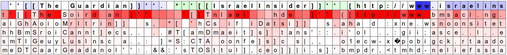

# Generating Baby Names\

> Section 7 of 10 from [08 - The Unreasonable Effectiveness of Recurrent Neural Networks](../../papers/08-unreasonable-effectiveness-of-recurrent-neural-networks.md) · `other` · pages n/a

\
Lets try one more for fun. Lets feed the RNN a large text file that contains 8000 baby names listed out, one per line (names obtained from [here](http://www.cs.cmu.edu/afs/cs/project/ai-repository/ai/areas/nlp/corpora/names/)). We can feed this to the RNN and then generate new names! Here are some example names, only showing the ones that do not occur in the training data (90% don’t):\
\
_Rudi_\
_Levette_\
_Berice_\
_Lussa_\
_Hany_\
_Mareanne_\
_Chrestina_\
_Carissy_\
_Marylen_\
_Hammine_\
_Janye_\
_Marlise_\
_Jacacrie_\
_Hendred_\
_Romand_\
_Charienna_\
_Nenotto_\
_Ette_\
_Dorane_\
_Wallen_\
_Marly_\
_Darine_\
_Salina_\
_Elvyn_\
_Ersia_\
_Maralena_\
_Minoria_\
_Ellia_\
_Charmin_\
_Antley_\
_Nerille_\
_Chelon_\
_Walmor_\
_Evena_\
_Jeryly_\
_Stachon_\
_Charisa_\
_Allisa_\
_Anatha_\
_Cathanie_\
_Geetra_\
_Alexie_\
_Jerin_\
_Cassen_\
_Herbett_\
_Cossie_\
_Velen_\
_Daurenge_\
_Robester_\
_Shermond_\
_Terisa_\
_Licia_\
_Roselen_\
_Ferine_\
_Jayn_\
_Lusine_\
_Charyanne_\
_Sales_\
_Sanny_\
_Resa_\
_Wallon_\
_Martine_\
_Merus_\
_Jelen_\
_Candica_\
_Wallin_\
_Tel_\
_Rachene_\
_Tarine_\
_Ozila_\
_Ketia_\
_Shanne_\
_Arnande_\
_Karella_\
_Roselina_\
_Alessia_\
_Chasty_\
_Deland_\
_Berther_\
_Geamar_\
_Jackein_\
_Mellisand_\
_Sagdy_\
_Nenc_\
_Lessie_\
_Rasemy_\
_Guen_\
_Gavi_\
_Milea_\
_Anneda_\
_Margoris_\
_Janin_\
_Rodelin_\
_Zeanna_\
_Elyne_\
_Janah_\
_Ferzina_\
_Susta_\
_Pey_\
_Castina_\
\
You can see many more [here](http://cs.stanford.edu/people/karpathy/namesGenUnique.txt). Some of my favorites include “Baby” (haha), “Killie”, “Char”, “R”, “More”, “Mars”, “Hi”, “Saddie”, “With” and “Ahbort”. Well that was fun. Of course, you can imagine this being quite useful inspiration when writing a novel, or naming a new startup :)\
\
## Understanding what’s going on\
\
We saw that the results at the end of training can be impressive, but how does any of this work? Lets run two quick experiments to briefly peek under the hood.\
\
### The evolution of samples while training\
\
First, it’s fun to look at how the sampled text evolves while the model trains. For example, I trained an LSTM of Leo Tolstoy’s War and Peace and then generated samples every 100 iterations of training. At iteration 100 the model samples random jumbles:\
\
```\
tyntd-iafhatawiaoihrdemot  lytdws  e ,tfti, astai f ogoh eoase rrranbyne 'nhthnee e\
plia tklrgd t o idoe ns,smtt   h ne etie h,hregtrs nigtike,aoaenns lng\
```\
\
However, notice that at least it is starting to get an idea about words separated by spaces. Except sometimes it inserts two spaces. It also doesn’t know that comma is amost always followed by a space. At 300 iterations we see that the model starts to get an idea about quotes and periods:\
\
```\
"Tmont thithey" fomesscerliund\
Keushey. Thom here\
sheulke, anmerenith ol sivh I lalterthend Bleipile shuwy fil on aseterlome\
coaniogennc Phe lism thond hon at. MeiDimorotion in ther thize."\
```\
\
The words are now also separated with spaces and the model starts to get the idea about periods at the end of a sentence. At iteration 500:\
\
```\
we counter. He stutn co des. His stanted out one ofler that concossions and was\
to gearang reay Jotrets and with fre colt otf paitt thin wall. Which das stimn\
```\
\
the model has now learned to spell the shortest and most common words such as “we”, “He”, “His”, “Which”, “and”, etc. At iteration 700 we’re starting to see more and more English-like text emerge:\
\
```\
Aftair fall unsuch that the hall for Prince Velzonski's that me of\
her hearly, and behs to so arwage fiving were to it beloge, pavu say falling misfort\
how, and Gogition is so overelical and ofter.\
```\
\
At iteration 1200 we’re now seeing use of quotations and question/exclamation marks. Longer words have now been learned as well:\
\
```\
"Kite vouch!" he repeated by her\
door. "But I would be done and quarts, feeling, then, son is people...."\
```\
\
Until at last we start to get properly spelled words, quotations, names, and so on by about iteration 2000:\
\
```\
"Why do what that day," replied Natasha, and wishing to himself the fact the\
princess, Princess Mary was easier, fed in had oftened him.\
Pierre aking his soul came to the packs and drove up his father-in-law women.\
```\
\
The picture that emerges is that the model first discovers the general word-space structure and then rapidly starts to learn the words; First starting with the short words and then eventually the longer ones. Topics and themes that span multiple words (and in general longer-term dependencies) start to emerge only much later.\
\
### Visualizing the predictions and the “neuron” firings in the RNN\
\
Another fun visualization is to look at the predicted distributions over characters. In the visualizations below we feed a Wikipedia RNN model character data from the validation set (shown along the blue/green rows) and under every character we visualize (in red) the top 5 guesses that the model assigns for the next character. The guesses are colored by their probability (so dark red = judged as very likely, white = not very likely). For example, notice that there are stretches of characters where the model is extremely confident about the next letter (e.g., the model is very confident about characters during the _http://www._ sequence).\
\
The input character sequence (blue/green) is colored based on the _firing_ of a randomly chosen neuron in the hidden representation of the RNN. Think about it as green = very excited and blue = not very excited (for those familiar with details of LSTMs, these are values between \[-1,1\] in the hidden state vector, which is just the gated and tanh’d LSTM cell state). Intuitively, this is visualizing the firing rate of some neuron in the “brain” of the RNN while it reads the input sequence. Different neurons might be looking for different patterns; Below we’ll look at 4 different ones that I found and thought were interesting or interpretable (many also aren’t):\
\
\
\
The neuron highlighted in this image seems to get very excited about URLs and turns off outside of the URLs. The LSTM is likely using this neuron to remember if it is inside a URL or not.\
\
\
\
The highlighted neuron here gets very excited when the RNN is inside the \[\[ \]\] markdown environment and turns off outside of it. Interestingly, the neuron can't turn on right after it sees the character "\[", it must wait for the second "\[" and then activate. This task of counting whether the model has seen one or two "\[" is likely done with a different neuron.\
\
\
\
Here we see a neuron that varies seemingly linearly across the \[\[ \]\] environment. In other words its activation is giving the RNN a time-aligned coordinate system across the \[\[ \]\] scope. The RNN can use this information to make different characters more or less likely depending on how early/late it is in the \[\[ \]\] scope (perhaps?).\
\
\
\
Here is another neuron that has very local behavior: it is relatively silent but sharply turns off right after the first "w" in the "www" sequence. The RNN might be using this neuron to count up how far in the "www" sequence it is, so that it can know whether it should emit another "w", or if it should start the URL.\
\
Of course, a lot of these conclusions are slightly hand-wavy as the hidden state of the RNN is a huge, high-dimensional and largely distributed representation. These visualizations were produced with custom HTML/CSS/Javascript, you can see a sketch of what’s involved [here](http://cs.stanford.edu/people/karpathy/viscode.zip) if you’d like to create something similar.\
\
We can also condense this visualization by excluding the most likely predictions and only visualize the text, colored by activations of a cell. We can see that in addition to a large portion of cells that do not do anything interpretible, about 5% of them turn out to have learned quite interesting and interpretible algorithms:\
\
\
\
Again, what is beautiful about this is that we didn’t have to hardcode at any point that if you’re trying to predict the next character it might, for example, be useful to keep track of whether or not you are currently inside or outside of quote. We just trained the LSTM on raw data and it decided that this is a useful quantitity to keep track of. In other words one of its cells gradually tuned itself during training to become a quote detection cell, since this helps it better perform the final task. This is one of the cleanest and most compelling examples of where the power in Deep Learning models (and more generally end-to-end training) is coming from.\
\

---

Full document: [08 - The Unreasonable Effectiveness of Recurrent Neural Networks](../../papers/08-unreasonable-effectiveness-of-recurrent-neural-networks.md) · Page-level evidence: [paper-pages/08-unreasonable-effectiveness-of-recurrent-neural-networks](../../paper-pages/08-unreasonable-effectiveness-of-recurrent-neural-networks/index.md)
