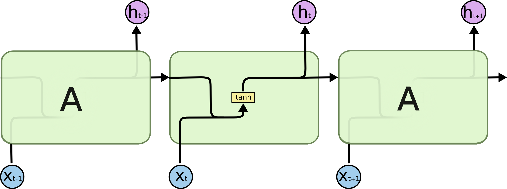
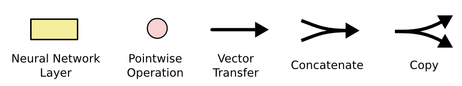

# LSTM Networks

> Section 4 of 10 from [09 - Understanding LSTM Networks](../../papers/09-understanding-lstm-networks.md) · `other` · pages n/a

Long Short Term Memory networks – usually just called “LSTMs” – are a special kind of RNN, capable of learning long-term dependencies. They were introduced by [Hochreiter & Schmidhuber (1997)](http://www.bioinf.jku.at/publications/older/2604.pdf), and were refined and popularized by many people in following work. [1](https://colah.github.io/posts/2015-08-Understanding-LSTMs/#fn1) They work tremendously well on a large variety of problems, and are now widely used.

LSTMs are explicitly designed to avoid the long-term dependency problem. Remembering information for long periods of time is practically their default behavior, not something they struggle to learn!

All recurrent neural networks have the form of a chain of repeating modules of neural network. In standard RNNs, this repeating module will have a very simple structure, such as a single tanh layer.

**The repeating module in a standard RNN contains a single layer.**

LSTMs also have this chain like structure, but the repeating module has a different structure. Instead of having a single neural network layer, there are four, interacting in a very special way.

**The repeating module in an LSTM contains four interacting layers.**

Don’t worry about the details of what’s going on. We’ll walk through the LSTM diagram step by step later. For now, let’s just try to get comfortable with the notation we’ll be using.

In the above diagram, each line carries an entire vector, from the output of one node to the inputs of others. The pink circles represent pointwise operations, like vector addition, while the yellow boxes are learned neural network layers. Lines merging denote concatenation, while a line forking denote its content being copied and the copies going to different locations.

---

Full document: [09 - Understanding LSTM Networks](../../papers/09-understanding-lstm-networks.md) · Page-level evidence: [paper-pages/09-understanding-lstm-networks](../../paper-pages/09-understanding-lstm-networks/index.md)
