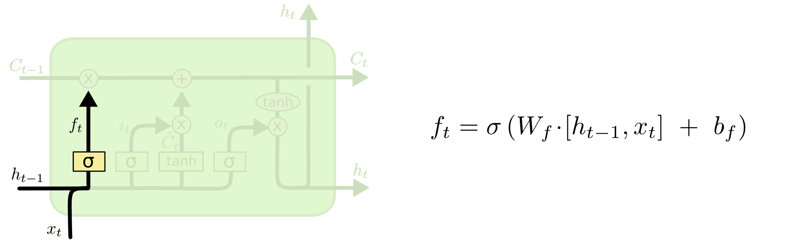
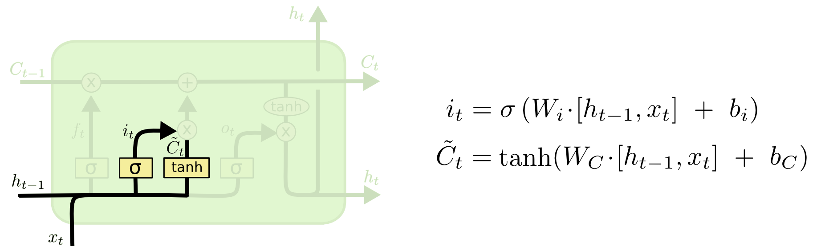
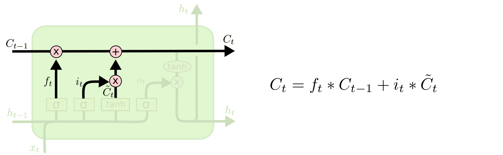
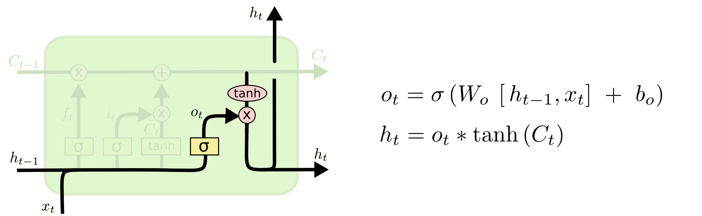

# Step-by-Step LSTM Walk Through

> Section 6 of 10 from [09 - Understanding LSTM Networks](../../papers/09-understanding-lstm-networks.md) · `other` · pages n/a

The first step in our LSTM is to decide what information we’re going to throw away from the cell state. This decision is made by a sigmoid layer called the “forget gate layer.” It looks at ht−1ht−1 and xtxt, and outputs a number between 00 and 11 for each number in the cell state Ct−1Ct−1. A 11 represents “completely keep this” while a 00 represents “completely get rid of this.”

Let’s go back to our example of a language model trying to predict the next word based on all the previous ones. In such a problem, the cell state might include the gender of the present subject, so that the correct pronouns can be used. When we see a new subject, we want to forget the gender of the old subject.

The next step is to decide what new information we’re going to store in the cell state. This has two parts. First, a sigmoid layer called the “input gate layer” decides which values we’ll update. Next, a tanh layer creates a vector of new candidate values, C~tC~t, that could be added to the state. In the next step, we’ll combine these two to create an update to the state.

In the example of our language model, we’d want to add the gender of the new subject to the cell state, to replace the old one we’re forgetting.

It’s now time to update the old cell state, Ct−1Ct−1, into the new cell state CtCt. The previous steps already decided what to do, we just need to actually do it.

We multiply the old state by ftft, forgetting the things we decided to forget earlier. Then we add it∗C~tit∗C~t. This is the new candidate values, scaled by how much we decided to update each state value.

In the case of the language model, this is where we’d actually drop the information about the old subject’s gender and add the new information, as we decided in the previous steps.

Finally, we need to decide what we’re going to output. This output will be based on our cell state, but will be a filtered version. First, we run a sigmoid layer which decides what parts of the cell state we’re going to output. Then, we put the cell state through tanhtanh (to push the values to be between −1−1 and 11) and multiply it by the output of the sigmoid gate, so that we only output the parts we decided to.

For the language model example, since it just saw a subject, it might want to output information relevant to a verb, in case that’s what is coming next. For example, it might output whether the subject is singular or plural, so that we know what form a verb should be conjugated into if that’s what follows next.

---

Full document: [09 - Understanding LSTM Networks](../../papers/09-understanding-lstm-networks.md) · Page-level evidence: [paper-pages/09-understanding-lstm-networks](../../paper-pages/09-understanding-lstm-networks/index.md)
