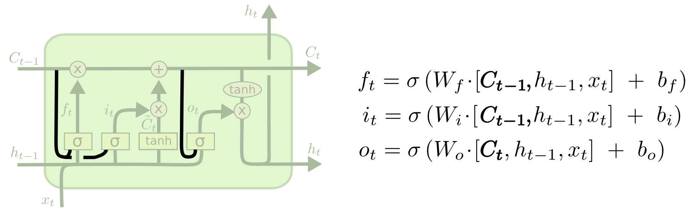
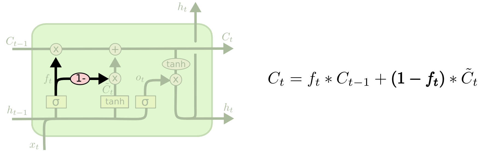
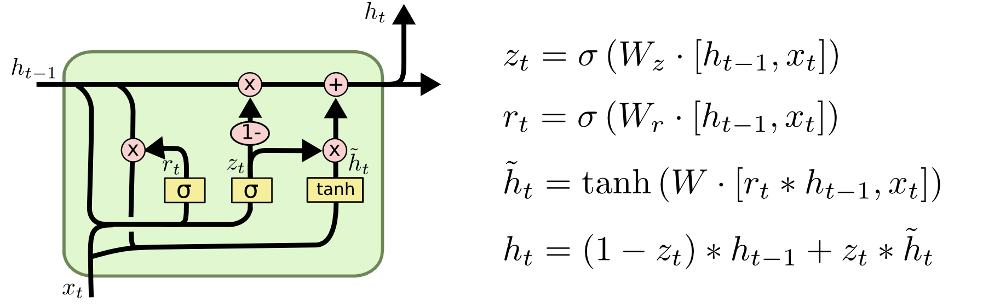

# Variants on Long Short Term Memory

> Section 7 of 10 from [09 - Understanding LSTM Networks](../../papers/09-understanding-lstm-networks.md) · `other` · pages n/a

What I’ve described so far is a pretty normal LSTM. But not all LSTMs are the same as the above. In fact, it seems like almost every paper involving LSTMs uses a slightly different version. The differences are minor, but it’s worth mentioning some of them.

One popular LSTM variant, introduced by [Gers & Schmidhuber (2000)](ftp://ftp.idsia.ch/pub/juergen/TimeCount-IJCNN2000.pdf), is adding “peephole connections.” This means that we let the gate layers look at the cell state.

The above diagram adds peepholes to all the gates, but many papers will give some peepholes and not others.

Another variation is to use coupled forget and input gates. Instead of separately deciding what to forget and what we should add new information to, we make those decisions together. We only forget when we’re going to input something in its place. We only input new values to the state when we forget something older.

A slightly more dramatic variation on the LSTM is the Gated Recurrent Unit, or GRU, introduced by [Cho, et al. (2014)](http://arxiv.org/pdf/1406.1078v3.pdf). It combines the forget and input gates into a single “update gate.” It also merges the cell state and hidden state, and makes some other changes. The resulting model is simpler than standard LSTM models, and has been growing increasingly popular.

These are only a few of the most notable LSTM variants. There are lots of others, like Depth Gated RNNs by [Yao, et al. (2015)](http://arxiv.org/pdf/1508.03790v2.pdf). There’s also some completely different approach to tackling long-term dependencies, like Clockwork RNNs by [Koutnik, et al. (2014)](http://arxiv.org/pdf/1402.3511v1.pdf).

Which of these variants is best? Do the differences matter? [Greff, et al. (2015)](http://arxiv.org/pdf/1503.04069.pdf) do a nice comparison of popular variants, finding that they’re all about the same. [Jozefowicz, et al. (2015)](http://jmlr.org/proceedings/papers/v37/jozefowicz15.pdf) tested more than ten thousand RNN architectures, finding some that worked better than LSTMs on certain tasks.

---

Full document: [09 - Understanding LSTM Networks](../../papers/09-understanding-lstm-networks.md) · Page-level evidence: [paper-pages/09-understanding-lstm-networks](../../paper-pages/09-understanding-lstm-networks/index.md)
