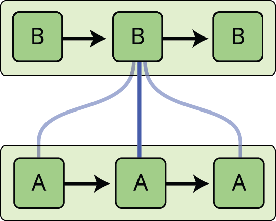
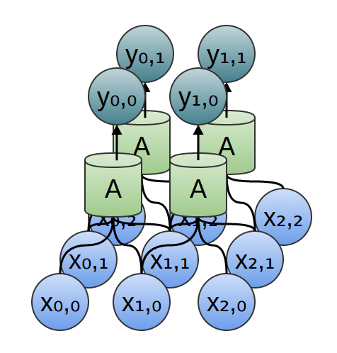
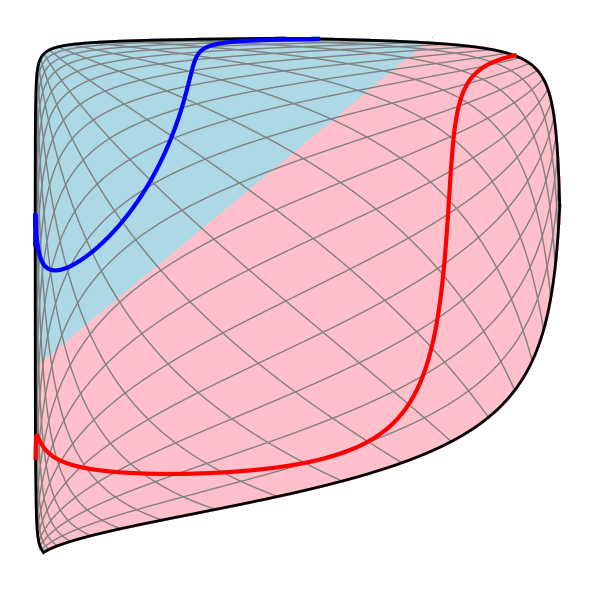
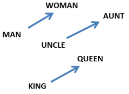

# More Posts

> Section 10 of 10 from [09 - Understanding LSTM Networks](../../papers/09-understanding-lstm-networks.md) · `other` · pages n/a

[**Attention and Augmented Recurrent Neural Networks**  **_On Distill_**](http://distill.pub/2016/augmented-rnns/) [**Conv Nets**  **A Modular Perspective**](https://colah.github.io/posts/2014-07-Conv-Nets-Modular/) [**Neural Networks, Manifolds, and Topology**](https://colah.github.io/posts/2014-03-NN-Manifolds-Topology/) [**Deep Learning, NLP, and Representations**](https://colah.github.io/posts/2014-07-NLP-RNNs-Representations/)

---

Full document: [09 - Understanding LSTM Networks](../../papers/09-understanding-lstm-networks.md) · Page-level evidence: [paper-pages/09-understanding-lstm-networks](../../paper-pages/09-understanding-lstm-networks/index.md)
