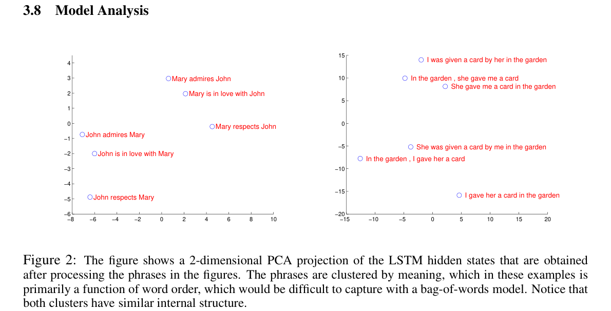

# 3.8 Model Analysis

> Section 15 of 20 from [10 - Sequence to Sequence Learning with Neural Networks](../../papers/10-sequence-to-sequence-learning.md) · `method` · pages 5-6

15

I was given a card by her in the garden

4

She gave me a card in the garden In the garden , she gave me a card

Mary admires John

3

10

Mary is in love with John

2

5

1

0

0

Mary respects John John admires Mary

−1

−5

She was given a card by me in the garden

John is in love with Mary

−2

In the garden , I gave her a card

−3

−10

−4

−15

I gave her a card in the garden

John respects Mary

−5

−8 −6 −4 −2 0 2 4 6 8 10 −6

−15 −10 −5 0 5 10 15 20 −20

Figure 2: The figure shows a 2-dimensional PCA projection of the LSTM hidden states that are obtained after processing the phrases in the figures. The phrases are clustered by meaning, which in these examples is primarily a function of word order, which would be difficult to capture with a bag-of-words model. Notice that both clusters have similar internal structure.

One of the attractive features of our model is its ability to turn a sequence of words into a vector of fixed dimensionality. Figure 2 visualizes some of the learned representations. The figure clearly shows that the representations are sensitive to the order of words, while being fairly insensitive to the

## Type

---

Full document: [10 - Sequence to Sequence Learning with Neural Networks](../../papers/10-sequence-to-sequence-learning.md) · Page-level evidence: [paper-pages/10-sequence-to-sequence-learning](../../paper-pages/10-sequence-to-sequence-learning/index.md)
