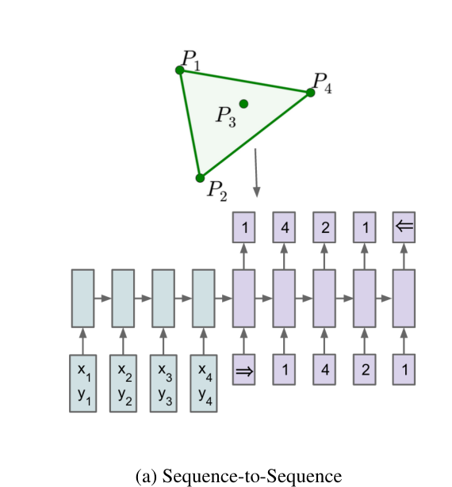
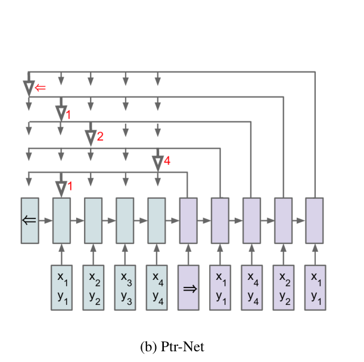

# 1 Introduction

> Section 3 of 18 from [12 - Pointer Networks](../../papers/12-pointer-networks.md) · `introduction` · pages 1-1

Recurrent Neural Networks (RNNs) have been used for learning functions over sequences from examples for more than three decades \[3\]. However, their architecture limited them to settings where the inputs and outputs were available at a fixed frame rate (e.g. \[4\]). The recently introduced sequence-to-sequence paradigm \[1\] removed these constraints by using one RNN to map an input sequence to an embedding and another (possibly the same) RNN to map the embedding to an output sequence. Bahdanau et. al. augmented the decoder by propagating extra contextual information from the input using a content-based attentional mechanism \[5, 2, 6\]. These developments have made it possible to apply RNNs to new domains, achieving state-of-the-art results in core problems in natural language processing such as translation \[1, 5\] and parsing \[7\], image and video captioning \[8, 9\], and even learning to execute small programs \[2, 10\].

Nonetheless, these methods still require the size of the output dictionary to be fixed a priori. Because of this constraint we cannot directly apply this framework to combinatorial problems where the size of the output dictionary depends on the length of the input sequence. In this paper, we address this limitation by repurposing the attention mechanism of \[5\] to create pointers to input elements. We show that the resulting architecture, which we name Pointer Networks (Ptr-Nets), can be trained to output satisfactory solutions to three combinatorial optimization problems – computing planar convex hulls, Delaunay triangulations and the symmetric planar Travelling Salesman Problem (TSP). The resulting models produce approximate solutions to these problems in a purely data driven fash-

∗Equal contribution

(b) Ptr-Net

(a) Sequence-to-Sequence

Figure 1: (a) Sequence-to-Sequence - An RNN (blue) processes the input sequence to create a code vector that is used to generate the output sequence (purple) using the probability chain rule and another RNN. The output dimensionality is fixed by the dimensionality of the problem and it is the same during training and inference \[1\]. (b) Ptr-Net - An encoding RNN converts the input sequence to a code (blue) that is fed to the generating network (purple). At each step, the generating network produces a vector that modulates a content-based attention mechanism over inputs (\[5, 2\]). The output of the attention mechanism is a softmax distribution with dictionary size equal to the length of the input.

ion (i.e., when we only have examples of inputs and desired outputs). The proposed approach is depicted in Figure 1.

The main contributions of our work are as follows:

• We propose a new architecture, that we call Pointer Net, which is simple and effective. It deals with the fundamental problem of representing variable length dictionaries by using a softmax probability distribution as a “pointer”. • We apply the Pointer Net model to three distinct non-trivial algorithmic problems involving geometry. We show that the learned model generalizes to test problems with more points than the training problems. • Our Pointer Net model learns a competitive small scale (n ≤50) TSP approximate solver. Our results demonstrate that a purely data driven approach can learn approximate solutions to problems that are computationally intractable.

---

Full document: [12 - Pointer Networks](../../papers/12-pointer-networks.md) · Page-level evidence: [paper-pages/12-pointer-networks](../../paper-pages/12-pointer-networks/index.md)
