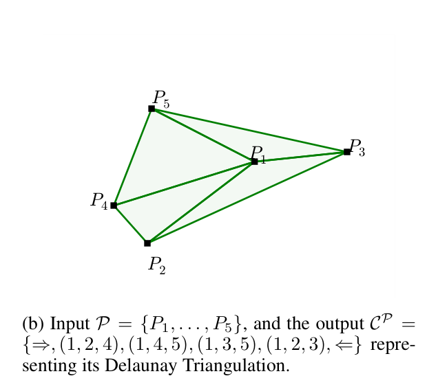
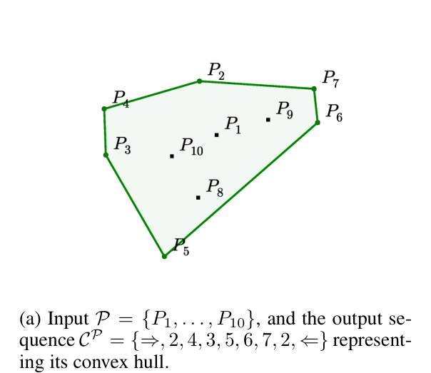

# 3.1 Convex Hull

> Section 9 of 18 from [12 - Pointer Networks](../../papers/12-pointer-networks.md) · `other` · pages 3-4

We used this example as a baseline to develop our models and to understand the difficulty of solving combinatorial problems with data driven approaches. Finding the convex hull of a finite number of points is a well understood task in computational geometry, and there are several exact solutions available (see \[13, 14, 15\]). In general, finding the (generally unique) solution has complexity O(n log n), where n is the number of points considered.

The vectors Pj are uniformly sampled from \[0, 1\] × \[0, 1\]. The elements Ci are indices between 1 and n corresponding to positions in the sequence P, or special tokens representing beginning or end of sequence. See Figure 2 (a) for an illustration. To represent the output as a sequence, we start from the point with the lowest index, and go counter-clockwise – this is an arbitrary choice but helps reducing ambiguities during training.

1We release all the datasets at http://goo.gl/NDcOIG.

P5

P3

P1

P4

P2

(b) Input P = {P1, . . . , P5}, and the output CP = {⇒, (1, 2, 4), (1, 4, 5), (1, 3, 5), (1, 2, 3), ⇐} representing its Delaunay Triangulation.

(a) Input P = {P1, . . . , P10}, and the output sequence CP = {⇒, 2, 4, 3, 5, 6, 7, 2, ⇐} representing its convex hull.

Figure 2: Input/output representation for (a) convex hull and (b) Delaunay triangulation. The tokens ⇒and ⇐represent beginning and end of sequence, respectively.

---

Full document: [12 - Pointer Networks](../../papers/12-pointer-networks.md) · Page-level evidence: [paper-pages/12-pointer-networks](../../paper-pages/12-pointer-networks/index.md)
