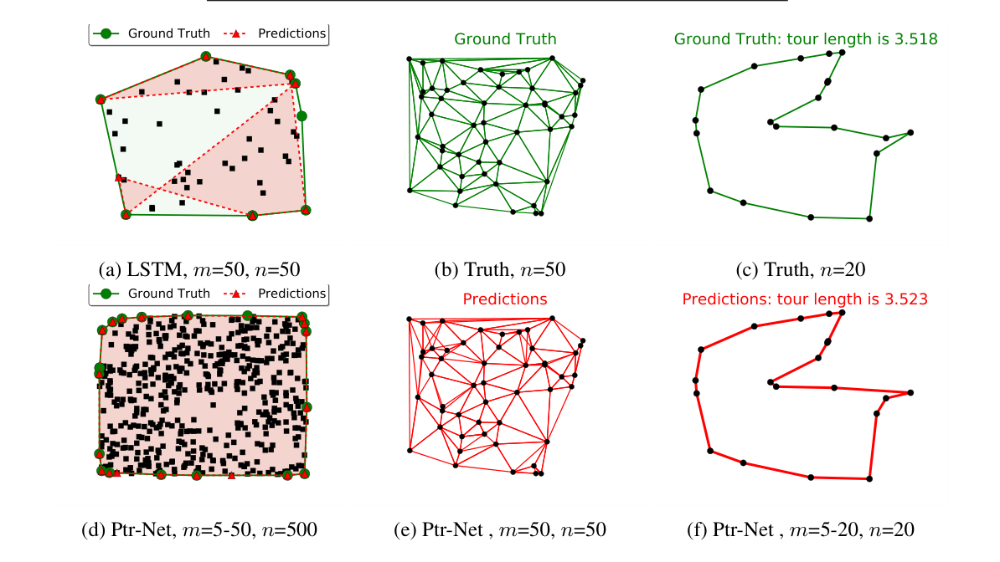

# 4.3 Delaunay Triangulation

> Section 14 of 18 from [12 - Pointer Networks](../../papers/12-pointer-networks.md) · `other` · pages 5-6

The Delaunay Triangulation test case is connected to our first problem of finding the convex hull. In fact, the Delaunay Triangulation for a given set of points triangulates the convex hull of these points.

We reported two metrics: accuracy and triangle coverage in percentage (the percentage of triangles the model predicted correctly). Note that, in this case, for an input point set P, the output sequence C(P) is, in fact, a set. As a consequence, any permutation of its elements will represent the same triangulation.

Table 1: Comparison between LSTM, LSTM with attention, and our Ptr-Net model on the convex hull problem. Note that the baselines must be trained on the same n that they are tested on.

METHOD TRAINED n n ACCURACY AREA

LSTM \[1\] 50 50 1.9% FAIL +ATTENTION \[5\] 50 50 38.9% 99.7% PTR-NET 50 50 72.6% 99.9% LSTM \[1\] 5 5 87.7% 99.6% PTR-NET 5-50 5 92.0% 99.6% LSTM \[1\] 10 10 29.9% FAIL PTR-NET 5-50 10 87.0% 99.8% PTR-NET 5-50 50 69.6% 99.9% PTR-NET 5-50 100 50.3% 99.9% PTR-NET 5-50 200 22.1% 99.9% PTR-NET 5-50 500 1.3% 99.2%

Ground Truth Predictions

Ground Truth

Ground Truth: tour length is 3.518

(a) LSTM, m=50, n=50

(b) Truth, n=50

(c) Truth, n=20

Ground Truth Predictions

Predictions

Predictions: tour length is 3.523

(d) Ptr-Net, m=5-50, n=500

(e) Ptr-Net , m=50, n=50

(f) Ptr-Net , m=5-20, n=20

Figure 3: Examples of our model on Convex hulls (left), Delaunay (center) and TSP (right), trained on m points, and tested on n points. A failure of the LSTM sequence-to-sequence model for Convex hulls is shown in (a). Note that the baselines cannot be applied to a different length from training. Using the Ptr-Net model for n = 5, we obtained an accuracy of 80.7% and triangle coverage of 93.0%. For n = 10, the accuracy was 22.6% and the triangle coverage 81.3%. For n = 50, we did not produce any precisely correct triangulation, but obtained 52.8% triangle coverage. See the middle column of Figure 3 for an example for n = 50.

---

Full document: [12 - Pointer Networks](../../papers/12-pointer-networks.md) · Page-level evidence: [paper-pages/12-pointer-networks](../../paper-pages/12-pointer-networks/index.md)
