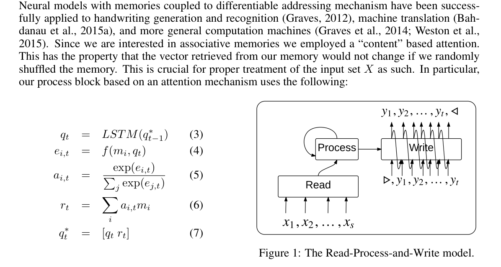

# 4 INPUT SETS

> Section 6 of 9 from [13 - Order Matters: Sequence to Sequence for Sets](../../papers/13-order-matters-sequence-to-sequence-for-sets.md) · `other` · pages 2-5

We first study extensions to encoding (reading) sets. As we discussed in the previous section, sequences can be read with a recurrent neural network which can compress its contents into a vector. An important invariance property that must be satisfied when the input is a set (i.e., the order does not matter) is that swapping two elements xi and xj in the set X should not alter its encoding.

A simple approach which satisfies this, and which in fact has been commonly used for encoding sentences, is the bag-of-words approach. In this case, the representation is simply a reduction (e.g., addition) of counts, word embeddings, or similar embedding functions, and is naturally permutation invariant. For language and other domains which are naturally sequential, this is replaced with more complex encoders such as recurrent neural networks that take order into account and model higher order statistics of the data.

An unsatisfying property of using a reduction operation (such as addition) is that it makes the representation quite inefficient: the model operates over a fixed dimensional embedding regardless of the length of the set. It is unlikely that such representation will succeed, as the amount of memory required to encode a length T set (or sequence, for that matter) should increase as a function of T. Thus, we argue that even deep convolutional architectures will suffer from this limitation – though some modifications exist (Maas et al., 2012).

In our work, we largely rely on attention mechanisms to integrate information from a variable length structure, which we describe in Section 4.2.

4.1 INPUT ORDER MATTERS

In this section, we highlight prior work where we observed that the order of inputs impacted the performance of seq2seq models taking sequences as input. In principle, order should not matter when using a complex encoder such as a recurrent neural network, as these are universal approximators that can encode complex features from the input sequence (e.g., n-grams of any order). We believe that the reason order seems to matter is due to the underlying non-convex optimization and more suitable prior.

The first example which we experimented with was altering the order of sequences in the context of machine translation. In machine translation, the mapping function encodes a sentence in a source language (e.g., English), and decodes it to its translation in a target language (e.g., French). By reversing the order of the input English sentence, Sutskever et al. (2014) got a 5.0 BLEU score improvement which allowed them to close the gap between their model – a fully end-to-end model for machine translation – and state-of-the-art models which were highly engineered. Similarly, for constituency parsing, in which the mapping is from an English sentence to a flattened version of its constituency parse tree, a 0.5% absolute increase in F1 score was observed when reversing the English sentence (Vinyals et al., 2015b).

Furthermore, if we preprocess the data for, e.g., convex hull computation that was presented in Vinyals et al. (2015a) by sorting the points by angle, the task becomes simpler (from O(n log n) to O(n)), and as a result the models obtained are much faster to train and better (increasing accuracy by up to 10% absolute in the most challenging cases).

All these empirical findings point to the same story: often for optimization purposes, the order in which input data is shown to the model has an impact on the learning performance.

Note that we can define an ordering which is independent of the input sequence or set X (e.g., always reversing the words in a translation task), but also an ordering which is input dependent (e.g., sorting the input points in the convex hull case). This distinction also applies in the discussion about output sequences and sets in Section 5.1.

Recent approaches which pushed the seq2seq paradigm further by adding memory and computation to these models allowed us to define a model which makes no assumptions about input ordering, whilst preserving the right properties which we just discussed: a memory that increases with the size of the set, and which is order invariant. In the next sections, we explain such a modification, which could also be seen as a special case of a Memory Network (Weston et al., 2015) or Neural Turing Machine (Graves et al., 2014) – with a computation flow as depicted in Figure 1.

4.2 ATTENTION MECHANISMS

Neural models with memories coupled to differentiable addressing mechanism have been successfully applied to handwriting generation and recognition (Graves, 2012), machine translation (Bahdanau et al., 2015a), and more general computation machines (Graves et al., 2014; Weston et al., 2015). Since we are interested in associative memories we employed a “content” based attention. This has the property that the vector retrieved from our memory would not change if we randomly shuffled the memory. This is crucial for proper treatment of the input set X as such. In particular, our process block based on an attention mechanism uses the following:

qt = LSTM(q∗

t−1) (3) ei,t = f(mi, qt) (4)

Process Write

ai,t = exp(ei,t) P

j exp(ej,t) (5)

Read

X

rt =

ai,tmi (6)

i

q∗

t = \[qt rt\] (7)

Figure 1: The Read-Process-and-Write model.

where i indexes through each memory vector mi (typically equal to the cardinality of X), qt is a query vector which allows us to read rt from the memories, f is a function that computes a single scalar from mi and qt (e.g., a dot product), and LSTM is an LSTM which computes a recurrent state but which takes no inputs. q∗

t is the state which this LSTM evolves, and is formed by concatenating the query qt with the resulting attention readout rt. t is the index which indicates how many “processing steps” are being carried to compute the state to be fed to the decoder. Note that permuting mi and mi′ has no effect on the read vector rt.

4.3 READ, PROCESS, WRITE

Our model, which naturally handles input sets, has three components (the exact equations and implementation will be released in an appendix prior to publication):

• A reading block, which simply embeds each element xi ∈X using a small neural network onto a memory vector mi (the same neural network is used for all i).

• A process block, which is an LSTM without inputs or outputs performing T steps of computation over the memories mi. This LSTM keeps updating its state by reading mi repeatedly using the attention mechanism described in the previous section. At the end of this block, its hidden state q∗

T is an embedding which is permutation invariant to the inputs. See eqs. (3)-(7) for more details.

• A write block, which is an LSTM pointer network (Vinyals et al., 2015a) that takes in q∗ T (as the context it needs from which to produce the output from the input set), and points at elements of mi (implicitly, xi), one step at a time. The original work in Vinyals et al. (2015a) used a pointer mechanism which, instead of issuing a readout of memory by a weighted sum with a soft pointer (see eq. 6), it uses the pointer as part of the loss. We extended this by adding an extra attention step before the pointer (we called this glimpse). This is related to the process block described above, but with the difference that the attention reads happen interleaved between each pointer output. As described later in the results, we found these two mechanisms to complement each other.

The architecture is depicted in Figure 1 and can be seen as a special case of a Neural Turing Machine or Memory Network. It satisfies the key property of being invariant to the order of the elements in X, thus effectively processing the inputs as a set. Also note that the write component could simply be an LSTM if the outputs were from a fixed dictionary. For this model, though, we study combinatorial problems where the outputs are pointers to the inputs, so we use a pointer network.

4.4 SORTING EXPERIMENT

In order to verify if our model handles sets more efficiently than the vanilla seq2seq approach, we ran the following experiment on artificial data for the task of sorting numbers: given N unordered random floating point numbers between 0 and 1, we return them in a sorted order. Note that this problem is an instance of set2seq. We used the architecture defined in Figure 1, where the Read module is a small multilayer perceptron for each number, the Process module is an attention mechanism over the read numbers, implemented as T steps over an LSTM with no input nor output, but attending the input embeddings, followed by an LSTM to produce indices in the input numbers with a pointer network (Vinyals et al., 2015a), in the proper sorted order. We also compared this architecture with a vanilla seq2seq architecture made of an input LSTM connected to an output LSTM which produces indices in the input numbers with a pointer network (Ptr-Net). Note that the only difference between these two models is the encoding of the set using either an LSTM (as in previous work), or with the architecture proposed in the previous section. We ran multiple experiments, varying the number N of numbers to sort, as well as the number T of processing steps of the Read, Process, Write model.

The out-of-sample accuracies (whether we succeeded in sorting all numbers or not) of these experiments are summarized in Table 1. We can see that the baseline pointer network LSTM input model is better than the Read-Process-and-Write model when no processing steps (P = 0 step) are used, but as soon as at least one processing step is allowed, the performance of the Read-Process-and-Write model gets better, increasing with the number of processing steps. We can also see that, as the size of the task (expressed in the number of elements to sort N) grows, the performance gets worse, as expected. Also note that with 0 processing steps and 0 glimpses, the writing module is effectively unconditioned on X and has to “blindly” point at the elements of X. Thus, it is unsurprising to see it performing worse than any other model considered in Table 1. Lastly, equipping the writing module with glimpses (i.e., adding an attention mechanism prior to “pointing”) improves both the baseline model (Ptr-Net), and our proposed modification quite significantly (in the most challenging cases, it more than doubles accuracy).

Table 1: The sorting experiment: out-of-sample sorting accuracy for various problem sizes and processing steps, with or without glimpses. All the reported accuracies are shown after reaching 10000 training iterations, at which point all models had converged but none overfitted. Higher is better.

Length N Ptr-Net P = 0 step P = 1 step P = 5 steps P = 10 steps glimpses 0 1 0 1 0 1 0 1 0 1 N = 5 81% 90% 65% 84% 84% 92% 88% 94% 90% 94% N = 10 8% 28% 7% 30% 14% 44% 17% 57% 19% 50% N = 15 0% 4% 1% 2% 0% 5% 2% 4% 0% 10%

---

Full document: [13 - Order Matters: Sequence to Sequence for Sets](../../papers/13-order-matters-sequence-to-sequence-for-sets.md) · Page-level evidence: [paper-pages/13-order-matters-sequence-to-sequence-for-sets](../../paper-pages/13-order-matters-sequence-to-sequence-for-sets/index.md)
