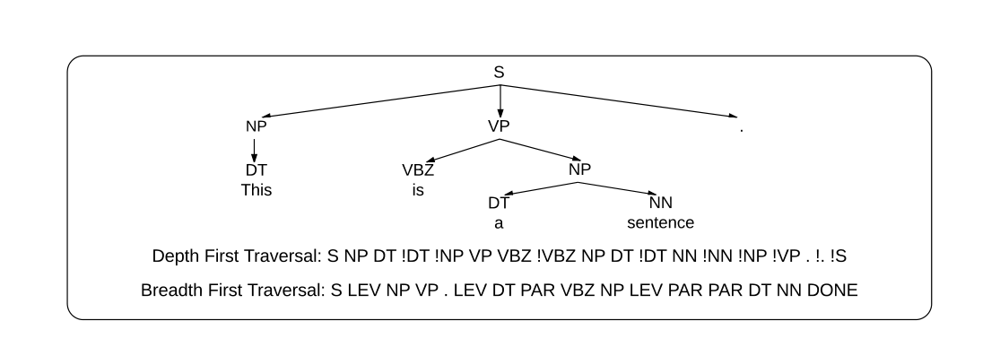

# 5 OUTPUT SETS

> Section 7 of 9 from [13 - Order Matters: Sequence to Sequence for Sets](../../papers/13-order-matters-sequence-to-sequence-for-sets.md) · `other` · pages 5-9

So far, we have considered the problem of encoding input sets; let us now turn our attention to output representations. The chain rule which describes joint probabilities over sets of random variables Y is, perhaps, the simplest decomposition of the joint probability which does not incur arbitrary restrictions (such as conditional independence). Thus, as long as a powerful model that is trainable exists (which can cope with long range correlations), any order should work without any prior order information of the underlying problem that generated Y . Despite this, and even when a very powerful model (in terms of modeling power, and resilience to vanishing long term gradients) like the LSTM is employed, output ordering still plays a key role in successfully training models.

In the next subsection, we describe how the order in which we apply the chain rule affects the performance on various tasks.

5.1 OUTPUT ORDER MATTERS

Let Y be a set (or a sequence). In this section, we will study the effect that ordering has on the performance of seq2seq models on several tasks. Namely, we will consider arbitrary (and non-arbitrary) orders over the variables in Y , and model the conditional probability distribution P(Y |X) following that order for all training examples. As we will see, order matters (even when considering that the formulation through the chain rule works regardless of the ordering of Y , at least in principle).

5.1.1 LANGUAGE MODELING

For this experiment, we use the PennTree Bank, which is a standard language modeling benchmark. This dataset is quite small for language modeling standards, so most models are data starved. We trained medium sized LSTMs with large amounts of regularization (see medium model from Zaremba et al. (2014)) to estimate probabilities over sequences of words. We consider three version of the dataset with three orderings: natural, reverse, and a fixed, 3-word reversal:

Natural: “This is a sentence .” Reverse: “. sentence a is This” 3-word: “a is This <pad> . sentence”

Note that the 3-word reversal destroys the underlying structure of the sentence, and makes modeling the joint probability much more difficult since many higher order n-grams are scrambled. For each ordering we trained a different model. The results for both natural and reverse matched each other at 86 perplexity on the development set (using the same setup as Zaremba et al. (2014)). Surprisingly, the 3-word reversal degraded only 10 perplexity points, still achieving an impressive result in this corpus at 96 perplexity. We note, however, that training perplexities were also 10 points higher, which indicates that the model had trouble handling the awkward ordering. Thus, even when considering that the chain rule still properly models the joint probability, some degradation was observed when a confounding ordering was chosen.

5.1.2 PARSING

The task of constituency parsing consists in producing a parse tree given a sentence. The model proposed by Vinyals et al. (2015b) is a sentence encoder LSTM followed by a decoder LSTM trained to generate a depth first traversal encoding of the parse tree, using an attention mechanism. This approach matched state-of-the-art results on this task.

Even though it seemed more sensible, depth first traversal is only one of the many ways one can uniquely encode a tree onto a sequence. We thus tried to train a small model using depth first traversal (which matches the baseline of Vinyals et al. (2015b)) and another one using breadth first traversal (note that these orderings are input dependent). See Figure 2 for an example on how the tree linearizes under both traversal schemes. The model trained to produce depth first traversal linearized trees obtained 89.5% F1 score (as reported by Vinyals et al. (2015b)), whereas the one producing breadth first traversal trees had a much lower F1 score at 81.5%,1 showing again the importance of picking the right output ordering.

1In fact, in many cases the decoder failed to produce a valid tree, so the real F1 score is likely lower.

S

. VP

NP

NP

DT This

VBZ

is

NN sentence

DT

a

Depth First Traversal: S NP DT !DT !NP VP VBZ !VBZ NP DT !DT NN !NN !NP !VP . !. !S

Breadth First Traversal: S LEV NP VP . LEV DT PAR VBZ NP LEV PAR PAR DT NN DONE

Figure 2: Depth first and breadth first linearizations of a parse tree which shows our different setups for output ordering in the parsing task.

5.1.3 COMBINATORIAL PROBLEMS

Unlike in the previous two examples, a problem that more commonly comes up as we try to represent non-sequential data (like tours, triangulations, etc., discussed by (Vinyals et al., 2015a)), is the fact that there may exist a large equivalence class of solutions.

Take, as an example, outputting the indices for the sorted inputs of a set of random numbers, X. Indeed, this is a deterministic function. We can choose to output these indices in some order (e.g., increasing, decreasing, or using any arbitrary fixed permutation), or treat them as a set (a tuple of argsort indices with corresponding ranking). As a result, there are n! possible outputs for a given X, all of which are perfectly valid. If our training set is generated with any of these permutations picked uniformly at random, our mapping (when perfectly trained) will have to place equal probability on n! output configurations for the same input X. Thus, this formulation is much less statistically efficient.

In previous work (Vinyals et al., 2015a), it was found that restricting as much as possible the equivalence class for the outputs was always better. For instance, to output a tour (i.e. a sequence of cities one has to visit for the traveling salesman problem), we started from the lower indexed city (i.e., the first city that we input), and followed a counter-clockwise ordering. Similarly, to output a set of triangles (which triangulate the set of input points), we sorted them in lexicographical order and moved left to right. In all cases, improvements of 5% absolute accuracy or more were observed.

Failing to restrict the output equivalence class generally implies much slower convergence (and, thus, requires much more training data). For instance, for sorting, if considering the outputs as sets which we output in any of the possible n! orderings, convergence for n as small as 5 never reached the same performance.

5.1.4 GRAPHICAL MODELS

Let us consider the joint probability of a set of T random variables P(y1, y2, . . . , yT ). Having no prior on how these random variables interact with each other, one way to model their joint probability is to use the chain rule as follows:

T Y

P(yt|y1, y2, . . . , yt−1) (8)

P(y1, y2, . . . , yT ) =

t=1

and model this using an RNN, similar to RNN language models.

While for sentences the natural order of words gives a good clue of how to order the random variables in the model, for other kind of data it might be harder to decide on it. Furthermore, in theory, the order should not matter, because of Bayes rule which lets us reorder all the conditional probabilities as needed. In practice however, it might be that one order is easier to model than another, as we have shown in this paper.

The purpose of this experiment is to demonstrate this using a controlled toy experiment. We generated star-like graphical models over random variables where one variable (the head) follows an unconditional distribution, while the others follow a conditional distribution based on the value of

the head variable. We expect that it should be easier to model the joint distribution by choosing any ordering which starts with the head variable. We created several artificial datasets by varying the number of random variables to model (between 10 and 50, each of which was a multinomial over 10 symbols), the training set size (between 200 and 20000 training samples), and the randomness of the marginal distributions, or how deterministic, or peaky, they were. For each problem, we trained two LSTMs for 10,000 mini-batch iterations to model the joint probability, one where the head random variable was shown first, and one where it was shown last.

The results were as follows:

• when the training set size is large enough (20000), the LSTM is able to learn the joint probability in whichever order;

• when the marginal distributions are very peaky (and thus almost deterministic), the LSTM is also able to learn the joint probability independently of the order;

• in all other cases (small training set size, small or large number of random variables, and some amount of randomness in the marginal distributions), it was always easier to learn an LSTM with the optimal order of random variables than any other order.

5.2 FINDING OPTIMAL ORDERINGS WHILE TRAINING

Recall the model we proposed for dealing with input sets: given an embedding for each of the inputs, we have a generic module that is able to process its inputs in any order. This yields an embedding satisfying the key property of being invariant to reorderings, whilst being generic in the kinds of computations to do over the input set.

Unfortunately, placing a joint probability over a set of random variables y1, . . . yn when the structure of the joint probability function is unknown is a hard problem. Fortunately, and thanks to recurrent neural networks, we can apply the chain rule which decomposes this joint probability sequentially (see eq. 8) without independence assumptions. In this work, we focus on using the chain rule, discarding more naive decompositions that have strong and unrealistic assumptions (e.g., conditional independence).

An obvious drawback of the chain rule which violates the argument of treating y1, . . . yn as a set is that we condition these random variables in a particular order. Even though, in principle, the order should not matter, in the previous section we have shown that this is indeed not the case, and that certain orderings are better than others in a variety of tasks – most likely due to the parameterization of the joint probability (using an LSTM), and the non-convex nature of the optimization problem.

Our proposed solution to deal with the aforementioned drawback is extremely simple: as we train, we let the model decide which is the best ordering in which it will apply the chain rule. More formally, assume there exists an ordering which maximally simplifies the task, π(X) (where X is the input sequence or set, which can be empty). We would like to train the model as p(Yπ(X)|X). The number of possible orderings is large – n! where n is the length of the output, and the best order is unknown a priori.

Since n! can be very large, we could attempt to do (inexact) search as we train the model. Instead of maximizing the log probability of p(Y |X) for each training example pair, we also maximize over orderings as follows:

X

θ⋆= arg max

max π(Xi) log p(Yπ(Xi)|Xi; θ) (9)

θ

i

where maxπ(Xi) is computed either naively, or with an inexact search. Note that Equation (9) may not strictly improve the regular maximum likelihood framework due to non-convexity, but we found this to not be an issue in practice.

Besides not being scalable, we found that, if done naively and picking the max over ordering as we train, the model would pick a random ordering (as a function of the initial parameters), and would get stuck on it permanently (since it would reinforce it through learning). We added two ways to explore the space of all orderings as follows:

• We pretrain the model with a uniform prior over π(X) for 1000 steps, which amounts to replacing the maxπ(Xi) in eq. (9) by a P

π(Xi).

• We then pick an ordering by sampling π(X) according to a distribution proportional to p(Yπ(X)|X). This costs O(1) model evaluations (vs. naive search which would be O(n!)).

Crucially, sampling p(Yπ(X)|X) can be done very efficiently as we can use ancestral sampling (leftto-right) which requires to evaluate p(.) only once instead of n!.

5.2.1 5-GRAM MODELING

In our initial attempt to solve (9), we considered a simplified version of the language modeling task described in Section 5.1.1. The simplified task consists of modeling the joint probability of 5grams without any further context (i.e., there is no input X). This choice allowed us to have a small enough n as initially we were trying to exactly find the best ordering out of the n! possible ones. Thus, we disregarded possible effects of inexact search, and focused on the essential of the training dynamics where the model being optimized picks the best ordering π which maximizes p(Yπ) under its current parameters, and reinforces that ordering by applying updates on the gradient of log p(Yπ) w.r.t. the parameters. Eventually, as noted in Section 5.2, we found sampling to be superior in terms of convergence, whilst simplifying the complexity from O(n!) down to O(1), and is the preferred solution which we used in the rest of this section.

To test this framework, we converted 5-grams (i.e., sequences of words) to a set in the following way:

5-gram (sequence): y1=This, y2=is, y3=a, y4=five, y5=gram 5-gram (set): y1=(This,1), y2=(is,2), y3=(a,3), y4=(five,4), y5=(gram,5)

Note that adding the original position alongside the words makes Y a set. Thus, we can shuffle Y in arbitrarily without losing the original structure of the sequence. The first experiment, which reinforces our result in Section 5.1.1, tests the hypothesis once again that order matters. Training a model which follows the natural order (i.e., produces (This,1), followed by (is,2) conditioned on (This,1), etc.), achieves a validation perplexity of 225.2 If, instead of picking (1, 2, 3, 4, 5), we use (5, 1, 3, 4, 2), perplexity drops to 280.

We then test optimization of eq. (9) in two setups:

Easy: The training set contains examples from (1, 2, 3, 4, 5) and (5, 1, 3, 4, 2), uniformly sampled. Hard: The training set contains examples from the 5! possible orderings, uniformly sampled.

Our results are shown in Table 2. Note that, in the easy case, we restrict the search space over orderings to only 2, where one order is clearly better than the other. We note that, after the pretraining phase, we decide which of the two orderings is better to represent the data under the model being trained. Very quickly, the model settles on the natural (1, 2, 3, 4, 5) ordering, yielding a perplexity of 225. In the most difficult case, where any order is possible, the model settles to orders such as (1, 2, 3, 4, 5), (5, 4, 3, 2, 1), and small variations of them. In all cases, the final perplexity is 225. Thus, the framework we propose is able to find good orderings without any prior knowledge. We plan to not only recover optimal orderings, but find ones that were unknown to us when applying the seq2seq framework naively.

Table 2: Experiments in which the model finds the optimal ordering of a set for the 5-gram language modeling task. Perplexities are reported on the validation set (lower is better).

Task Orders considered Perplexity (1, 2, 3, 4, 5) 1 225 (5, 1, 3, 4, 2) 1 280 Easy 2 225 Hard 5! 225

2This is much worse than the results reported in Section 5.1.1 since modeling 5-grams without context is much harder than standard language modeling.

---

Full document: [13 - Order Matters: Sequence to Sequence for Sets](../../papers/13-order-matters-sequence-to-sequence-for-sets.md) · Page-level evidence: [paper-pages/13-order-matters-sequence-to-sequence-for-sets](../../paper-pages/13-order-matters-sequence-to-sequence-for-sets/index.md)
