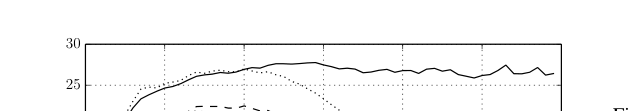

# 4 EXPERIMENT SETTINGS

> Section 6 of 14 from [14 - Neural Machine Translation by Jointly Learning to Align and Translate](../../papers/14-neural-machine-translation-jointly-learning-to-align-and-translate.md) · `experiments` · pages 3-4

We evaluate the proposed approach on the task of English-to-French translation. We use the bilingual, parallel corpora provided by ACL WMT ’14.3 As a comparison, we also report the performance of an RNN Encoder–Decoder which was proposed recently by Cho et al. (2014a). We use the same training procedures and the same dataset for both models.4

4.1 DATASET

WMT ’14 contains the following English-French parallel corpora: Europarl (61M words), news commentary (5.5M), UN (421M) and two crawled corpora of 90M and 272.5M words respectively, totaling 850M words. Following the procedure described in Cho et al. (2014a), we reduce the size of the combined corpus to have 348M words using the data selection method by Axelrod et al. (2011).5 We do not use any monolingual data other than the mentioned parallel corpora, although it may be possible to use a much larger monolingual corpus to pretrain an encoder. We concatenate news-test-

3 http://www.statmt.org/wmt14/translation-task.html 4 Implementations are available at https://github.com/lisa-groundhog/GroundHog. 5 Available online at http://www-lium.univ-lemans.fr/˜schwenk/cslm\_joint\_paper/.

30

25

Figure 2: The BLEU scores of the generated translations on the test set with respect to the lengths of the sentences. The results are on the full test set which includes sentences having unknown words to the models.

20

BLEU score

15

RNNsearch-50 RNNsearch-30 RNNenc-50 RNNenc-30

10

5

0

0 10 20 30 40 50 60 Sentence length

2012 and news-test-2013 to make a development (validation) set, and evaluate the models on the test set (news-test-2014) from WMT ’14, which consists of 3003 sentences not present in the training data.

After a usual tokenization6, we use a shortlist of 30,000 most frequent words in each language to train our models. Any word not included in the shortlist is mapped to a special token (\[UNK\]). We do not apply any other special preprocessing, such as lowercasing or stemming, to the data.

4.2 MODELS

We train two types of models. The first one is an RNN Encoder–Decoder (RNNencdec, Cho et al., 2014a), and the other is the proposed model, to which we refer as RNNsearch. We train each model twice: first with the sentences of length up to 30 words (RNNencdec-30, RNNsearch-30) and then with the sentences of length up to 50 word (RNNencdec-50, RNNsearch-50).

The encoder and decoder of the RNNencdec have 1000 hidden units each.7 The encoder of the RNNsearch consists of forward and backward recurrent neural networks (RNN) each having 1000 hidden units. Its decoder has 1000 hidden units. In both cases, we use a multilayer network with a single maxout (Goodfellow et al., 2013) hidden layer to compute the conditional probability of each target word (Pascanu et al., 2014).

We use a minibatch stochastic gradient descent (SGD) algorithm together with Adadelta (Zeiler, 2012) to train each model. Each SGD update direction is computed using a minibatch of 80 sentences. We trained each model for approximately 5 days.

Once a model is trained, we use a beam search to find a translation that approximately maximizes the conditional probability (see, e.g., Graves, 2012; Boulanger-Lewandowski et al., 2013). Sutskever et al. (2014) used this approach to generate translations from their neural machine translation model.

For more details on the architectures of the models and training procedure used in the experiments, see Appendices A and B.

---

Full document: [14 - Neural Machine Translation by Jointly Learning to Align and Translate](../../papers/14-neural-machine-translation-jointly-learning-to-align-and-translate.md) · Page-level evidence: [paper-pages/14-neural-machine-translation-jointly-learning-to-align-and-translate](../../paper-pages/14-neural-machine-translation-jointly-learning-to-align-and-translate/index.md)
