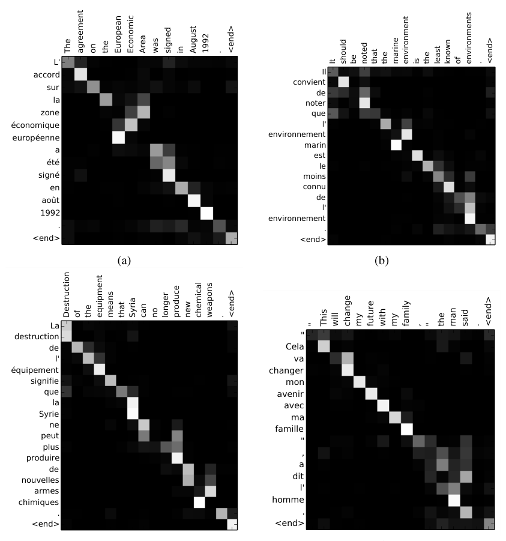

# 5 RESULTS

> Section 7 of 14 from [14 - Neural Machine Translation by Jointly Learning to Align and Translate](../../papers/14-neural-machine-translation-jointly-learning-to-align-and-translate.md) · `results` · pages 4-7

5.1 QUANTITATIVE RESULTS

In Table 1, we list the translation performances measured in BLEU score. It is clear from the table that in all the cases, the proposed RNNsearch outperforms the conventional RNNencdec. More importantly, the performance of the RNNsearch is as high as that of the conventional phrase-based translation system (Moses), when only the sentences consisting of known words are considered. This is a significant achievement, considering that Moses uses a separate monolingual corpus (418M words) in addition to the parallel corpora we used to train the RNNsearch and RNNencdec.

6 We used the tokenization script from the open-source machine translation package, Moses. 7 In this paper, by a ’hidden unit’, we always mean the gated hidden unit (see Appendix A.1.1).

agreement

environments

Economic

European

environment

<end>

August

signed

1992

Area

<end>

marine

was

The

should

known

the

noted

on

least

in

that

.

the

the

be

of

L'

is

It

.

Il convient

accord

sur

de noter

la

zone

que

l' environnement

économique

européenne

marin

a

est

été

le moins connu

signé

en

de

août

l' environnement

1992

.

. <end>

<end>

(a) (b)

Destruction

equipment

chemical

weapons

produce

<end>

means

longer

change

<end>

Syria

family

future

new

that

can

the

man

no

with

said

This

of

will

the

my

my

.

La destruction

"

"

,

.

" Cela

de

va changer

l' équipement

signifie

mon avenir

que

la Syrie

avec

ma famille

ne peut

"

plus produire

, a dit

de nouvelles

l' homme

armes chimiques

. <end>

. <end>

(c) (d)

Figure 3: Four sample alignments found by RNNsearch-50. The x-axis and y-axis of each plot correspond to the words in the source sentence (English) and the generated translation (French), respectively. Each pixel shows the weight αij of the annotation of the j-th source word for the i-th target word (see Eq. (6)), in grayscale (0: black, 1: white). (a) an arbitrary sentence. (b–d) three randomly selected samples among the sentences without any unknown words and of length between 10 and 20 words from the test set.

One of the motivations behind the proposed approach was the use of a fixed-length context vector in the basic encoder–decoder approach. We conjectured that this limitation may make the basic encoder–decoder approach to underperform with long sentences. In Fig. 2, we see that the performance of RNNencdec dramatically drops as the length of the sentences increases. On the other hand, both RNNsearch-30 and RNNsearch-50 are more robust to the length of the sentences. RNNsearch50, especially, shows no performance deterioration even with sentences of length 50 or more. This superiority of the proposed model over the basic encoder–decoder is further confirmed by the fact that the RNNsearch-30 even outperforms RNNencdec-50 (see Table 1).

Table 1: BLEU scores of the trained models computed on the test set. The second and third columns show respectively the scores on all the sentences and, on the sentences without any unknown word in themselves and in the reference translations. Note that RNNsearch-50⋆was trained much longer until the performance on the development set stopped improving. (◦) We disallowed the models to generate \[UNK\] tokens when only the sentences having no unknown words were evaluated (last column).

Model All No UNK◦

RNNencdec-30 13.93 24.19 RNNsearch-30 21.50 31.44 RNNencdec-50 17.82 26.71 RNNsearch-50 26.75 34.16 RNNsearch-50⋆ 28.45 36.15 Moses 33.30 35.63

5.2 QUALITATIVE ANALYSIS

5.2.1 ALIGNMENT

The proposed approach provides an intuitive way to inspect the (soft-)alignment between the words in a generated translation and those in a source sentence. This is done by visualizing the annotation weights αij from Eq. (6), as in Fig. 3. Each row of a matrix in each plot indicates the weights associated with the annotations. From this we see which positions in the source sentence were considered more important when generating the target word.

We can see from the alignments in Fig. 3 that the alignment of words between English and French is largely monotonic. We see strong weights along the diagonal of each matrix. However, we also observe a number of non-trivial, non-monotonic alignments. Adjectives and nouns are typically ordered differently between French and English, and we see an example in Fig. 3 (a). From this figure, we see that the model correctly translates a phrase \[European Economic Area\] into \[zone

´economique europ´een\]. The RNNsearch was able to correctly align \[zone\] with \[Area\], jumping over the two words (\[European\] and \[Economic\]), and then looked one word back at a time to complete the whole phrase \[zone ´economique europ´eenne\].

The strength of the soft-alignment, opposed to a hard-alignment, is evident, for instance, from Fig. 3 (d). Consider the source phrase \[the man\] which was translated into \[l’ homme\]. Any hard alignment will map \[the\] to \[l’\] and \[man\] to \[homme\]. This is not helpful for translation, as one must consider the word following \[the\] to determine whether it should be translated into \[le\], \[la\], \[les\] or \[l’\]. Our soft-alignment solves this issue naturally by letting the model look at both \[the\] and \[man\], and in this example, we see that the model was able to correctly translate \[the\] into \[l’\]. We observe similar behaviors in all the presented cases in Fig. 3. An additional benefit of the soft alignment is that it naturally deals with source and target phrases of different lengths, without requiring a counter-intuitive way of mapping some words to or from nowhere (\[NULL\]) (see, e.g., Chapters 4 and 5 of Koehn, 2010).

5.2.2 LONG SENTENCES

As clearly visible from Fig. 2 the proposed model (RNNsearch) is much better than the conventional model (RNNencdec) at translating long sentences. This is likely due to the fact that the RNNsearch does not require encoding a long sentence into a fixed-length vector perfectly, but only accurately encoding the parts of the input sentence that surround a particular word.

As an example, consider this source sentence from the test set:

An admitting privilege is the right of a doctor to admit a patient to a hospital or a medical centre to carry out a diagnosis or a procedure, based on his status as a health care worker at a hospital.

The RNNencdec-50 translated this sentence into:

Un privil\`ege d’admission est le droit d’un m´edecin de reconnaˆıtre un patient \`a l’hˆopital ou un centre m´edical d’un diagnostic ou de prendre un diagnostic en fonction de son ´etat de sant´e.

The RNNencdec-50 correctly translated the source sentence until \[a medical center\]. However, from there on (underlined), it deviated from the original meaning of the source sentence. For instance, it replaced \[based on his status as a health care worker at a hospital\] in the source sentence with \[en fonction de son ´etat de sant´e\] (“based on his state of health”).

On the other hand, the RNNsearch-50 generated the following correct translation, preserving the whole meaning of the input sentence without omitting any details:

Un privil\`ege d’admission est le droit d’un m´edecin d’admettre un patient \`a un hˆopital ou un centre m´edical pour effectuer un diagnostic ou une proc´edure, selon son statut de travailleur des soins de sant´e \`a l’hˆopital.

Let us consider another sentence from the test set:

This kind of experience is part of Disney’s efforts to ”extend the lifetime of its series and build new relationships with audiences via digital platforms that are becoming ever more important,” he added.

The translation by the RNNencdec-50 is

Ce type d’exp´erience fait partie des initiatives du Disney pour ”prolonger la dur´ee de vie de ses nouvelles et de d´evelopper des liens avec les lecteurs num´eriques qui deviennent plus complexes.

As with the previous example, the RNNencdec began deviating from the actual meaning of the source sentence after generating approximately 30 words (see the underlined phrase). After that point, the quality of the translation deteriorates, with basic mistakes such as the lack of a closing quotation mark.

Again, the RNNsearch-50 was able to translate this long sentence correctly:

Ce genre d’exp´erience fait partie des efforts de Disney pour ”prolonger la dur´ee de vie de ses s´eries et cr´eer de nouvelles relations avec des publics via des plateformes num´eriques de plus en plus importantes”, a-t-il ajout´e.

In conjunction with the quantitative results presented already, these qualitative observations confirm our hypotheses that the RNNsearch architecture enables far more reliable translation of long sentences than the standard RNNencdec model.

In Appendix C, we provide a few more sample translations of long source sentences generated by the RNNencdec-50, RNNsearch-50 and Google Translate along with the reference translations.

---

Full document: [14 - Neural Machine Translation by Jointly Learning to Align and Translate](../../papers/14-neural-machine-translation-jointly-learning-to-align-and-translate.md) · Page-level evidence: [paper-pages/14-neural-machine-translation-jointly-learning-to-align-and-translate](../../paper-pages/14-neural-machine-translation-jointly-learning-to-align-and-translate/index.md)
