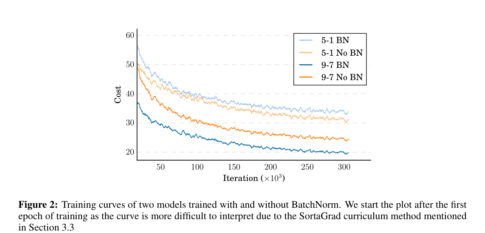

# 3.2 Batch Normalization for Deep RNNs

> Section 7 of 38 from [15 - Deep Speech 2: End-to-End Speech Recognition in English and Mandarin](../../papers/15-deep-speech-2.md) · `other` · pages 5-6

To efficiently scale our model as we scale the training set, we increase the depth of the networks by adding more hidden layers, rather than making each layer larger. Previous work has examined doing so by increasing the number of consecutive bidirectional recurrent layers \[24\]. We explore Batch Normalization (BatchNorm) as a technique to accelerate training for such networks \[63\] since they often suffer from optimization issues.

Recent research has shown that BatchNorm improves the speed of convergence of recurrent nets, without showing any improvement in generalization performance \[37\]. In contrast, we demonstrate that when applied to very deep networks of simple RNNs on large data sets, batch normalization substantially improves final generalization error while greatly accelerating training.

In a typical feed-forward layer containing an affine transformation followed by a non-linearity f(·), we insert a BatchNorm transformation by applying f(B(Wh)) instead of f(Wh + b), where

B(x) = γ x −E\[x\]

(Var\[x\] + ϵ)1/2 + β. (6)

The terms E and Var are the empirical mean and variance over a minibatch. The bias b of the layer is dropped since its effect is cancelled by mean removal. The learnable parameters γ and β allow the layer to scale and shift each hidden unit as desired. The constant ϵ is small and positive, and is included only for numerical stability. In our convolutional layers the mean and variance are estimated over all the temporal output units for a given convolutional filter on a minibatch. The BatchNorm transformation reduces internal covariate shift by insulating a given layer from potentially uninteresting changes in the mean and variance of the layer’s input.

We consider two methods of extending BatchNorm to bidirectional RNNs \[37\]. A natural extension is to insert a BatchNorm transformation immediately before every non-linearity. Equation 3 then becomes −→h l

t + −→ U l−→h l

t = f(B(W lhl−1

t−1)). (7)

In this case the mean and variance statistics are accumulated over a single time-step of the minibatch. The sequential dependence between time-steps prevents averaging over all time-steps. We find that this technique does not lead to improvements in optimization. We also tried accumulating an average over successive time-steps, so later time-steps are normalized over all present and previous timesteps. This also proved ineffective and greatly complicated backpropagation.

We find that sequence-wise normalization \[37\] overcomes these issues. The recurrent computation is given by −→h l

t ) + −→ U l−→h l

t = f(B(W lhl−1

t−1). (8)

For each hidden unit, we compute the mean and variance statistics over all items in the minibatch over the length of the sequence. Figure 2 shows that deep networks converge faster with sequencewise normalization. Table 1 shows that the performance improvement from sequence-wise normalization increases with the depth of the network, with a 12% performance difference for the deepest network. When comparing depth, in order to control for model size we hold constant the total

60

5-1 BN 5-1 No BN 9-7 BN 9-7 No BN

50

Cost

40

30

20

50 100 150 200 250 300 Iteration (⇥103)

Figure 2: Training curves of two models trained with and without BatchNorm. We start the plot after the first epoch of training as the curve is more difficult to interpret due to the SortaGrad curriculum method mentioned in Section 3.3

Train Dev

Baseline BatchNorm Baseline BatchNorm

Not Sorted 10.71 8.04 11.96 9.78 Sorted 8.76 7.68 10.83 9.52

Table 2: Comparison of WER on a training and development set with and without SortaGrad, and with and without batch normalization.

number of parameters and still see strong performance gains. We would expect to see even larger improvements from depth if we held constant the number of activations per layer and added layers. We also find that BatchNorm harms generalization error for the shallowest network just as it converges slower for shallower networks.

The BatchNorm approach works well in training, but is difficult to implement for a deployed ASR system, since it is often necessary to evaluate a single utterance in deployment rather than a batch. We find that normalizing each neuron to its mean and variance over just the sequence degrades performance. Instead, we store a running average of the mean and variance for the neuron collected during training, and use these for evaluation in deployment \[63\]. Using this technique, we can evaluate a single utterance at a time with better results than evaluating with a large batch.

---

Full document: [15 - Deep Speech 2: End-to-End Speech Recognition in English and Mandarin](../../papers/15-deep-speech-2.md) · Page-level evidence: [paper-pages/15-deep-speech-2](../../paper-pages/15-deep-speech-2/index.md)
