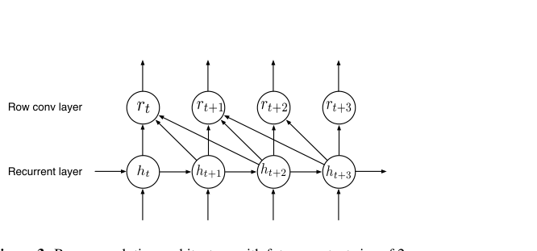

# 3.7 Row Convolution and Unidirectional Models

> Section 12 of 38 from [15 - Deep Speech 2: End-to-End Speech Recognition in English and Mandarin](../../papers/15-deep-speech-2.md) · `other` · pages 9-10

Bidirectional RNN models are challenging to deploy in an online, low-latency setting, because they are built to operate on an entire sample, and so it is not possible to perform the transcription process as the utterance streams from the user. We have found an unidirectional architecture that performs as well as our bidirectional models. This allows us to use unidirectional, forward-only RNN layers in our deployment system.

To accomplish this, we employ a special layer that we call row convolution, shown in Figure 3. The intuition behind this layer is that we only need a small portion of future information to make an accurate prediction at the current time-step. Suppose at time-step t, we use a future context of τ steps. We now have a feature matrix ht:t+τ = \[ht, ht+1, ..., ht+τ\] of size d × (τ + 1). We define a parameter matrix W of the same size as ht:t+τ. The activations rt for the new layer at time-step t are

2Chinese characters are more similar to English syllables than English characters. This is reflected in our training data, where there are on average 14.1 characters/s in English, while only 3.3 characters/s in Mandarin. Conversely, the Shannon entropy per character as calculated from occurrence in the training set, is less in English due to the smaller character set—4.9 bits/char compared to 12.6 bits/char in Mandarin. This implies that spoken Mandarin has a lower temporal entropy density, ∼41 bits/s compared to ∼58 bits/s, and can thus more easily be temporally compressed without losing character information.

## rt+3 rt+2 rt+1 rt

Row conv layer

ht ht+1 ht+2 ht+3

Recurrent layer

Figure 3: Row convolution architecture with future context size of 2

τ+1 X

rt,i =

Wi,jht+j−1,i, for 1 ≤i ≤d. (11)

j=1

Since the convolution-like operation in Eq. 11 is row oriented for both W and ht:t+τ, we call this layer row convolution.

We place the row convolution layer above all recurrent layers. This has two advantages. First, this allows us to stream all computation below the row convolution layer on a finer granularity given little future context is needed. Second, this results in better CER compared to the best bidirectional model for Mandarin. We conjecture that the recurrent layers have learned good feature representations, so the row convolution layer simply gathers the appropriate information to feed to the classifier. Results for a unidirectional Mandarin speech system with row convolution and a comparison to a bidirectional model are given in Section 7 on deployment.

---

Full document: [15 - Deep Speech 2: End-to-End Speech Recognition in English and Mandarin](../../papers/15-deep-speech-2.md) · Page-level evidence: [paper-pages/15-deep-speech-2](../../paper-pages/15-deep-speech-2/index.md)
