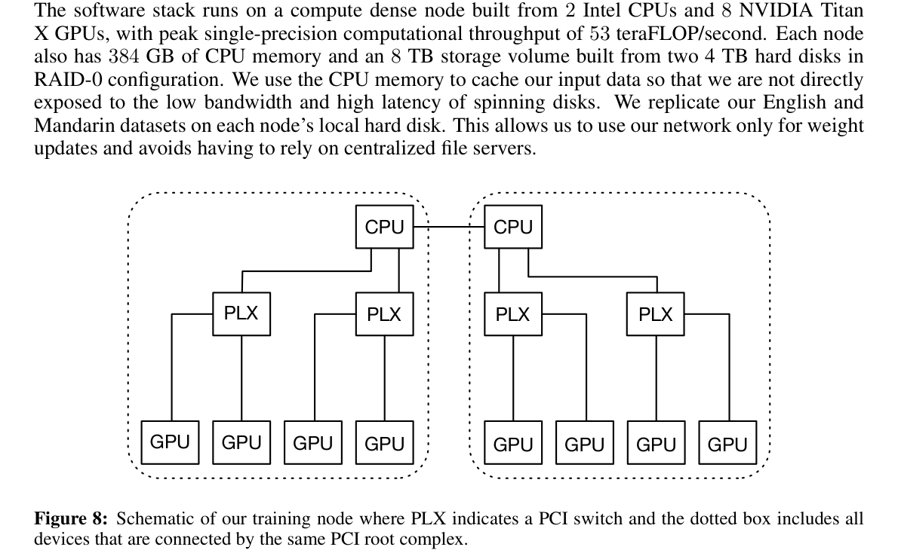

# References

> Section 37 of 38 from [15 - Deep Speech 2: End-to-End Speech Recognition in English and Mandarin](../../papers/15-deep-speech-2.md) · `references` · pages 22-26

\[1\] O. Abdel-Hamid, A.-r. Mohamed, H. Jang, and G. Penn. Applying convolutional neural networks con-

cepts to hybrid nn-hmm model for speech recognition. In ICASSP, 2012.

\[2\] D. Bahdanau, K. Cho, and Y. Bengio. Neural machine translation by jointly learning to align and translate.

In ICLR, 2015.

\[3\] D. Bahdanau, J. Chorowski, D. Serdyuk, P. Brakel, and Y. Bengio. End-to-end attention-based large

vocabulary speech recognition. abs/1508.04395, 2015. http://arxiv.org/abs/1508.04395.

\[4\] J. Barker, E. Marxer, Ricard Vincent, and S. Watanabe. The third ’CHiME’ speech separation and recogni-

tion challenge: Dataset, task and baselines. 2015. Submitted to IEEE 2015 Automatic Speech Recognition and Understanding Workshop (ASRU).

\[5\] S. Baxter. Modern GPU. https://nvlabs.github.io/moderngpu/.

\[6\] Y. Bengio, J. Louradour, R. Collobert, and J. Weston. Curriculum learning. In International Conference

on Machine Learning, 2009.

\[7\] H. Bourlard and N. Morgan. Connectionist Speech Recognition: A Hybrid Approach. Kluwer Academic

Publishers, Norwell, MA, 1993.

\[8\] W. Chan, N. Jaitly, Q. Le, and O. Vinyals. Listen, attend, and spell. abs/1508.01211, 2015. http://arxiv.org/abs/1508.01211.

\[9\] S. Chetlur, C. Woolley, P. Vandermersch, J. Cohen, J. Tran, B. Catanzaro, and E. Shelhamer. cuDNN:

Efficient primitives for deep learning.

\[10\] T. Chilimbi, Y. Suzue, J. Apacible, and K. Kalyanaraman. Project adam: Building an efficient and scalable

deep learning training system. In USENIX Symposium on Operating Systems Design and Implementation, 2014.

\[11\] K. Cho, B. Van Merrienboer, C. Gulcehre, D. Bahdanau, F. Bougares, H. Schwenk, and Y. Bengio. Learn-

ing phrase representations using rnn encoder-decoder for statistical machine translation. In EMNLP, 2014.

\[12\] J. Chorowski, D. Bahdanau, K. Cho, and Y. Bengio. End-to-end continuous speech recognition using

attention-based recurrent nn: First results. abs/1412.1602, 2015. http://arxiv.org/abs/1412.1602.

\[13\] C. Cieri, D. Miller, and K. Walker. The Fisher corpus: a resource for the next generations of speech-to-

text. In LREC, volume 4, pages 69–71, 2004.

\[14\] A. Coates, B. Carpenter, C. Case, S. Satheesh, B. Suresh, T. Wang, D. J. Wu, and A. Y. Ng. Text detection

and character recognition in scene images with unsupervised feature learning. In International Conference on Document Analysis and Recognition, 2011.

\[15\] A. Coates, B. Huval, T. Wang, D. J. Wu, A. Y. Ng, and B. Catanzaro. Deep learning with COTS HPC. In

International Conference on Machine Learning, 2013.

\[16\] G. Dahl, D. Yu, and L. Deng. Large vocabulary continuous speech recognition with context-dependent

DBN-HMMs. In Proc. ICASSP, 2011.

\[17\] G. Dahl, D. Yu, L. Deng, and A. Acero. Context-dependent pre-trained deep neural networks for large

vocabulary speech recognition. IEEE Transactions on Audio, Speech, and Language Processing, 2011.

\[18\] J. Dean, G. S. Corrado, R. Monga, K. Chen, M. Devin, Q. Le, M. Mao, M. Ranzato, A. Senior, P. Tucker,

K. Yang, and A. Ng. Large scale distributed deep networks. In Advances in Neural Information Processing Systems 25, 2012.

\[19\] D. Ellis and N. Morgan. Size matters: An empirical study of neural network training for large vocabulary

continuous speech recognition. In ICASSP, volume 2, pages 1013–1016. IEEE, 1999.

\[20\] E. Elsen. Optimizing RNN performance. http://svail.github.io/rnn\_perf. Accessed: 2015-11-24.

\[21\] M. J. F. Gales, A. Ragni, H. Aldamarki, and C. Gautier. Support vector machines for noise robust ASR.

In ASRU, pages 205–2010, 2009.

\[22\] A. Graves, S. Fernández, F. Gomez, and J. Schmidhuber. Connectionist temporal classification: Labelling

unsegmented sequence data with recurrent neural networks. In ICML, pages 369–376. ACM, 2006.

\[23\] A. Graves and N. Jaitly. Towards end-to-end speech recognition with recurrent neural networks. In ICML,

2014.

\[24\] A. Graves, A.-r. Mohamed, and G. Hinton. Speech recognition with deep recurrent neural networks. In

ICASSP, 2013.

\[25\] H. H. Sak, A. Senior, and F. Beaufays. Long short-term memory recurrent neural network architectures

for large scale acoustic modeling. In Interspeech, 2014.

\[26\] A. Hannun, C. Case, J. Casper, B. Catanzaro, G. Diamos, E. Elsen, R. Prenger, S. Satheesh, S. Sengupta,

A. Coates, and A. Y. Ng. Deep speech: Scaling up end-to-end speech recognition. 1412.5567, 2014. http://arxiv.org/abs/1412.5567.

\[27\] A. Y. Hannun, A. L. Maas, D. Jurafsky, and A. Y. Ng. First-pass large vocabulary continuous speech

recognition using bi-directional recurrent DNNs. abs/1408.2873, 2014. http://arxiv.org/abs/1408.2873.

\[28\] K. Heafield, I. Pouzyrevsky, J. H. Clark, and P. Koehn. Scalable modified Kneser-Ney language model

estimation. In Proceedings of the 51st Annual Meeting of the Association for Computational Linguistics, Sofia, Bulgaria, 8 2013.

\[29\] G. Hinton, L. Deng, D. Yu, G. Dahl, A. Mohamed, N. Jaitly, A. Senior, V. Vanhoucke, P. Nguyen,

T. Sainath, and B. Kingsbury. Deep neural networks for acoustic modeling in speech recognition. IEEE Signal Processing Magazine, 29(November):82–97, 2012.

\[30\] S. Hochreiter and J. Schmidhuber. Long short-term memory. Neural Computation, 9(8):1735—1780,

1997.

\[31\] N. Jaitly and G. Hinton. Vocal tract length perturbation (VTLP) improves speech recognition. In ICML

Workshop on Deep Learning for Audio, Speech, and Language Processing, 2013.

\[32\] R. Jozefowicz, W. Zaremba, and I. Sutskever. An empirical exploration of recurrent network architectures.

In ICML, 2015.

\[33\] O. Kapralova, J. Alex, E. Weinstein, P. Moreno, and O. Siohan. A big data approach to acoustic model

training corpus selection. In Interspeech, 2014.

\[34\] K. C. Knowlton. A fast storage allocator. Commun. ACM, 8(10):623–624, Oct. 1965.

\[35\] T. Ko, V. Peddinti, D. Povey, and S. Khudanpur. Audio augmentation for speech recognition. In Inter-

speech, 2015.

\[36\] A. Krizhevsky, I. Sutskever, and G. Hinton. Imagenet classification with deep convolutional neural net-

works. In Advances in Neural Information Processing Systems 25, pages 1106–1114, 2012.

\[37\] C. Laurent, G. Pereyra, P. Brakel, Y. Zhang, and Y. Bengio. Batch normalized recurrent neural networks.

abs/1510.01378, 2015. http://arxiv.org/abs/1510.01378.

\[38\] Q. Le, M. Ranzato, R. Monga, M. Devin, K. Chen, G. Corrado, J. Dean, and A. Ng. Building high-level

features using large scale unsupervised learning. In International Conference on Machine Learning, 2012.

\[39\] Y. LeCun, F. J. Huang, and L. Bottou. Learning methods for generic object recognition with invariance

to pose and lighting. In Computer Vision and Pattern Recognition, volume 2, pages 97–104, 2004.

\[40\] A. Maas, Z. Xie, D. Jurafsky, and A. Ng. Lexicon-free conversational speech recognition with neural

networks. In NAACL, 2015.

\[41\] Y. Miao, M. Gowayyed, and F. Metz. EESEN: End-to-end speech recognition using deep rnn models and

wfst-based decoding. In ASRU, 2015.

\[42\] A. Mohamed, G. Dahl, and G. Hinton. Acoustic modeling using deep belief networks. IEEE Transactions

on Audio, Speech, and Language Processing, (99), 2011.

\[43\] A. S. N. Jaitly, P. Nguyen and V. Vanhoucke. Application of pretrained deep neural networks to large

vocabulary speech recognition. In Interspeech, 2012.

\[44\] Nervana Systems. Nervana GPU. https://github.com/NervanaSystems/nervanagpu. Accessed:

2015-11-06.

\[45\] J. Niu, L. Xie, L. Jia, and N. Hu. Context-dependent deep neural networks for commercial mandarin

speech recognition applications. In APSIPA, 2013.

\[46\] V. Panayotov, G. Chen, D. Povey, and S. Khudanpur. Librispeech: an asr corpus based on public domain

audio books. In ICASSP, 2015.

\[47\] R. Pascanu, T. Mikolov, and Y. Bengio. On the difficulty of training recurrent neural networks. abs/1211.5063, 2012. http://arxiv.org/abs/1211.5063.

\[48\] P. Patarasuk and X. Yuan. Bandwidth optimal all-reduce algorithms for clusters of workstations. J.

Parallel Distrib. Comput., 69(2):117–124, Feb. 2009.

\[49\] R. Raina, A. Madhavan, and A. Ng. Large-scale deep unsupervised learning using graphics processors.

In 26th International Conference on Machine Learning, 2009.

\[50\] S. Renals, N. Morgan, H. Bourlard, M. Cohen, and H. Franco. Connectionist probability estimators in

HMM speech recognition. IEEE Transactions on Speech and Audio Processing, 2(1):161–174, 1994.

\[51\] T. Robinson, M. Hochberg, and S. Renals. The use of recurrent neural networks in continuous speech

recognition. pages 253–258, 1996.

\[52\] T. Sainath, O. Vinyals, A. Senior, and H. Sak. Convolutional, long short-term memory, fully connected

deep neural networks. In ICASSP, 2015.

\[53\] T. N. Sainath, A. rahman Mohamed, B. Kingsbury, and B. Ramabhadran. Deep convolutional neural

networks for LVCSR. In ICASSP, 2013.

\[54\] H. Sak, A. Senior, K. Rao, and F. Beaufays. Fast and accurate recurrent neural network acoustic models

for speech recognition. abs/1507.06947, 2015. http://arxiv.org/abs/1507.06947.

\[55\] H. Sak, O. Vinyals, G. Heigold, A. Senior, E. McDermott, R. Monga, and M. Mao. Sequence discrimina-

tive distributed training of long shortterm memory recurrent neural networks. In Interspeech, 2014.

\[56\] B. Sapp, A. Saxena, and A. Ng. A fast data collection and augmentation procedure for object recognition.

In AAAI Twenty-Third Conference on Artificial Intelligence, 2008.

\[57\] M. Schuster and K. K. Paliwal. Bidirectional recurrent neural networks. IEEE Transactions on Signal

Processing, 45(11):2673–2681, 1997.

\[58\] F. Seide, G. Li, and D. Yu. Conversational speech transcription using context-dependent deep neural

networks. In Interspeech, pages 437–440, 2011.

\[59\] J. Shan, G. Wu, Z. Hu, X. Tang, M. Jansche, and P. Moreno. Search by voice in mandarin chinese. In

Interspeech, 2010.

\[60\] H. Soltau, G. Saon, and T. Sainath. Joint training of convolutional and non-convolutional neural networks.

In ICASSP, 2014.

\[61\] I. Sutskever, J. Martens, G. Dahl, and G. Hinton. On the importance of momentum and initialization in

deep learning. In 30th International Conference on Machine Learning, 2013.

\[62\] I. Sutskever, O. Vinyals, and Q. V. Le. Sequence to sequence learning with neural networks. 2014.

http://arxiv.org/abs/1409.3215.

\[63\] C. Szegedy and S. Ioffe. Batch normalization: Accelerating deep network training by reducing internal

covariate shift. abs/1502.03167, 2015. http://arxiv.org/abs/1502.03167.

\[64\] C. Szegedy, W. Liu, Y. Jia, P. Sermanet, S. Reed, D. Anguelov, D. Erhan, V. Vanhoucke, and A. Rabi-

novich. Going deeper with convolutions. 2014.

\[65\] R. Thakur and R. Rabenseifner. Optimization of collective communication operations in mpich. Interna-

tional Journal of High Performance Computing Applications, 19:49–66, 2005.

\[66\] K. Vesely, A. Ghoshal, L. Burget, and D. Povey. Sequence-discriminative training of deep neural net-

works. In Interspeech, 2013.

\[67\] A. Waibel, T. Hanazawa, G. Hinton, K. Shikano, and K. Lang. Phoneme recognition using time-delay

neural networks,â ˘A˙I acoustics speech and signal processing. IEEE Transactions on Acoustics, Speech and Signal Processing, 37(3):328–339, 1989.

\[68\] R. Williams and J. Peng. An efficient gradient-based algorithm for online training of recurrent network

trajectories. Neural computation, 2:490–501, 1990.

\[69\] T. Yoshioka, N. Ito, M. Delcroix, A. Ogawa, K. Kinoshita, M. F. C. Yu, W. J. Fabian, M. Espi, T. Higuchi,

S. Araki, and T. Nakatani. The ntt chime-3 system: Advances in speech enhancement and recognition for mobile multi-microphone devices. In IEEE ASRU, 2015.

\[70\] W. Zaremba and I. Sutskever. Learning to execute. abs/1410.4615, 2014. http://arxiv.org/abs/1410.4615.

## A Scalability improvements

In this section, we discuss some of our scalability improvements in more detail.

## A.1 Node and cluster architecture

The software stack runs on a compute dense node built from 2 Intel CPUs and 8 NVIDIA Titan X GPUs, with peak single-precision computational throughput of 53 teraFLOP/second. Each node also has 384 GB of CPU memory and an 8 TB storage volume built from two 4 TB hard disks in RAID-0 configuration. We use the CPU memory to cache our input data so that we are not directly exposed to the low bandwidth and high latency of spinning disks. We replicate our English and Mandarin datasets on each node’s local hard disk. This allows us to use our network only for weight updates and avoids having to rely on centralized file servers.

CPU CPU

PLX PLX PLX

PLX

GPU GPU GPU GPU GPU GPU GPU GPU

Figure 8: Schematic of our training node where PLX indicates a PCI switch and the dotted box includes all devices that are connected by the same PCI root complex.

Figure 8 shows a schematic diagram of one our nodes, where all devices connected by the same PCI root complex are encapsulated in a dotted box. We have tried to maximize the number of GPUs within the root complex for faster communication between GPUs using GPUDirect. This allows us to use an efficient communication mechanism to transfer gradient matrices between GPUs.

All the nodes in our cluster are connected through Fourteen Data Rate (FDR) Infiniband which is primarily used for gradient transfer during back-propagation.

---

Full document: [15 - Deep Speech 2: End-to-End Speech Recognition in English and Mandarin](../../papers/15-deep-speech-2.md) · Page-level evidence: [paper-pages/15-deep-speech-2](../../paper-pages/15-deep-speech-2/index.md)
