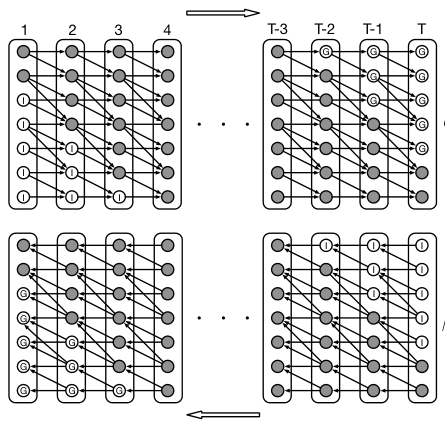

# A.2 GPU Implementation of CTC Loss Function

> Section 38 of 38 from [15 - Deep Speech 2: End-to-End Speech Recognition in English and Mandarin](../../papers/15-deep-speech-2.md) · `other` · pages 26-28

The CTC loss function that we use to train our models has two passes: forward and backward, and the gradient computation involves element-wise addition of two matrices, α and β, generated during the forward and backward passes respectively. Finally, we sum the gradients using the character in the utterance label as the key, to generate one gradient per character. These gradients are then backpropagated through the network. The input to the CTC loss function are probabilities calculated by the softmax function which can be very small, so we compute in log probability space for better numerical stability.

The forward pass of the CTC algorithm calculates the α matrix, which has S rows and T columns, where S = 2(L + 1). The variable L is the number of characters in the label and T is the number of time-steps in the utterance. Our CPU-based implementation of the CTC algorithm assigns one thread to each utterance label in a minibatch, performing the CTC calculation for the utterances in parallel. Each thread calculates the relevant entries of the matrix sequentially. This is inefficient for two reasons.

Firstly, since the remainder of our network is computed on the GPU, the output of the softmax function has to be copied to the CPU for CTC calculation. The gradient matrices from the CTC function then has to be copied back to the GPU for backpropagation. For languages like Mandarin with large character sets, these matrices have hundreds of millions of entries, making this copy expensive. Furthermore, we need as much interconnect bandwidth as possible for synchronizing the gradient updates with data parallelism, so this copy incurs a substantial opportunity cost.

Secondly, although entries in each column of the α matrix can be computed in parallel, the number of entries to calculate in each column depends both on the column and the number of repeated characters in the utterance label. Due to this complexity, the CPU implementation does not use SIMD parallelism optimally, making the computation inefficient.

We wrote a GPU-based implementation of CTC in order to overcome these two problems. The key insight behind our implementation is that we can compute all elements in each column of the α matrix, rather than just the valid entries. If we do so, Figure 9 shows that invalid elements either contain a finite garbage value (G), or −∞(I), when we use a special summation function that adds probabilities in log space that discards inputs that are −∞. This summation is shown in Figure 9 where arrows incident on a circle are inputs and the result is stored in the circle. However, when we compute the final gradient by element-wise summing α and β, all finite garbage values will be added with a corresponding −∞value from the other matrix, which results in −∞, effectively ignoring the garbage value and computing the correct result. One important observation is that this element-wise sum of α and β is a simple sum and does not use our summation function.

To compute the gradient, we take each column of the matrix generated from element-wise addition of α and β matrices, and do a key-value reduction using the character as key, using the ModernGPU library \[5\]. This means elements of the column corresponding to the same character will sum up their values. In the example shown in Figure 9, the blank character, B, is the only repeated character and at some columns, say for t = 1 of t = 2, both valid elements (gray) and −∞correspond to it. Since our summation function in log space effectively ignores the −∞elements, only the valid elements are combined in the reduction.

In our GPU implementation, we map each utterance in the minibatch to a CUDA thread block. Since there are no dependencies between the elements of a column, all of them can be computed in parallel by the threads in a threadblock. There are dependencies between columns, since the column corresponding to time-step t + 1 cannot be computed before the column corresponding to time-step t. The reverse happens when computing the β matrix, when column corresponding to time-step t cannot be computed before the column corresponding to time-step t + 1. Thus, in both cases, columns are processed sequentially by the thread block.

Mapping the forward and backward passes to corresponding CUDA kernels is straightforward since there are no data dependencies between elements of a column. The kernel that does the backward pass also computes the gradient. However, since the gradients must be summed up based on the label

1 2 3 4 T-3 T-2 T-1 T

B

G

G G

C

G

G

B

I

G

G

## ↵

I A

G

B

I

I

G

T

I I

B

I I I

B

I

I I

C

I

I

B

G

I

I

## β

G A

I

B

G

G

I

T

G G

B

G G G

Figure 9: Forward and backward pass for GPU implementation of CTC. Gray circles contain valid values, circle with I contain −∞and circle with G contain garbage values that are finite. B stand for the blank character that the CTC algorithm adds to the input utterance label. Column labels on top show different time-steps going from 1 to T.

values, with each character as key, we must deal with data dependencies due to repeated characters in an utterance label. For languages with small character sets like English, this happens with high probability. Even if there are no repeated characters, the CTC algorithm adds L + 1 blank characters to the utterance label. We solve this problem by performing a key-value sort, where the keys are the characters in the utterance label, and the values are the indices of each character in the utterance. After sorting, all occurrences of a given character are arranged in contiguous segments. We only need to do the sort once for each utterance. The indices generated by the sort are then used to sequentially sum up the gradients for each character. This sum is done once per column and in parallel over all characters in the utterance. Amortizing the cost of key-value sort over T columns is a key insight that makes the gradient calculation fast.

Our GPU implementation uses fast shared memory and registers to achieve high performance when performing this task. Both forward and backward kernels store the α matrix in shared memory. Since shared memory is a limited resource, it is not possible to store the entire β matrix. However, as we go backward in time, we only need to keep one column of the β matrix as we compute the gradient, adding element-wise the column of the β matrix with the corresponding column of the α matrix. Due to on-chip memory space constraints, we read the output of the softmax function directly from off-chip global memory.

Due to inaccuracies in floating-point arithmetic, especially in transcendental functions, our GPU and CPU implementation are not bit-wise identical. This is not an impediment in practice, since both implementations train models equally well when coupled with the technique of sorting utterances by length mentioned in Section 3.3.

---

Full document: [15 - Deep Speech 2: End-to-End Speech Recognition in English and Mandarin](../../papers/15-deep-speech-2.md) · Page-level evidence: [paper-pages/15-deep-speech-2](../../paper-pages/15-deep-speech-2/index.md)
