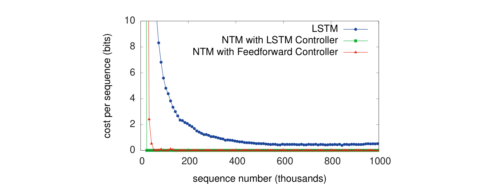
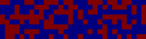
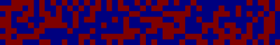
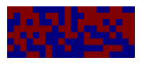
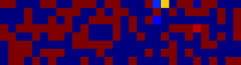
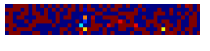
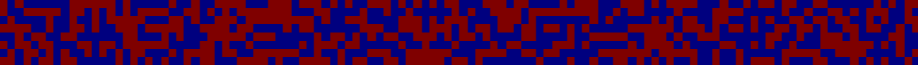
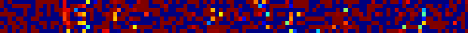

# 4.1 Copy

> Section 15 of 25 from [16 - Neural Turing Machines](../../papers/16-neural-turing-machines.md) · `other` · pages 9-11

The copy task tests whether NTM can store and recall a long sequence of arbitrary information. The network is presented with an input sequence of random binary vectors followed by a delimiter flag. Storage and access of information over long time periods has always been problematic for RNNs and other dynamic architectures. We were particularly interested to see if an NTM is able to bridge longer time delays than LSTM.

The networks were trained to copy sequences of eight bit random vectors, where the sequence lengths were randomised between 1 and 20. The target sequence was simply a copy of the input sequence (without the delimiter flag). Note that no inputs were presented to the network while it receives the targets, to ensure that it recalls the entire sequence with no intermediate assistance.

As can be seen from Figure 3, NTM (with either a feedforward or LSTM controller) learned much faster than LSTM alone, and converged to a lower cost. The disparity between the NTM and LSTM learning curves is dramatic enough to suggest a qualitative,

10

10

LSTM NTM with LSTM Controller NTM with Feedforward Controller

cost per sequence (bits)

8

6

4

2

0

0 200 400 600 800 1000

sequence number (thousands)

Figure 3: Copy Learning Curves.

rather than quantitative, difference in the way the two models solve the problem.

We also studied the ability of the networks to generalise to longer sequences than seen during training (that they can generalise to novel vectors is clear from the training error). Figures 4 and 5 demonstrate that the behaviour of LSTM and NTM in this regime is radically different. NTM continues to copy as the length increases2, while LSTM rapidly degrades beyond length 20.

The preceding analysis suggests that NTM, unlike LSTM, has learned some form of copy algorithm. To determine what this algorithm is, we examined the interaction between the controller and the memory (Figure 6). We believe that the sequence of operations performed by the network can be summarised by the following pseudocode:

initialise: move head to start location while input delimiter not seen do

receive input vector write input to head location increment head location by 1 end while return head to start location while true do

read output vector from head location emit output increment head location by 1 end while

This is essentially how a human programmer would perform the same task in a low-

2The limiting factor was the size of the memory (128 locations), after which the cyclical shifts wrapped around and previous writes were overwritten.

11

Figure 4: NTM Generalisation on the Copy Task. The four pairs of plots in the top row depict network outputs and corresponding copy targets for test sequences of length 10, 20, 30, and 50, respectively. The plots in the bottom row are for a length 120 sequence. The network was only trained on sequences of up to length 20. The first four sequences are reproduced with high confidence and very few mistakes. The longest one has a few more local errors and one global error: at the point indicated by the red arrow at the bottom, a single vector is duplicated, pushing all subsequent vectors one step back. Despite being subjectively close to a correct copy, this leads to a high loss.

level programming language. In terms of data structures, we could say that NTM has learned how to create and iterate through arrays. Note that the algorithm combines both content-based addressing (to jump to start of the sequence) and location-based addressing (to move along the sequence). Also note that the iteration would not generalise to long sequences without the ability to use relative shifts from the previous read and write weightings (Equation 7), and that without the focus-sharpening mechanism (Equation 9) the weightings would probably lose precision over time.

---

Full document: [16 - Neural Turing Machines](../../papers/16-neural-turing-machines.md) · Page-level evidence: [paper-pages/16-neural-turing-machines](../../paper-pages/16-neural-turing-machines/index.md)
