# 4.2 Repeat Copy

> Section 16 of 25 from [16 - Neural Turing Machines](../../papers/16-neural-turing-machines.md) · `other` · pages 11-13

The repeat copy task extends copy by requiring the network to output the copied sequence a specified number of times and then emit an end-of-sequence marker. The main motivation was to see if the NTM could learn a simple nested function. Ideally, we would like it to be able to execute a “for loop” containing any subroutine it has already learned.

The network receives random-length sequences of random binary vectors, followed by a scalar value indicating the desired number of copies, which appears on a separate input channel. To emit the end marker at the correct time the network must be both able to interpret the extra input and keep count of the number of copies it has performed so far. As with the copy task, no inputs are provided to the network after the initial sequence and repeat number. The networks were trained to reproduce sequences of size eight random binary vectors, where both the sequence length and the number of repetitions were chosen randomly from one to ten. The input representing the repeat number was normalised to have mean zero and variance one.

12

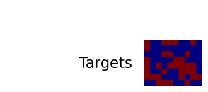

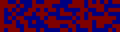

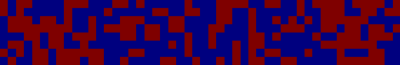

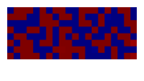

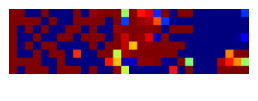

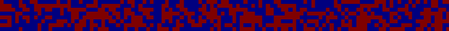

Figure 5: LSTM Generalisation on the Copy Task. The plots show inputs and outputs for the same sequence lengths as Figure 4. Like NTM, LSTM learns to reproduce sequences of up to length 20 almost perfectly. However it clearly fails to generalise to longer sequences. Also note that the length of the accurate prefix decreases as the sequence length increases, suggesting that the network has trouble retaining information for long periods.

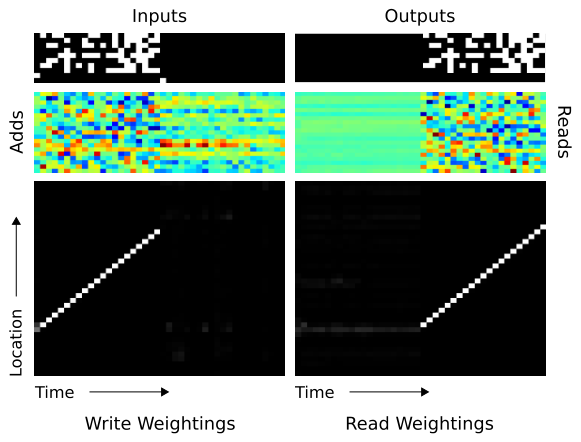

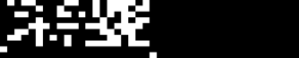

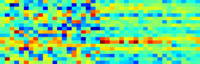

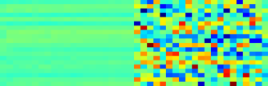

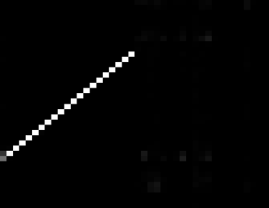

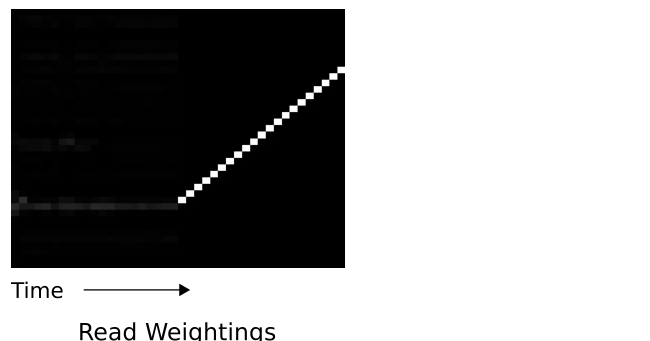

Figure 6: NTM Memory Use During the Copy Task. The plots in the left column depict the inputs to the network (top), the vectors added to memory (middle) and the corresponding write weightings (bottom) during a single test sequence for the copy task. The plots on the right show the outputs from the network (top), the vectors read from memory (middle) and the read weightings (bottom). Only a subset of memory locations are shown. Notice the sharp focus of all the weightings on a single location in memory (black is weight zero, white is weight one). Also note the translation of the focal point over time, reflects the network’s use of iterative shifts for location-based addressing, as described in Section 3.3.2. Lastly, observe that the read locations exactly match the write locations, and the read vectors match the add vectors. This suggests that the network writes each input vector in turn to a specific memory location during the input phase, then reads from the same location sequence during the output phase.

13

0 20 40 60 80 100 120 140 160 180 200

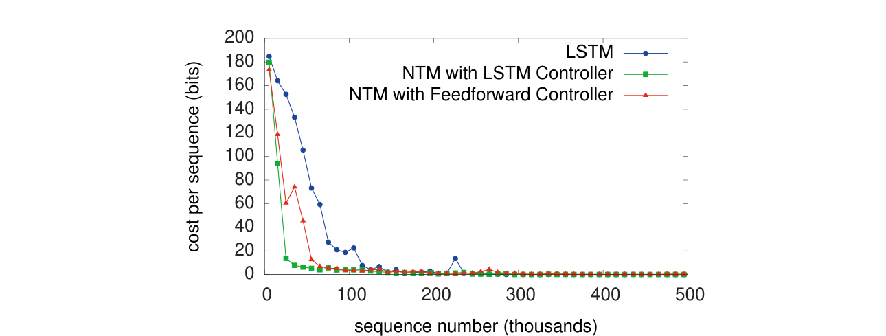

LSTM NTM with LSTM Controller NTM with Feedforward Controller

cost per sequence (bits)

0 100 200 300 400 500

sequence number (thousands)

Figure 7: Repeat Copy Learning Curves.

Figure 7 shows that NTM learns the task much faster than LSTM, but both were able to solve it perfectly.3 The difference between the two architectures only becomes clear when they are asked to generalise beyond the training data. In this case we were interested in generalisation along two dimensions: sequence length and number of repetitions. Figure 8 illustrates the effect of doubling first one, then the other, for both LSTM and NTM. Whereas LSTM fails both tests, NTM succeeds with longer sequences and is able to perform more than ten repetitions; however it is unable to keep count of of how many repeats it has completed, and does not predict the end marker correctly. This is probably a consequence of representing the number of repetitions numerically, which does not easily generalise beyond a fixed range.

Figure 9 suggests that NTM learns a simple extension of the copy algorithm in the previous section, where the sequential read is repeated as many times as necessary.

---

Full document: [16 - Neural Turing Machines](../../papers/16-neural-turing-machines.md) · Page-level evidence: [paper-pages/16-neural-turing-machines](../../paper-pages/16-neural-turing-machines/index.md)
