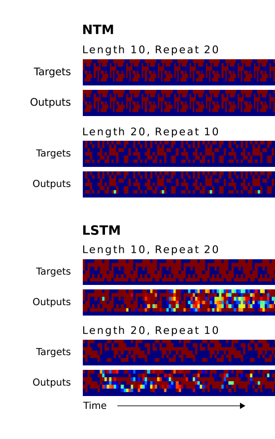
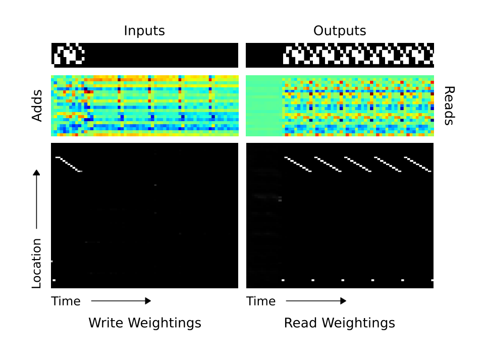
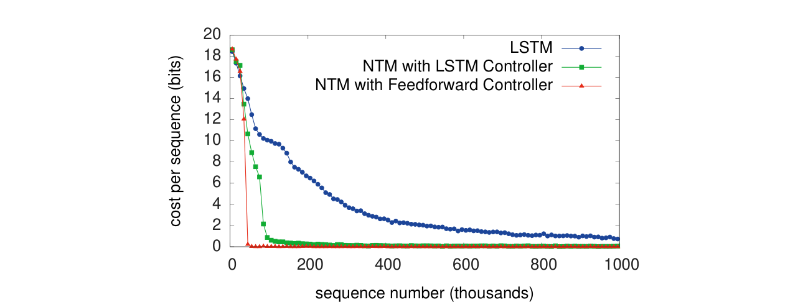
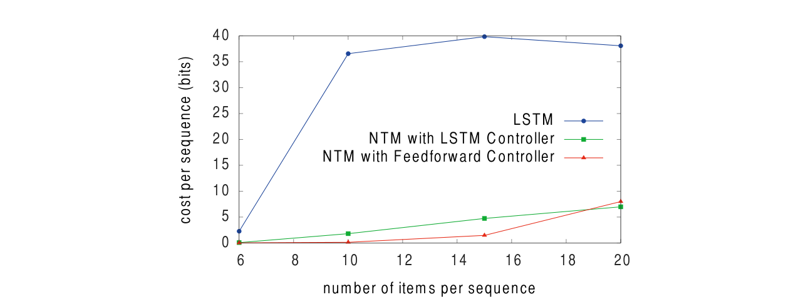

# 4.3 Associative Recall

> Section 17 of 25 from [16 - Neural Turing Machines](../../papers/16-neural-turing-machines.md) · `other` · pages 13-16

The previous tasks show that the NTM can apply algorithms to relatively simple, linear data structures. The next order of complexity in organising data arises from “indirection”—that is, when one data item points to another. We test the NTM’s capability for learning an instance of this more interesting class by constructing a list of items so that querying with one of the items demands that the network return the subsequent item. More specifically, we define an item as a sequence of binary vectors that is bounded on the left and right by delimiter symbols. After several items have been propagated to the network, we query by showing a random item, and we ask the network to produce the next item. In our experiments, each item consisted of three six-bit binary vectors (giving a total of 18 bits

3It surprised us that LSTM performed better here than on the copy problem. The likely reasons are that the sequences were shorter (up to length 10 instead of up to 20), and the LSTM network was larger and therefore had more memory capacity.

14

Figure 8: NTM and LSTM Generalisation for the Repeat Copy Task. NTM generalises almost perfectly to longer sequences than seen during training. When the number of repeats is increased it is able to continue duplicating the input sequence fairly accurately; but it is unable to predict when the sequence will end, emitting the end marker after the end of every repetition beyond the eleventh. LSTM struggles with both increased length and number, rapidly diverging from the input sequence in both cases.

per item). During training, we used a minimum of 2 items and a maximum of 6 items in a single episode.

Figure 10 shows that NTM learns this task significantly faster than LSTM, terminating at near zero cost within approximately 30, 000 episodes, whereas LSTM does not reach zero cost after a million episodes. Additionally, NTM with a feedforward controller learns faster than NTM with an LSTM controller. These two results suggest that NTM’s external memory is a more effective way of maintaining the data structure than LSTM’s internal state. NTM also generalises much better to longer sequences than LSTM, as can be seen in Figure 11. NTM with a feedforward controller is nearly perfect for sequences of up to 12 items (twice the maximum length used in training), and still has an average cost below 1 bit per sequence for sequences of 15 items. In Figure 12, we show the operation of the NTM memory, controlled by an LSTM with one head, on a single test episode. In “Inputs,” we see that the input denotes item delimiters as single bits in row 7. After the sequence of items has been propagated, a

15

Figure 9: NTM Memory Use During the Repeat Copy Task. As with the copy task the network first writes the input vectors to memory using iterative shifts. It then reads through the sequence to replicate the input as many times as necessary (six in this case). The white dot at the bottom of the read weightings seems to correspond to an intermediate location used to redirect the head to the start of the sequence (The NTM equivalent of a goto statement).

0 2 4 6 8 10 12 14 16 18 20

LSTM NTM with LSTM Controller NTM with Feedforward Controller

cost per sequence (bits)

0 200 400 600 800 1000

sequence number (thousands)

Figure 10: Associative Recall Learning Curves for NTM and LSTM.

16

40

35

cost per sequence (bits)

30

25

LSTM NTM with LSTM Controller NTM with Feedforward Controller

20

15

10

5

0

6 8 10 12 14 16 18 20

num ber of items per sequence

Figure 11: Generalisation Performance on Associative Recall for Longer Item Sequences. The NTM with either a feedforward or LSTM controller generalises to much longer sequences of items than the LSTM alone. In particular, the NTM with a feedforward controller is nearly perfect for item sequences of twice the length of sequences in its training set.

delimiter in row 8 prepares the network to receive a query item. In this case, the query item corresponds to the second item in the sequence (contained in the green box). In “Outputs,” we see that the network crisply outputs item 3 in the sequence (from the red box). In “Read Weightings,” on the last three time steps, we see that the controller reads from contiguous locations that each store the time slices of item 3. This is curious because it appears that the network has jumped directly to the correct location storing item 3. However we can explain this behaviour by looking at “Write Weightings.” Here we see that the memory is written to even when the input presents a delimiter symbol between items. One can confirm in “Adds” that data are indeed written to memory when the delimiters are presented (e.g., the data within the black box); furthermore, each time a delimiter is presented, the vector added to memory is different. Further analysis of the memory reveals that the network accesses the location it reads after the query by using a content-based lookup that produces a weighting that is shifted by one. Additionally, the key used for content-lookup corresponds to the vector that was added in the black box. This implies the following memory-access algorithm: when each item delimiter is presented, the controller writes a compressed representation of the previous three time slices of the item. After the query arrives, the controller recomputes the same compressed representation of the query item, uses a content-based lookup to find the location where it wrote the first representation, and then shifts by one to produce the subsequent item in the sequence (thereby combining content-based lookup with location-based offsetting).

---

Full document: [16 - Neural Turing Machines](../../papers/16-neural-turing-machines.md) · Page-level evidence: [paper-pages/16-neural-turing-machines](../../paper-pages/16-neural-turing-machines/index.md)
