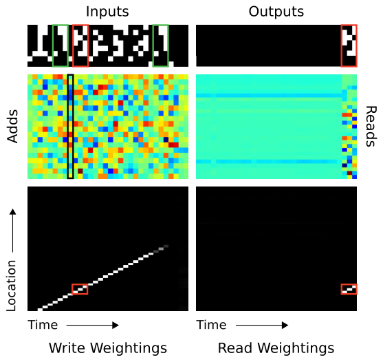
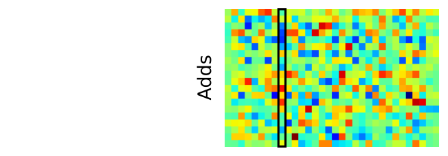
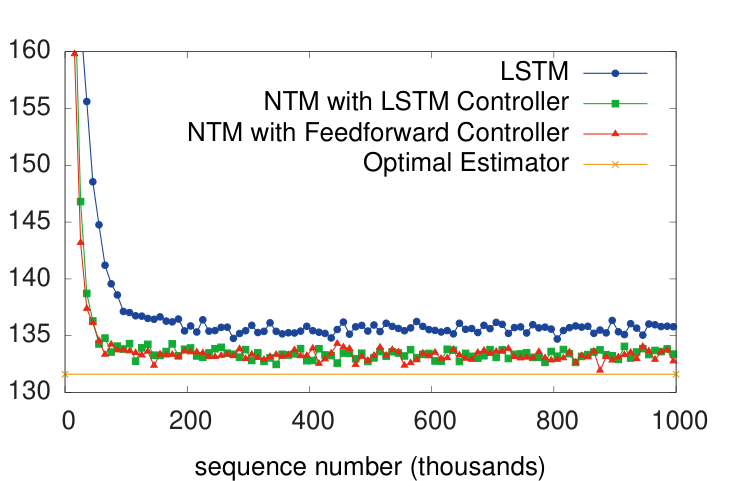

# 4.4 Dynamic N-Grams

> Section 18 of 25 from [16 - Neural Turing Machines](../../papers/16-neural-turing-machines.md) · `other` · pages 16-18

The goal of the dynamic N-Grams task was to test whether NTM could rapidly adapt to new predictive distributions. In particular we were interested to see if it were able to use its

17

Figure 12: NTM Memory Use During the Associative Recall Task. In “Inputs,” a sequence of items, each composed of three consecutive binary random vectors is propagated to the controller. The distinction between items is designated by delimiter symbols (row 7 in “Inputs”). After several items have been presented, a delimiter that designates a query is presented (row 8 in “Inputs”). A single query item is presented (green box), and the network target corresponds to the subsequent item in the sequence (red box). In “Outputs,” we see that the network correctly produces the target item. The red boxes in the read and write weightings highlight the three locations where the target item was written and then read. The solution the network finds is to form a compressed representation (black box in “Adds”) of each item that it can store in a single location. For further analysis, see the main text.

memory as a re-writable table that it could use to keep count of transition statistics, thereby emulating a conventional N-Gram model.

We considered the set of all possible 6-Gram distributions over binary sequences. Each 6-Gram distribution can be expressed as a table of 25 = 32 numbers, specifying the probability that the next bit will be one, given all possible length five binary histories. For each training example, we first generated random 6-Gram probabilities by independently drawing all 32 probabilities from the Beta(1

2, 1 2) distribution. We then generated a particular training sequence by drawing 200 successive bits using the current lookup table.4 The network observes the sequence one bit at a time and is then asked to predict the next bit. The optimal estimator for the problem can be determined by

4The first 5 bits, for which insufficient context exists to sample from the table, are drawn i.i.d. from a Bernoulli distribution with p = 0.5.

18

160

LSTM NTM with LSTM Controller NTM with Feedforward Controller

cost per sequence (bits)

155

Optimal Estimator

150

145

140

135

130

0 200 400 600 800 1000

sequence number (thousands)

Figure 13: Dynamic N-Gram Learning Curves.

Bayesian analysis (Murphy, 2012):

P(B = 1|N1, N0, c) = N1 + 1

2 N1 + N0 + 1 (10)

where c is the five bit previous context, B is the value of the next bit and N0 and N1 are respectively the number of zeros and ones observed after c so far in the sequence. We can therefore compare NTM to the optimal predictor as well as LSTM. To assess performance we used a validation set of 1000 length 200 sequences sampled from the same distribution as the training data. As shown in Figure 13, NTM achieves a small, but significant performance advantage over LSTM, but never quite reaches the optimum cost.

The evolution of the two architecture’s predictions as they observe new inputs is shown in Figure 14, along with the optimal predictions. Close analysis of NTM’s memory usage (Figure 15) suggests that the controller uses the memory to count how many ones and zeros it has observed in different contexts, allowing it to implement an algorithm similar to the optimal estimator.

---

Full document: [16 - Neural Turing Machines](../../papers/16-neural-turing-machines.md) · Page-level evidence: [paper-pages/16-neural-turing-machines](../../paper-pages/16-neural-turing-machines/index.md)
