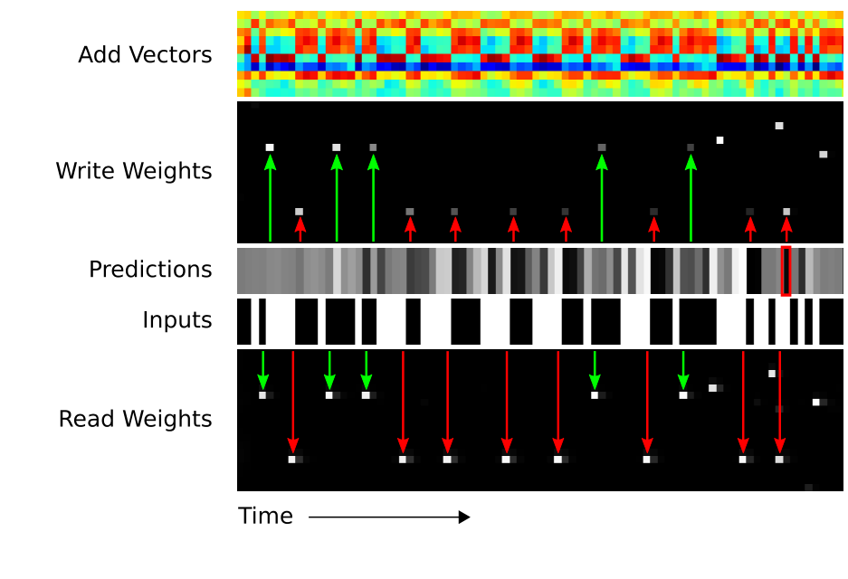
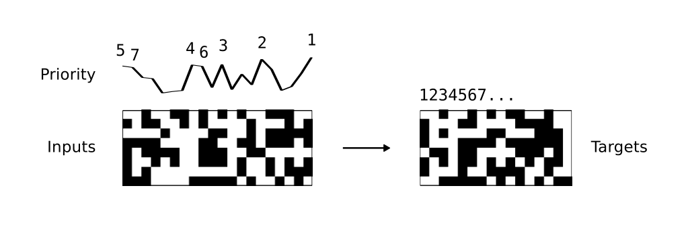
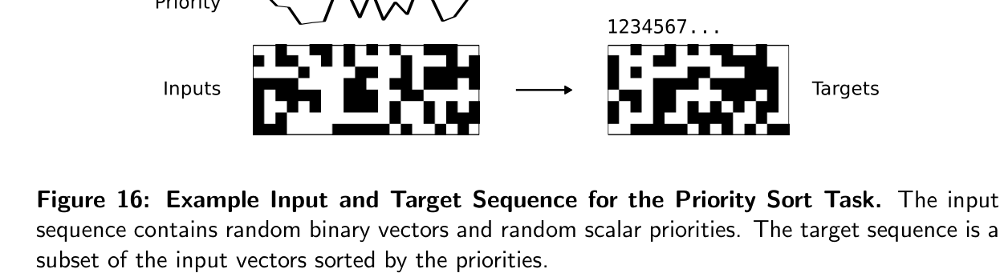
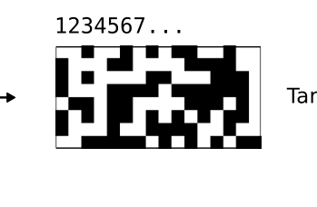
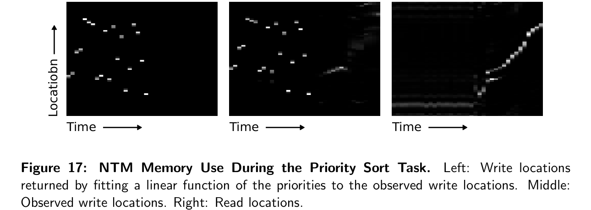

# 4.5 Priority Sort

> Section 19 of 25 from [16 - Neural Turing Machines](../../papers/16-neural-turing-machines.md) · `other` · pages 18-20

This task tests whether the NTM can sort data—an important elementary algorithm. A sequence of random binary vectors is input to the network along with a scalar priority rating for each vector. The priority is drawn uniformly from the range \[-1, 1\]. The target sequence contains the binary vectors sorted according to their priorities, as depicted in Figure 16.

Each input sequence contained 20 binary vectors with corresponding priorities, and each target sequence was the 16 highest-priority vectors in the input.5 Inspection of NTM’s

5We limited the sort to size 16 because we were interested to see if NTM would solve the task using a binary heap sort of depth 4.

19

Figure 14: Dynamic N-Gram Inference. The top row shows a test sequence from the N-Gram task, and the rows below show the corresponding predictive distributions emitted by the optimal estimator, NTM, and LSTM. In most places the NTM predictions are almost indistinguishable from the optimal ones. However at the points indicated by the two arrows it makes clear mistakes, one of which is explained in Figure 15. LSTM follows the optimal predictions closely in some places but appears to diverge further as the sequence progresses; we speculate that this is due to LSTM “forgetting” the observations at the start of the sequence.

Figure 15: NTM Memory Use During the Dynamic N-Gram Task. The red and green arrows indicate point where the same context is repeatedly observed during the test sequence (“00010” for the green arrows, “01111” for the red arrows). At each such point the same location is accessed by the read head, and then, on the next time-step, accessed by the write head. We postulate that the network uses the writes to keep count of the fraction of ones and zeros following each context in the sequence so far. This is supported by the add vectors, which are clearly anti-correlated at places where the input is one or zero, suggesting a distributed “counter.” Note that the write weightings grow fainter as the same context is repeatedly seen; this may be because the memory records a ratio of ones to zeros, rather than absolute counts. The red box in the prediction sequence corresponds to the mistake at the first red arrow in Figure 14; the controller appears to have accessed the wrong memory location, as the previous context was “01101” and not “01111.”

20

Figure 16: Example Input and Target Sequence for the Priority Sort Task. The input sequence contains random binary vectors and random scalar priorities. The target sequence is a subset of the input vectors sorted by the priorities.

Hypothesised Locations

Write Weightings

Read Weightings

Locatiobn

Time Time Time

Figure 17: NTM Memory Use During the Priority Sort Task. Left: Write locations returned by fitting a linear function of the priorities to the observed write locations. Middle: Observed write locations. Right: Read locations.

memory use led us to hypothesise that it uses the priorities to determine the relative location of each write. To test this hypothesis we fitted a linear function of the priority to the observed write locations. Figure 17 shows that the locations returned by the linear function closely match the observed write locations. It also shows that the network reads from the memory locations in increasing order, thereby traversing the sorted sequence.

The learning curves in Figure 18 demonstrate that NTM with both feedforward and LSTM controllers substantially outperform LSTM on this task. Note that eight parallel read and write heads were needed for best performance with a feedforward controller on this task; this may reflect the difficulty of sorting vectors using only unary vector operations (see Section 3.4).

---

Full document: [16 - Neural Turing Machines](../../papers/16-neural-turing-machines.md) · Page-level evidence: [paper-pages/16-neural-turing-machines](../../paper-pages/16-neural-turing-machines/index.md)
