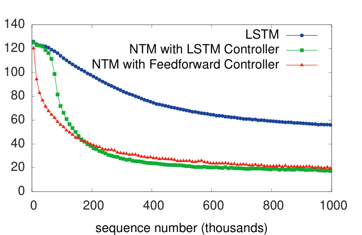

# 4.6 Experimental Details

> Section 20 of 25 from [16 - Neural Turing Machines](../../papers/16-neural-turing-machines.md) · `experiments` · pages 20-21

For all experiments, the RMSProp algorithm was used for training in the form described in (Graves, 2013) with momentum of 0.9. Tables 1 to 3 give details about the network configurations and learning rates used in the experiments. All LSTM networks had three stacked hidden layers. Note that the number of LSTM parameters grows quadratically with

21

140

LSTM NTM with LSTM Controller NTM with Feedforward Controller

cost per sequence (bits)

120

100

80

60

40

20

0

0 200 400 600 800 1000

sequence number (thousands)

Figure 18: Priority Sort Learning Curves.

Task #Heads Controller Size Memory Size Learning Rate #Parameters

Copy 1 100 128 × 20 10−4 17, 162 Repeat Copy 1 100 128 × 20 10−4 16, 712 Associative 4 256 128 × 20 10−4 146, 845 N-Grams 1 100 128 × 20 3 × 10−5 14, 656 Priority Sort 8 512 128 × 20 3 × 10−5 508, 305

---

Full document: [16 - Neural Turing Machines](../../papers/16-neural-turing-machines.md) · Page-level evidence: [paper-pages/16-neural-turing-machines](../../paper-pages/16-neural-turing-machines/index.md)
