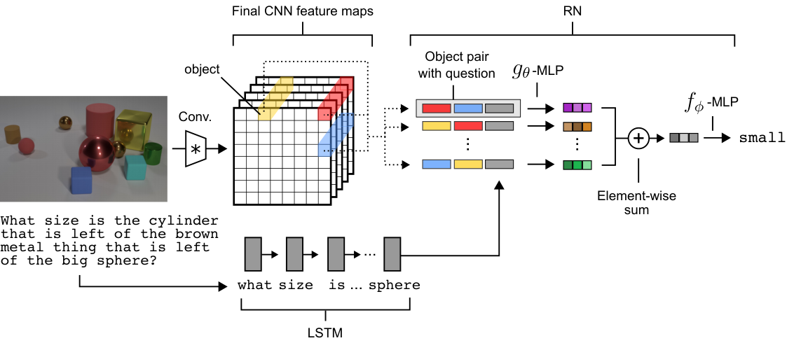

# 4 Models

> Section 11 of 22 from [17 - A Simple Neural Network Module for Relational Reasoning](../../papers/17-simple-neural-network-module-for-relational-reasoning.md) · `method` · pages 4-6

In their simplest form RNs operate on objects, and hence do not explicitly operate on images or natural language. A central contribution of this work is to demonstrate the flexibility with which relatively unstructured inputs, such as CNN or LSTM embeddings, can be considered as a set of objects for an RN. Although the RN expects object representations as input, the semantics of what an object is need not be specified. Our results below demonstrate that the learning process induces upstream processing, comprised of conventional neural network modules, to produce a set of useful “objects” from distributed representations.

Dealing with pixels We used a CNN to parse pixel inputs into a set of objects. The CNN took images of size 128 × 128 and convolved them through four convolutional layers to k feature maps of size d × d, where k is the number of kernels in the final convolutional layer. We remained agnostic as to what particular image features should constitute an object. So, after convolving the image, each of the d2 k-dimensional cells in the d × d feature maps was tagged with an arbitrary coordinate indicating its relative spatial position, and was treated as an object for the RN (see Figure 2). This means that an “object” could comprise the background, a particular physical object, a texture, conjunctions of physical objects, etc., which affords the model great flexibility in the learning process.

Conditioning RNs with question embeddings The existence and meaning of an object-object relation should be question dependent. For example, if a question asks about a large sphere, then the relations between small cubes are probably irrelevant. So, we modified the RN architecture such that gθ could condition its processing on the question: a = fφ(P

i,j gθ(oi, oj, q)). To get the question embedding q, we used the final state of an LSTM that processed question words. Question words were assigned unique integers, which were then used to index a learnable lookup table that provided embeddings to the LSTM. At each time-step, the LSTM received a single word embedding as input, according to the syntax of the English-encoded question.

5

Final CNN feature maps RN

Object pair with question

object

-MLP

-MLP

Conv.

small +

...

...

\*

Element-wise

sum

What size is the cylinder that is left of the brown metal thing that is left of the big sphere?

...

...

is sphere what size

LSTM

Figure 2: Visual QA architecture. Questions are processed with an LSTM to produce a question embedding, and images are processed with a CNN to produce a set of objects for the RN. Objects (three examples illustrated here in yellow, red, and blue) are constructed using feature-map vectors

from the convolved image. The RN considers relations across all pairs of objects, conditioned on the question embedding, and integrates all these relations to answer the question.

Dealing with state descriptions We can provide state descriptions directly into the RN, since state descriptions are pre-factored object representations. Question processing can proceed as before: questions pass through an LSTM using a learnable lookup embedding for individual words, and the final state of the LSTM is concatenated to each object-pair.

Dealing with natural language For the bAbI suite of tasks the natural language inputs must be transformed into a set of objects. This is a distinctly different requirement from visual QA, where objects were defined as spatially distinct regions in convolved feature maps. So, we first identified up to 20 sentences in the support set that were immediately prior to the probe question. Then, we tagged these sentences with labels indicating their relative position in the support set, and processed each sentence word-by-word with an LSTM (with the same LSTM acting on each sentence independently). We note that this setup invokes minimal prior knowledge, in that we delineate objects as sentences, whereas previous bAbI models processed all word tokens from all support sentences sequentially. It’s unclear how much of an advantage this prior knowledge provides, since period punctuation also unambiguously delineates sentences for the token-by-token processing models. The final state of the sentence-processing-LSTM is considered to be an object. Similar to visual QA, a separate LSTM produced a question embedding, which was appened to each object pair as input to the RN. Our model was trained on the joint version of bAbI (all 20 tasks simultaneously), using the full dataset of 10K examples per task.

Model configuration details For the CLEVR-from-pixels task we used: 4 convolutional layers each with 24 kernels, ReLU non-linearities, and batch normalization; 128 unit LSTM for question processing; 32 unit word-lookup embeddings; four-layer MLP consisting of 256 units per layer with ReLU non-linearities for gθ; and a three-layer MLP consisting of 256, 256 (with 50% dropout), and 29 units with ReLU non-linearities for fφ. The final layer was a linear layer that produced logits for a softmax over the answer vocabulary. The softmax output was optimized with a cross-entropy loss function using the Adam optimizer with a learning rate of 2.5e−4. We used size 64 mini-batches and distributed training with 10 workers synchronously updating a central parameter server. The configurations for the other tasks are similar, and can be found in the supplementary information.

We’d like to emphasize the simplicity of our overall model architecture compared to the visual QA architectures used on CLEVR thus far, which use ResNet or VGG embeddings, sometimes with

6

Model Overall Count Exist Compare Numbers

Query Attribute

Compare Attribute

Human 92.6 86.7 96.6 86.5 95.0 96.0

Q-type baseline 41.8 34.6 50.2 51.0 36.0 51.3 LSTM 46.8 41.7 61.1 69.8 36.8 51.8 CNN+LSTM 52.3 43.7 65.2 67.1 49.3 53.0 CNN+LSTM+SA 68.5 52.2 71.1 73.5 85.3 52.3 CNN+LSTM+SA\* 76.6 64.4 82.7 77.4 82.6 75.4

CNN+LSTM+RN 95.5 90.1 97.8 93.6 97.9 97.1

\* Our implementation, with optimized hyperparameters and trained fully end-to-end.

Table 1: Results on CLEVR from pixels. Performances of our model (RN) and previously reported models \[16\], measured as accuracy on the test set and broken down by question category.

fine-tuning, very large LSTMs for language encoding, and further processing modules, such as stacked or iterative attention, or large fully connected layers (upwards of 4000 units, often) \[15\].

---

Full document: [17 - A Simple Neural Network Module for Relational Reasoning](../../papers/17-simple-neural-network-module-for-relational-reasoning.md) · Page-level evidence: [paper-pages/17-simple-neural-network-module-for-relational-reasoning](../../paper-pages/17-simple-neural-network-module-for-relational-reasoning/index.md)
