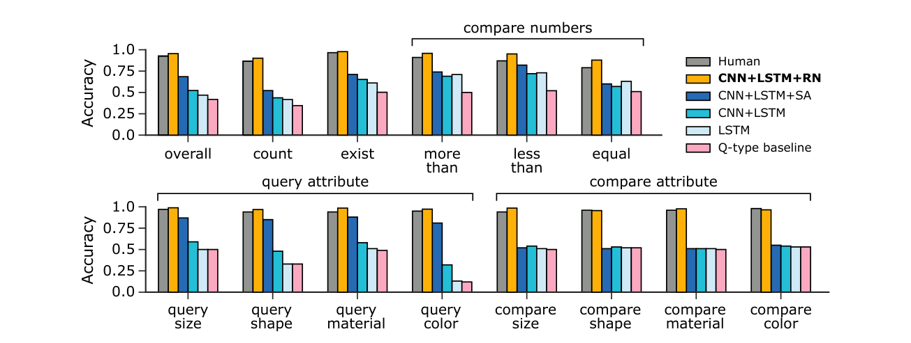

# 5.2 CLEVR from state descriptions

> Section 13 of 22 from [17 - A Simple Neural Network Module for Relational Reasoning](../../papers/17-simple-neural-network-module-for-relational-reasoning.md) · `other` · pages 6-7

To demonstrate that the RN is robust to the form of its input, we trained our model on the state description matrix version of the CLEVR dataset. The model achieved an accuracy of 96.4%. This result demonstrates the generality of the RN module, showing its capacity to learn and reason about object relations while being agnostic to the kind of inputs it receives – i.e., to the particular representation of the object features to which it has access. Therefore, RNs are not necessarily restricted to visual problems, and can thus be applied in very different contexts, and to different tasks that require relational reasoning.

7

compare numbers

1.0

Human

Accuracy Accuracy

0.75

LSTM CNN+LSTM CNN+LSTM+SA CNN+LSTM+RN

0.5

0.25

0.0

Q-type baseline

than exist count overall

equal less than more

compare attribute query attribute

1.0

0.75

0.5

0.25

0.0

query

query shape

query material

query

compare

compare

compare

compare

size

color

size

shape

material

color

Figure 3: Results on CLEVR from pixels. The RN augmented model outperformed all other models and exhibited super-human performance overall. In particular, it solved “compare attribute” questions, which trouble all other models because they heavily depend on relational reasoning.

---

Full document: [17 - A Simple Neural Network Module for Relational Reasoning](../../papers/17-simple-neural-network-module-for-relational-reasoning.md) · Page-level evidence: [paper-pages/17-simple-neural-network-module-for-relational-reasoning](../../paper-pages/17-simple-neural-network-module-for-relational-reasoning/index.md)
