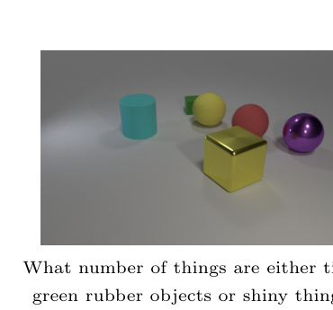
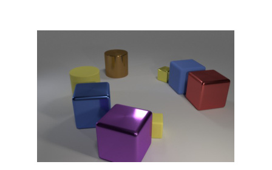
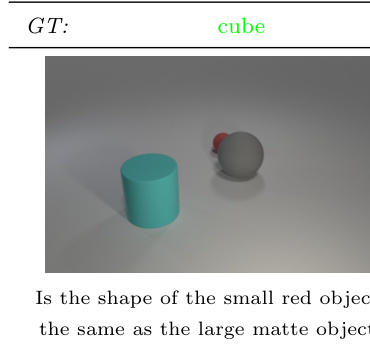
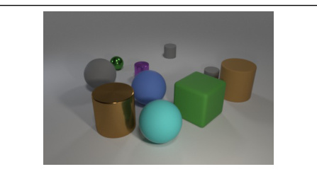
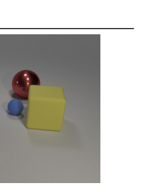
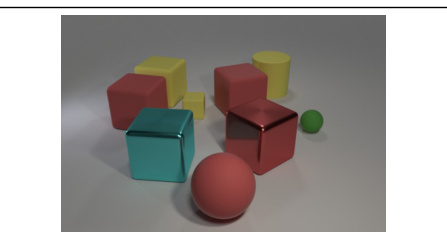
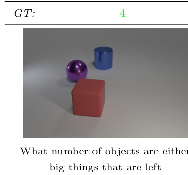
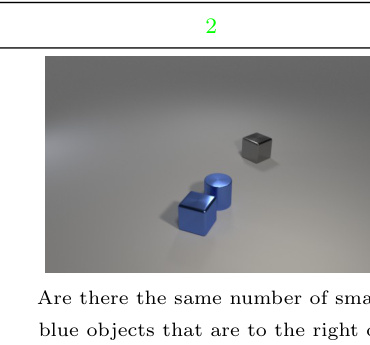

# D Sort-of-CLEVR

> Section 21 of 22 from [17 - A Simple Neural Network Module for Relational Reasoning](../../papers/17-simple-neural-network-module-for-relational-reasoning.md) · `other` · pages 10-14

The Sort-of-CLEVR dataset contains 10000 images of size 75 × 75, 200 of which were withheld for validation. There were 20 questions generated per image (10 relational and 10 non-relational).

Non-relational questions are split into three categories: (i) query shape, e.g. “What is the shape of the red object?”; (ii) query horizontal position, e.g. “Is the red object on the left or right of the image?”; (iii) query vertical position, e.g. “Is the red object on the top or bottom of the image?”. These questions are non-relational because one can answer them by reasoning about the attributes (e.g. position, shape) of a single entity which is identified by its unique color (e.g. red).

Relational questions are split into three categories: (i) closest-to, e.g. “What is the shape of the object that is closest to the green object?”; (ii) furthest-from, e.g. “What is the shape of the object that is furthest from the green object?”; (iii) count, e.g. “How many objects have the shape of the green object?”. We consider these relational because answering them requires reasoning about the

attributes of one or more objects that are defined relative to the attributes of a reference object. This reference object is uniquely identified by its color.

Questions were encoded as binary strings of length 11, where the first 6 bits identified the color of the object to which the question referred, as a one-hot vector, and the last 5 bits identified the question type and subtype.

11

In this task our model used: four convolutional layers with 32, 64, 128 and 256 kernels, ReLU non-linearities, and batch normalization; the questions, which were encoded as fixed-length binary strings, were treated as question embeddings and passed directly to the RN alongside the object pairs; a four-layer MLP consisting of 2000 units per layer with ReLU non-linearities was used for gθ; and a four-layer MLP consisting of 2000, 1000, 500, and 100 units with ReLU non-linearities used for fφ. An additional final linear layer produced logits for a softmax over the possible answers. The softmax output was optimized with a cross-entropy loss function using the Adam optimizer with a learning rate of 1e−4 and mini-batches of size 64.

We also trained a comparable MLP based model (CNN+MLP model) on the Sort-of-CLEVR task, to explore the extent to which a standard model can learn to answer relational questions. We used the same CNN and LSTM, trained end-to-end, as described above. However, this time we replaced the RN with an MLP with the same number of layers and number of units per layer. Note that there are more parameters in this model because the input layer of the MLP connects to the full CNN image embedding.

## E bAbI model for language understanding

For the bAbI task, each of the 20 sentences in the support set was processed through a 32 unit LSTM to produce an object. For the RN, gθ was a four-layer MLP consisting of 256 units per layer. For fφ, we used a three-layer MLP consisting of 256, 512, and 159 units, where the final layer was a linear layer that produced logits for a softmax over the answer vocabulary. A separate LSTM with 32 units was used to process the question. The softmax output was optimized with a cross-entropy loss function using the Adam optimizer with a learning rate of 2e−4.

## F Dynamic physical system reasoning

For the connection inference task the targets were binary vectors representing the existence (or non-existence) of a connection between each ball pair. For a total of 10 objects, the targets were 102 length vectors. For the counting task, the targets were one-hot vectors (of length 10) indicating the number of systems of connected balls. It is important to point out that in the first task the supervision signal provided by the targets explicitly informs about the relations that need to be computed. In the second task, the supervision signal (counts of systems) do not provide explicit information about the kind of relations that need to be computed. Therefore, the models that solve the counting task must successfully infer the relations implicitly.

Inputs to the RN were state descriptions. Each row of a state description matrix provided information about a particular object (i.e. ball), including its coordinate position and color. Since the system was dynamic, and hence evolved through time, each row contained object property descriptions for 16 consecutive time-frames. For example, a row could be comprised of 33 floats: 16 for the object’s x coordinate position across 16 frames, 16 for the object’s y coordinate position across 16 frames, and 1 for the object’s color. The RN treated each row in this state description matrix as an object. Thus, it had to infer an object description contained information of the object’s properties evolving through time.

For the connection inference task, the RN’s gθ was a four-layer MLP consisting of three layers with 1000 units and one layer with 500 units. For fφ, we used a three-layer MLP consisting of 500, 100, and 100 units, where the final layer was a linear layer that produced logits corresponding to the existence/absence of a connection between each ball pair. The output was optimized with a cross-entropy loss function using the Adam optimizer with a learning rate of 1e−4 and a batch size of 50. The same model was used for the counting task, but this time the output layer of the RN was a linear layer with 10 units. For baseline comparisons we replaced the RNs with MLPs with comparable number of parameters.

Please see the supplementary videos: https://www.youtube.com/channel/UCIAnkrNn45D0MeYwtVpmbUQ

12

## Non-relational question

1.0

CNN+RN CNN+MLP

Fraction correct

Q: What is the shape of the gray object? A: circle

0.8

0.6

Relational question Q: What is the shape of the object that is furthest from the gray object?

0.4

0.2

0.0 Non-Rel. Image

A: square

Rel.

## Non-relational question

Q: Is the green object on the left or on the right? A: right

Relational question Q: How many objects have the shape of the orange object?

A: 3

## Non-relational question

Q: Is the yellow object on the top or on the bottom? A: bottom

Relational question Q: What is the color of the object that is closest to the blue object?

A: red

## Non-relational question

Q: What is the shape of the red object? A: circle

Relational question Q: How many objects have the shape of the blue object?

A: 1

## Non-relational question

Q: Is the blue object on the top or on the bottom? A: top

Relational question Q: What is the color of the object that is closest to the red object?

A: yellow

Figure 4: “Sort-of-CLEVR” task: examples and results. The Sort-of-CLEVR example here consists of an image of six objects and two questions – a relational question, and a non-relational question – along with the corresponding answers. The fraction of correctly answered relational questions (inset bar plot) for our model (CNN+RN) is much larger than the comparable MLP based model (CNN+MLP), whereas both models have similar performance levels for non-relational questions.

13

What shape is the small object What number of things are either tiny What number of objects are blocks

that is in front of the yellow matte green rubber objects or shiny things that are in front of the large

thing and behind the gray sphere? that are behind the big metal block? red cube or green balls?

RN: cylinder 1 2

GT: cube 2 3

Is the shape of the small red object How many gray objects are in front What number of objects are big

the same as the large matte object of the tiny green shiny ball and right red matte cubes or things on the right

that is right of the small rubber ball? of the big blue matte thing? side of the large red matte block?

RN: no 0 5

GT: yes 1 6

There is a brown ball; How many objects are big purple How many things are rubber

what number of things are left of it? rubber blocks or red blocks in front cylinders in front of the tiny yellow

of the tiny yellow rubber thing? block or blocks that are to the right

of the small brown rubber thing?

RN: 3 3 2

GT: 4 2 3

What number of objects are either Are there the same number of small What number of other things

big things that are left blue objects that are to the right of are there of the same

of the cylinder or cylinders? the blue cube and blue metal cubes? material as the green cube?

RN: 2 no 6

GT: 3 yes 5

Table 2: Failures on CLEVR; RN – predicted answers, GT – ground-truth answer.

14

---

Full document: [17 - A Simple Neural Network Module for Relational Reasoning](../../papers/17-simple-neural-network-module-for-relational-reasoning.md) · Page-level evidence: [paper-pages/17-simple-neural-network-module-for-relational-reasoning](../../paper-pages/17-simple-neural-network-module-for-relational-reasoning/index.md)
