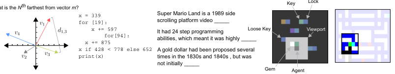
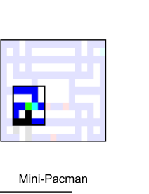

# 3.3 Introducing recurrence and embedding into an LSTM

> Section 9 of 25 from [18 - Relational Recurrent Neural Networks](../../papers/18-relational-recurrent-neural-networks.md) · `other` · pages 3-4

Suppose we have a temporal dimension with new observations at each timestep, xt. Since M and f M are the same dimensionality, we can naively introduce recurrence by first randomly initialising M, and then updating it with f M at each timestep. We chose to do this by embedding this update into an LSTM. Suppose memory matrix M can be interpreted as a matrix of cell states, usually denoted as C, for a 2-dimensional LSTM. We can make the operations of individual memories mi nearly identical to those in a normal LSTM cell state as follows (subscripts are overloaded to denote the row from a matrix, and timestep; e.g., mi,t is the ith row from M at time t).

si,t = (hi,t−1, mi,t−1) (3)

fi,t = W fxt + U fhi,t−1 + bf (4)

ii,t = W ixt + U ihi,t−1 + bi (5) oi,t = W oxt + U ohi,t−1 + bo (6)

mi,t = σ(fi,t + ˜bf) ◦mi,t−1 + σ(ii,t) ◦gψ( emi,t) | {z } (7)

hi,t = σ(oi,t) ◦tanh(mi,t) (8) si,t+1 = (mi,t, hi,t) (9)

The underbrace denotes the modification to a standard LSTM. In practice we did not find output gates necessary – please see the url in the footnote for our Tensorflow implementation of this model in the Sonnet library 2, and for the exact formulation we used, including our choice for the gψ function (briefly, we found a row/memory-wise MLP with layer normalisation to work best). There is also an interesting opportunity to introduce a different kind of gating, which we call ‘memory’ gating, which resembles previous gating ideas \[24, 3\]. Instead of producing scalar gates for each individual unit (‘unit’ gating), we can produce scalar gates for each memory row by converting W f, W i, W o, U f, U i, and U o from weight matrices into weight vectors, and by replacing the element-wise product in the gating equations with scalar-vector multiplication.

Since parameters W f, W i, W o, U f, U i, U o, and ψ are shared for each mi, we can modify the number of memories without affecting the number of parameters. Thus, tuning the number of memories and the size of each memory can be used to balance the overall storage capacity (equal to the total number of units, or elements, in M) and the number of parameters (proportional to the dimensionality of mi). We find in our experiments that some tasks require more, but not necessarily larger, memories, and others such as language modeling require fewer, larger memories.

2https://github.com/deepmind/sonnet/blob/master/sonnet/python/modules/ relational\_memory.py

Lock Key

What is the Nth farthest from vector m?

Super Mario Land is a 1989 side scrolling platform video \_\_\_\_\_

x = 339 for \[19\]: x += 597 for\[94\]: x += 875 x if 428 < 778 else 652 print(x)

Loose Key

Viewport

It had 24 step programming abilities, which meant it was highly \_\_\_\_\_

A gold dollar had been proposed several times in the 1830s and 1840s , but was not initially \_\_\_\_\_

Agent Gem

Program Evaluation Nth farthest Language Modeling

BoxWorld Mini-Pacman

Supervised Learning

Reinforcement Learning

Figure 2: Tasks. We tested the RMC on a suite of supervised and reinforcement learning tasks. Notable are the N th Farthest toy task and language modeling. In the former, the solution requires explicit relational reasoning since the model must sort distance relations between vectors, and not the vectors themselves. The latter tests the model on a large quantity of natural data and allows us to compare performance to well-tuned models.

Thus, we have a number of tune-able parameters: the number of memories, the size of each memory, the number of attention heads, the number of steps of attention, the gating method, and the postattention processor gψ. In the appendix we list the exact configurations for each task.

---

Full document: [18 - Relational Recurrent Neural Networks](../../papers/18-relational-recurrent-neural-networks.md) · Page-level evidence: [paper-pages/18-relational-recurrent-neural-networks](../../paper-pages/18-relational-recurrent-neural-networks/index.md)
